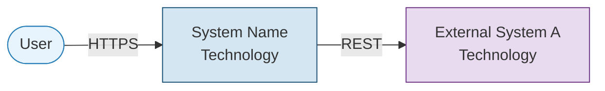
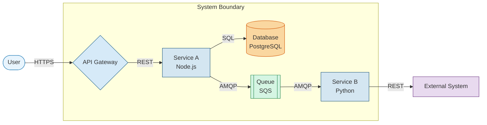
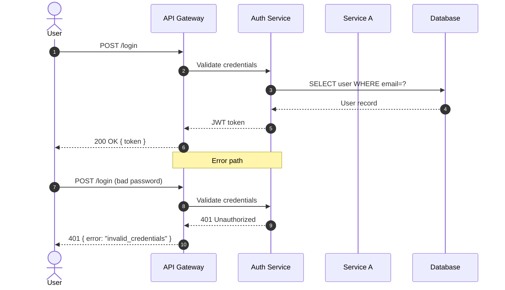
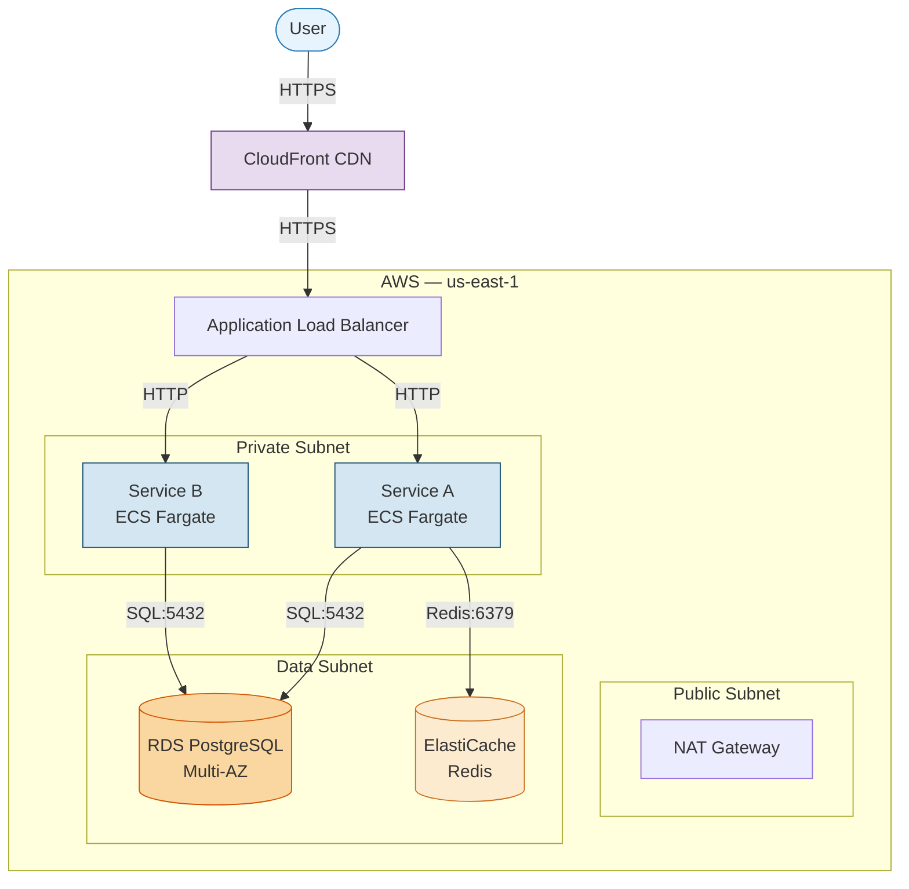

# Mermaid Diagram Rules

## Diagram types to use

| Diagram | Mermaid type | Direction |
|---|---|---|
| C4-L1 System Context | `flowchart LR` | Left to right |
| C4-L2 Container Diagram | `flowchart LR` | Left to right |
| C4-L3 Component (per service) | `flowchart LR` | Left to right |
| Sequence — Auth Flow | `sequenceDiagram` | Top to bottom |
| Sequence — [primary journey] | `sequenceDiagram` | Top to bottom |
| Deployment Topology | `flowchart TB` | Top to bottom |

---

## Node styling

Use Mermaid `classDef` and `:::` syntax to apply styles.

```
classDef actor fill:#E8F4FD,stroke:#2980B9
classDef service fill:#D4E6F1,stroke:#1A5276
classDef database fill:#FAD7A0,stroke:#D35400
classDef queue fill:#D5F5E3,stroke:#1E8449
classDef cache fill:#FDEBD0,stroke:#CA6F1E
classDef external fill:#E8DAEF,stroke:#6C3483
classDef gateway fill:#D6EAF8,stroke:#1F618D
```

| Element | Class | Shape syntax |
|---|---|---|
| User / actor | `actor` | `Person([Name])` |
| Internal service | `service` | `Service[Name]` |
| Database | `database` | `DB[(Name)]` |
| Message queue | `queue` | `Q[[Name]]` |
| Cache | `cache` | `Cache[(Name)]` |
| External system | `external` | `Ext[Name]` |
| API Gateway | `gateway` | `GW{Name}` |

Subgraph syntax for boundaries:
```
subgraph AWS["AWS Cloud"]
  subgraph VPC["VPC"]
    ...
  end
end
```

---

## Connector standards

| Relationship type | Mermaid syntax | Label format |
|---|---|---|
| Synchronous call | `A -->|REST POST /orders| B` | `[PROTOCOL] [description]` |
| Async / event | `A -.->|AMQP OrderCreated| B` | `[PROTOCOL] [event name]` |
| Data return | `A -.->|JSON response| B` | Direction must match response flow |
| Error path | `A -->|Error: 4xx/5xx| B` | Always labeled with error type |

Rules:
- Always directional — no bidirectional arrows unless genuinely two-way
- Always labeled — minimum: protocol name
- Full label format: `[PROTOCOL] [description]`
  Example: `REST POST /orders`, `SQL SELECT`, `AMQP OrderCreated`

---

## C4 Level 1 — System Context template



Build order:
1. Define all `classDef` entries first
2. Place actors (users) on the left
3. Place the main system in the center
4. Place external systems on the right
5. Draw and label all connectors

---

## C4 Level 2 — Container Diagram template



Build order:
1. Define all `classDef` entries
2. Place actor outside subgraph
3. Draw system boundary subgraph
4. Place API gateway at the top inside boundary
5. Place services in the middle
6. Place databases and queues at the bottom
7. Place external systems outside boundary
8. Draw and label all connectors

---

## Sequence diagram template



Rules:
- `autonumber` always enabled
- `actor` for humans, `participant` for systems
- Use `as` alias to keep names concise
- Solid arrow (`->>`) for requests
- Dashed arrow (`-->>`) for responses
- Add `Note over` divider between happy path and error path
- Label every single arrow

---

## Deployment Topology template



Build order:
1. Place user and CDN outside cloud boundary
2. Draw outermost AWS subgraph with region label
3. Draw ALB at top
4. Draw Public, Private, and Data subnets as nested subgraphs
5. Place services in Private subnet, data stores in Data subnet
6. Draw user → CDN → ALB → services → data stores with protocol labels

---

## Output format

Each generated diagram must be wrapped in a fenced code block:

````
```mermaid
[diagram content]
```
````

Do not add any text inside the code block other than valid Mermaid syntax.
After each diagram, add a one-line caption: `*Figure N: [Diagram title]*`
