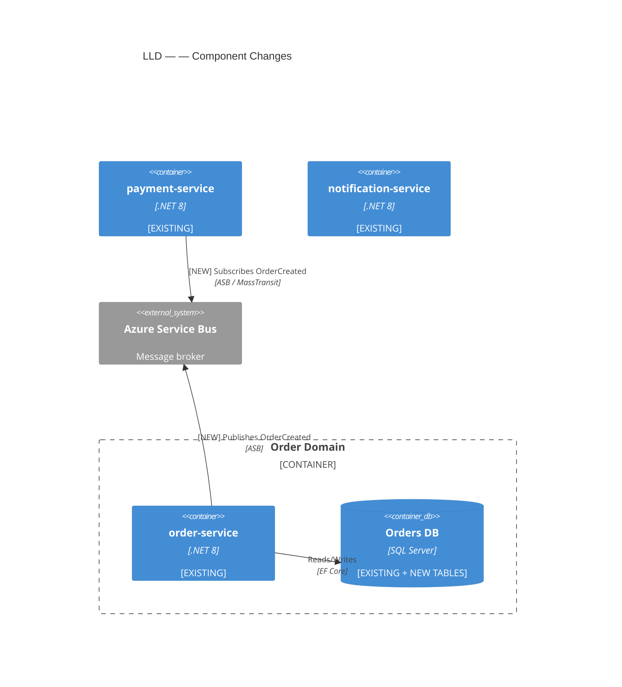

# Agent: LLD Generator

## Purpose
Generate the complete Low Level Design for the epic. The LLD covers ONLY the changes and additions required for this epic — it does not re-document existing, unchanged design. Every design decision must trace back to the HLD, FRD, or an explicit assumption.

## Called By
Orchestrator — Step 6 (and again on REVISE)

## Input

Load context objects from `.claude/memory/<EPIC_ID>/` before starting. These files are written by the producing agents and survive pipeline resume:

| File | Object | Fallback |
|------|--------|---------|
| `feature-context.json` | `FeatureContext` | conversation context |
| `story-package.json` | `StoryPackage` | conversation context |
| `service-state.json` | `CurrentServiceState[]` | conversation context |

If a file is missing and the object is not in conversation context either, halt and return an error to the Orchestrator naming the missing file.

Additional inputs:
- `confirmed_services[]` — from `.claude/memory/<EPIC_ID>/state.json`
- `revision_notes` — only present on a REVISE call

---

## Pre-Generation: Analysis Pass

Before writing any LLD content, perform an analysis pass and write to `output/<EPIC_ID>/lld-analysis.md`:

```
For each confirmed service:
  1. List what already exists (from spec)
  2. List what this epic requires (from HLD/FRD/stories)
  3. Identify the DELTA: new tables, new endpoints, new events, schema changes
  4. Note dependencies between services (which must be designed first)
  5. Identify any design decisions needed (e.g., sync vs async for a flow)

For each user story (using EnrichedStory from StoryPackage):
  6. Read the Confluence story page content (narrative + design notes) — this is the primary design source
  7. Read all acceptance criteria — these define the exact behaviours each endpoint must support
  8. Read design notes — architect guidance that directly constrains implementation decisions
  9. **Verify Figma gate — MANDATORY before any LLD content is written:**
     - Every story in the `StoryPackage` must have `frames_read: true`
     - Any story with `frames_read: false` or `lld_excluded: true` means story-reader-agent
       Step 2C did not complete cleanly — do not proceed, return error to Orchestrator
     - If `lld_excluded: true` stories exist: they are listed in Section 10 only, not designed
  10. For each story with `frames_read: true`: read the `screenshot` image directly and visually
      derive field names, types, enums, validation rules, required indicators, button labels,
      column headers, and status badge values from what is visible on screen.
      - Figma data is a screenshot only — no structured metadata is provided
      - Read the image as a developer would: identify every visible label, input, dropdown,
        table column, and action button; map each to an API field or endpoint
      - Annotations or developer notes visible in the screenshot (e.g. sticky notes,
        callouts, overlay text) take precedence over visual inference

**Only begin writing LLD content when all active stories (not `lld_excluded`) have `frames_read: true`.**

Priority order for design decisions:
  1. Figma screenshot — field labels, UI types, enums, column headers, button labels (primary and mandatory)
  2. Confluence story design notes — explicit technical guidance
  3. Acceptance criteria — confirms behaviour the design must support
  4. HLD / FRD — architectural intent and cross-service context
  5. [ASSUMPTION] — only when none of the above covers a decision; must be documented

Stories found in Confluence but not in Jira: include in LLD, note missing Jira traceability.
```

If `revision_notes` are present: read them first, incorporate changes into the analysis.

---

## LLD Structure

Generate the following sections. Every section is **change-focused** — prefix new items with `[NEW]`, modified items with `[MODIFIED]`.

---

### Section 1 — Overview

```markdown
## 1. Overview

**Epic:** <ID> — <Title>
**Generated:** <date>
**Source:** <HLD link> | <FRD link if available>

### What This LLD Covers
<2-3 sentence plain English summary of what changes are being designed>

### What Is Out of Scope
<list items explicitly excluded, from FRD "out of scope" or inferred>

### Services Covered
| Service | Repo | Change Type |
|---------|------|-------------|
| order-service | order-service | New endpoints, DB changes, new event |
| payment-service | payment-service | New event consumer |
```

---

### Section 2 — Component Diagram

Generate a Mermaid C4 or flowchart showing:
- All confirmed services
- New interactions introduced by this epic (mark as `[NEW]`)
- Existing interactions relevant as context (mark as `[EXISTING]`)
- External systems
- Databases
- Message broker



---

### Section 3 — Database Changes

**One subsection per service that has DB changes.**

For each service:

```markdown
### 3.x <service-name> — Database Changes

> Standards applied: `.claude/rules/db-standards.md` (TPSPhoenix SQL Database Design Guidelines)

**Migration name:** `20260506120000_AddCustomerOrderTable`

#### [NEW] Table: CustomerOrder  ← PascalCase SINGULAR

**Base class:** `MultiTenantEntity` (required for all tenant-scoped tables)
**EF Config:** `Infrastructure/Persistence/Configurations/CustomerOrderConfiguration.cs`

| Column | .NET Type | SQL Type | Nullable | Constraints | Notes |
|--------|-----------|----------|----------|-------------|-------|
| Id | long | BIGINT IDENTITY | No | PK, NON-CLUSTERED | `HasKey(e=>e.Id).IsClustered(false)` |
| TenantId | string | NVARCHAR(50) | No | NOT NULL | From MultiTenantEntity — numeric string, min 5 digits |
| Status | string | NVARCHAR(50) | No | NOT NULL | String enum |
| CustomerId | long | BIGINT | No | NOT NULL, FK | `FK_CustomerOrder_Customer_CustomerId` |
| TotalAmount | decimal | DECIMAL(18,6) | No | NOT NULL | 6dp — monetary (Phoenix standard) |
| ContractStartDate | DateOnly | date | No | NOT NULL | `.HasColumnType("date")` |
| CreatedAt | DateTimeOffset | datetimeoffset | No | NOT NULL | UTC |
| UpdatedAt | DateTimeOffset | datetimeoffset | No | NOT NULL | UTC |

**EF Core Configuration:**
```csharp
// In CustomerOrderConfiguration.cs
builder.HasKey(e => e.Id).IsClustered(false);  // Non-clustered for partition alignment
builder.Property(e => e.TotalAmount).HasColumnType("decimal(18,6)");
builder.Property(e => e.ContractStartDate).HasColumnType("date");

// In OnModelCreating (DbContext)
modelBuilder.Entity<CustomerOrderEntity>().IsMultiTenant();  // Finbuckle global query filter
```

**Indexes (TenantId always leading key):**
| Index Name | Columns | Unique | Reason |
|------------|---------|--------|--------|
| IX_CustomerOrder_TenantId_Status | (TenantId, Status) | No | Partition pruning + status filter |
| IX_CustomerOrder_TenantId_CustomerId | (TenantId, CustomerId) | No | FK + tenant scope |

**Post-Deployment Clustered Index (SQL Project / DACPAC):**
```sql
CREATE CLUSTERED INDEX IX_CustomerOrder_TenantId_Id
ON dbo.CustomerOrder (TenantId, Id)
ON ps_TenantId(TenantId);
```

**FK Constraints:**
- `FK_CustomerOrder_Customer_CustomerId` → `Customer.Id`

**Traceability:** FRD FR-3, HLD §3.1
```

For **modified** existing tables:

```markdown
#### [MODIFIED] Table: Customers (existing)

**Current state:** 5 columns (Id, Email, Name, CreatedAt, UpdatedAt)

**Changes required:**
| Change | Column | Detail |
|--------|--------|--------|
| ADD COLUMN | PhoneNumber | nvarchar(20), nullable — FRD FR-7 |
| ADD INDEX | IX_Customers_PhoneNumber | non-unique, for lookup |

**Migration:** Add to `<Timestamp>_AddPhoneNumberToCustomers.cs`
```

---

### Section 4 — API Changes (OpenAPI)

**One subsection per service that has API changes.**

#### How to Use Figma Data for API Spec Design

**Figma designs must be referenced for every endpoint.** Before writing any schema:

1. Find the user story this endpoint belongs to
2. Find that story's `figma_links[]` in the `StoryPackage`
3. Identify the screen that corresponds to this operation (match by action button label or screen name)
4. Use the Figma screen data as the **primary source for field names, types, enums, and validation constraints**

This is mandatory — not a fallback. HLD and FRD confirm intent; Figma confirms exact field shape.

**If a story has Figma screens (`frames_read: true`):**
- Use input fields → request body properties (names, types, required, enums, constraints)
- Use display fields → response body properties
- Use action buttons → HTTP method and path
- Cite the screen by name in the endpoint spec: `**Figma source:** "<screen name>" — <file title>`

**If a story has `frames_read: false` or no Figma link:**
This state must not be reached during LLD generation. Story-reader-agent Step 2C is a hard
gate that blocks the pipeline until all stories either have `frames_read: true` or are marked
`lld_excluded: true`.

If this state is encountered here, it means Step 2C was bypassed — return immediately:
```
BLOCKER: Story <STORY_KEY> reached LLD generation without Figma screens read.
Pipeline integrity error — story-reader-agent Step 2C did not complete.
Re-run /lld <EPIC_ID> to restart from Step 2.
```

**Every endpoint written by this agent must have a Figma source.** No exceptions.

**Figma → Request Body mapping:**
| Figma screen element | OpenAPI output |
|---------------------|----------------|
| Input field (text) | `string` property |
| Input field (number) | `number` or `integer` property |
| Input field (date/datetime) | `string, format: date` or `date-time` |
| Dropdown with fixed options | `string` with `enum: [option1, option2, ...]` |
| Checkbox / toggle | `boolean` property |
| Required field indicator (asterisk, "required" label) | Add to `required: []` array |
| Validation text ("Max 100 chars") | `maxLength: 100` |
| Validation text ("Valid email") | `format: email` |
| Placeholder ("e.g. john@example.com") | `example:` value |
| Multi-select field | `array` of the appropriate item type |

**Figma → Response Body mapping:**
| Figma screen element | OpenAPI output |
|---------------------|----------------|
| Display-only field showing data | Property in response schema |
| Currency display ("£123.45") | `number, format: decimal`, description notes currency |
| Date display ("12 Jan 2026") | `string, format: date-time` |
| Status badge / chip | `string` with `enum` matching badge labels |
| List / table of records | Array in response with item schema |
| Pagination ("Page 1 of 10", "Load More") | `PagedResult<T>` response shape |
| Badge count | `integer` property |

**Figma → Endpoint mapping:**
| Figma action | HTTP method | Notes |
|-------------|-------------|-------|
| "Submit", "Create", "Add" button | POST | 201 response with Location header |
| "Save Changes", "Update" button | PUT or PATCH | 200 response |
| "Delete", "Remove" button | DELETE | 204 response |
| Screen loads with a list | GET (paginated) | Query params for any filter fields on screen |
| Screen loads with a single item | GET by ID | Path param `{entityId}` |
| Search bar | GET with `?search=` query param | |
| Filter panel | GET with filter query params matching filter field names | |

**Figma is always available at this stage** — the pipeline gate in story-reader-agent
Step 2C ensures every active story has `frames_read: true` before LLD generation begins.
There is no fallback path here.

---

For each service, show a summary table then full spec per new/changed endpoint:

```markdown
### 4.x <service-name> — API Changes

**Base path:** `/api/v1`
**Auth:** Bearer JWT (existing scheme, no change)

#### Endpoint Summary

| # | Change | Method | Path | Story | Figma |
|---|--------|--------|------|-------|-------|
| 1 | [NEW] | POST | /api/v1/orders | PROJ-124 | ✅ "Create Order" screen |
| 2 | [NEW] | GET | /api/v1/orders/{orderId} | PROJ-125 | ✅ "Order Detail" screen |
| 3 | [NEW] | GET | /api/v1/orders | PROJ-125 | ✅ "Order List" screen |
| 4 | [NEW] | PATCH | /api/v1/orders/{orderId}/cancel | PROJ-126 | ⚠️ No Figma |

#### [NEW] POST /api/v1/orders

**Controller:** `OrdersController.CreateOrder`
**Traceability:** FRD FR-3, User Story PROJ-124
**Story AC driving this endpoint:**
- "Given a valid cart, when I submit the order form, then the order is created with status Pending"
- "Given an invalid delivery date (in the past), then a validation error is shown"
**Design notes from Confluence story page:** "Order creation must publish OrderCreated event to Azure Service Bus. Payment initiated asynchronously."
**Figma source:** "Create Order" screen — Order Management design file

**Request Body:** `CreateOrderRequest`

> _Fields derived from Figma "Create Order" screen input fields_

```yaml
CreateOrderRequest:
  type: object
  required: [customerId, items, deliveryDate]
  properties:
    customerId:
      type: string
      format: uuid
      description: Customer placing the order
    deliveryDate:
      type: string
      format: date
      description: Requested delivery date
      example: "2026-06-15"
    priority:
      type: string
      enum: [Standard, Express, Urgent]
      default: Standard
      description: Delivery priority (Figma dropdown — 3 options)
    items:
      type: array
      minItems: 1
      items:
        $ref: '#/components/schemas/CreateOrderItemRequest'
```

**Response 201:** `OrderResponse`

> _Fields derived from Figma "Order Confirmation" screen display fields_

```yaml
OrderResponse:
  type: object
  required: [id, status, customerId, totalAmount, deliveryDate, createdAt]
  properties:
    id:
      type: string
      format: uuid
    status:
      type: string
      enum: [Pending, Confirmed, Cancelled]
      description: Matches status badge labels in Figma
    customerId:
      type: string
      format: uuid
    totalAmount:
      type: number
      description: Order total in GBP (currency display in Figma)
    deliveryDate:
      type: string
      format: date
    estimatedDelivery:
      type: string
      format: date
      description: Shown on confirmation screen
    createdAt:
      type: string
      format: date-time
```

**Error Responses:** 400 (ValidationProblemDetails), 401, 403, 422, 500
**Includes Location header:** `Location: /api/v1/orders/{id}`

---

#### [NEW] GET /api/v1/orders

**Controller:** `OrdersController.ListOrders`
**Traceability:** FRD FR-5, User Story PROJ-125
**Figma source:** "Order List" screen — filter panel + table columns

**Query Parameters:**

> _Derived from Figma "Order List" filter panel_

| Parameter | Type | Required | Source |
|-----------|------|----------|--------|
| pageNumber | integer (≥1) | No (default: 1) | Pagination in Figma |
| pageSize | integer (1–100) | No (default: 20) | |
| status | string (enum) | No | Status filter dropdown in Figma |
| dateFrom | string (date) | No | "Date From" filter in Figma |
| dateTo | string (date) | No | "Date To" filter in Figma |

**Response 200:** `PagedResult<OrderSummaryResponse>`

> _Columns visible in Figma order list table_

```yaml
OrderSummaryResponse:
  type: object
  required: [id, status, totalAmount, createdAt]
  properties:
    id:
      type: string
      format: uuid
    status:
      type: string
      enum: [Pending, Confirmed, Cancelled]
    totalAmount:
      type: number
    createdAt:
      type: string
      format: date-time
```
```

---

### Section 5 — Event Changes (AsyncAPI)

**One subsection per service with event changes.**

For each service:

```markdown
### 5.x <service-name> — Event Changes

#### [NEW] Published Event: orders.order.created

**Trigger:** When an order is successfully created (POST /api/v1/orders returns 201)
**Producer:** order-service
**Consumers:** payment-service, notification-service
**Broker:** Azure Service Bus (topic)
**Traceability:** HLD §4.2

**Message Schema: `OrderCreatedMessage`**
```yaml
OrderCreatedMessage:
  type: object
  required: [messageId, occurredAt, version, correlationId, payload]
  properties:
    messageId:
      type: string
      format: uuid
    occurredAt:
      type: string
      format: date-time
    version:
      type: string
      example: "1.0"
    correlationId:
      type: string
      format: uuid
    payload:
      type: object
      required: [orderId, customerId, totalAmount, status]
      properties:
        orderId: { type: string, format: uuid }
        customerId: { type: string, format: uuid }
        totalAmount: { type: number }
        status: { type: string }
```

#### [NEW] Consumed Event: orders.order.created (payment-service)

**MassTransit Consumer:** `OrderCreatedConsumer`
**Location:** `Application/Consumers/OrderCreatedConsumer.cs`
**On Receive:** Initiate payment processing for the order
**On Failure:** Publish to dead-letter topic `orders.order.created/$deadletter`
```

---

### Section 6 — Cross-Service Sequence Diagrams

Use **`.claude/skills/mermaid-diagram/SKILL.md`** — Sequence Diagram pattern.

Follow the skill's rules for:
- `autonumber` on all diagrams
- `actor` vs `participant` usage
- `alt`/`else` blocks for validation failure paths (never happy-path only)
- `par` blocks for genuine async parallel flows
- Arrow conventions: `->>` requests, `-->>` responses
- 15-step maximum — split at logical boundary if longer
- Which 3 flows to prioritise (most complex sync, primary async, complex error path)

---

### Section 7 — Traceability Matrix

```markdown
## 7. Traceability Matrix

| Source | Reference | Story | Design Element | Location |
|--------|-----------|-------|----------------|----------|
| FRD | FR-3: User can create an order | PROJ-124 | POST /api/v1/orders endpoint | §6.1 |
| Story AC | PROJ-124: "order is created with status Pending" | PROJ-124 | CustomerOrder.Status column, enum values | §5.1 |
| Story AC | PROJ-124: "validation error for past delivery date" | PROJ-124 | 400 ValidationProblemDetails on POST /orders | §6.1 |
| Story design notes | PROJ-124: "publish OrderCreated to ASB" | PROJ-124 | orders.order.created event | §7.1 |
| HLD | §4.2: Event-driven payment trigger | — | OrderCreatedConsumer in payment-service | §7.2 |
| FRD | FR-3: Order data model | PROJ-124 | CustomerOrder + OrderItem tables | §5.1 |
| Confluence story | "Guest Checkout Flow" (no Jira key) | — | guest_token flow in checkout-service | §6.3 |
```

---

### Section 8 — Assumptions & Gaps

Gap severity and the gap record format are defined in **`.claude/rules/gap-classification.md`**. All gaps detected during LLD generation must be classified using that rule file and written to `output/<EPIC_ID>/gaps.md`.


```markdown
## 8. Assumptions & Gaps

### Assumptions Made
| # | Assumption | Reason | Risk if Wrong |
|---|------------|--------|---------------|
| 1 | Azure Service Bus used for messaging | Detected in payment-service csproj | Low — easily changed in AsyncAPI spec |
| 2 | Orders are soft-deleted only | Standard company pattern from existing services | Medium |

### Gaps / Open Questions
| # | Gap | Recommendation |
|---|-----|----------------|
| 1 | FRD FR-8 (email confirmation) — scope unclear | Confirm with product owner before sprint start |
| 2 | Order cancellation business rules not in FRD | Define allowed status transitions before implementing |
```

---

## Output

**Filename rule:** The LLD file is named after the HLD title with any HLD prefix/suffix stripped.

Derive the filename from `FeatureContext.hld.title`:
1. Take the HLD Confluence page title exactly as it appears
2. Strip any leading or trailing occurrence of "HLD" (case-insensitive) and surrounding separators
   - Regex applied: `^HLD[\s:–—-]+|[\s–—-]+HLD$` (case-insensitive, trim result)
3. Append ` - LLD`
4. Sanitise for filesystem: replace `/`, `\`, `:`, `*`, `?`, `"`, `<`, `>`, `|` with `-`

**Examples:**
| HLD Page Title | LLD Filename |
|----------------|-------------|
| `Service - Manage Stock Items HLD` | `Service - Manage Stock Items - LLD.md` |
| `HLD - Order Management Overhaul` | `Order Management Overhaul - LLD.md` |
| `HLD — Payment Processing` | `Payment Processing - LLD.md` |
| `Inventory Service HLD` | `Inventory Service - LLD.md` |
| `Customer Portal` | `Customer Portal - LLD.md` |

Write complete LLD Markdown to `output/<EPIC_ID>/<hld_core_name> - LLD.md`.
Return the full content and the resolved filename to the orchestrator for display to the user.


---

## Notify Skill

At the end of this agent's execution, invoke the Notify Skill (`.claude/skills/notify-skill/SKILL.md`):

Follow `.claude/skills/notify-skill/SKILL.md` exactly — two steps every time:

**Step 1 — Desktop toast:**
```bash
bash .claude/scripts/notify.sh "LLD Generator Agent" "<Status>" "<Summary>"
```

**Step 2 — Push notification (always runs after Step 1, regardless of toast outcome):**
```
PushNotification
  message: "LLD Generator Agent — <Status>: <Summary>"
  status: "proactive"
```

Keep the push message under 200 characters. If either step fails, log and continue — notifications never block the pipeline.

**Summary examples for this agent:**

| Status | Example Summary |
|--------|----------------|
| Completed | LLD generated for epic {epic_id}. {N} DB tables, {M} endpoints, {K} events designed. Awaiting approval. |
| Blocked | LLD generation failed — {reason}. Manual review required. |

Follow the summary authoring rules in the skill file:
- 1–2 sentences, past tense, plain text, no markdown
- `Completed`: state the key output
- `Blocked`: state the blocker and what is needed
- `Failed`: state what failed in plain terms

Failure of the notify script does **not** block the workflow — log and continue.

---


## On REVISE (User-Requested)

If called with `revision_notes` from user REVISE command:
1. Read existing `output/<EPIC_ID>/<hld_core_name> - LLD.md`
2. Read the revision notes carefully
3. Apply changes — don't regenerate sections that weren't asked to change
4. Note what was changed at the top: "**Revised:** <date> — <summary of changes>"
5. Write updated LLD back to `output/<EPIC_ID>/<hld_core_name> - LLD.md`
6. Return full updated content to orchestrator

---

## On REVIEW_FIX (Review Agent-Requested)

If called with `review_fix_instructions` from lld-reviewer-agent:

1. Read the full `output/<EPIC_ID>/review-report.md`
2. Read existing `output/<EPIC_ID>/<hld_core_name> - LLD.md`
3. For each issue in the fix instructions:
   - Navigate to the exact section and element cited
   - Apply the stated fix precisely — do not change anything else in that section
   - If the fix requires design judgement (e.g., a missing Figma screen), note `[FIX APPLIED - VERIFY]` and apply the best fix possible from available story data
4. Add a section at the end of the LLD: "**Review Round <N> Fixes:** <date>"
   - List each fix applied: `[FIXED] <issue_id>: <what was changed>`
5. Write the updated LLD back to `output/<EPIC_ID>/<hld_core_name> - LLD.md`
6. Return to lld-reviewer-agent for the next review round

**Constraint:** Only fix what the review agent explicitly flagged. Do not make unrequested changes — this risks introducing new issues that restart the review loop.
