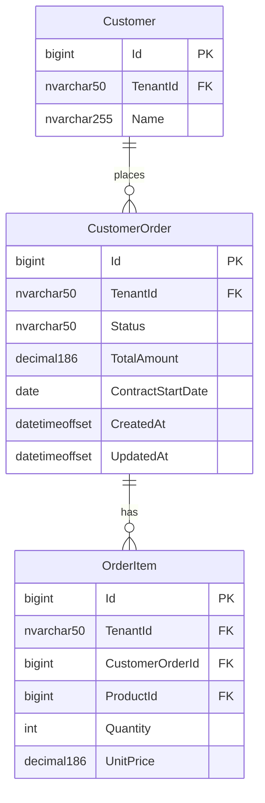
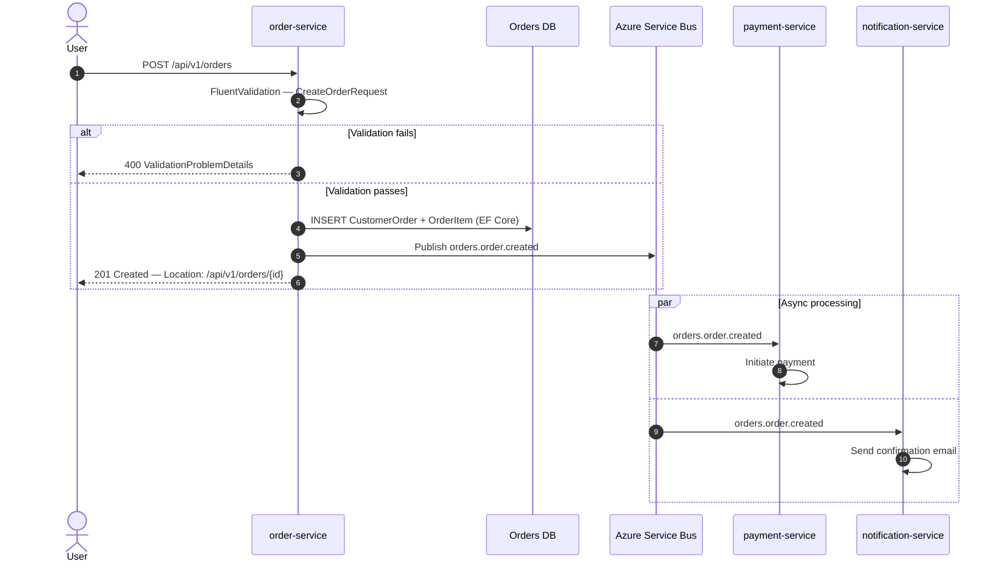

# Skill: Mermaid Diagram

## Purpose
Define the diagram conventions, patterns, and complexity guidance used when generating LLD diagrams. The LLD generator references this skill for all Mermaid output to ensure consistent, readable diagrams across epics.

## Used By
- `.claude/agents/lld-generator-agent.md` — Section 2 (component diagram) and Section 6 (sequence diagrams)

---

## Diagram Types

### 1. C4 Container Diagram — Component Overview

Use for Section 2 of every LLD. Shows all services involved in the epic, marking new interactions from existing ones.

```mermaid
C4Container
  title LLD — <Epic Title> — Component View

  Person(actor, "<Actor Name>", "<Actor description>")

  Container_Boundary(domain_boundary, "<Domain Name>") {
    Container(svc_name, "<Service Display Name>", ".NET 8 / ASP.NET Core", "[NEW] or [EXISTING]")
    ContainerDb(db_name, "<DB Display Name>", "Azure SQL", "[EXISTING + NEW TABLES]")
  }

  System_Ext(ext_name, "<External System>", "<Description>")
  System_Ext(broker, "Azure Service Bus", "Message broker")

  Rel(actor, svc_name, "Uses", "HTTPS/REST")
  Rel(svc_name, db_name, "Reads/Writes", "EF Core")
  Rel(svc_name, broker, "[NEW] Publishes <EventName>", "ASB")
  Rel(other_svc, broker, "[NEW] Subscribes <EventName>", "ASB / MassTransit")
```

**Rules:**
- Mark every new element: `[NEW]` on the label
- Mark unchanged elements shown for context: `[EXISTING]`
- Mark elements that gain new tables/columns: `[EXISTING + NEW TABLES]`
- Group services into `Container_Boundary` by domain/bounded context
- External systems always use `System_Ext` — never `Container`
- Label every `Rel` with the protocol or technology
- Keep to a single diagram — do not split unless > 8 services

**When to split:** If the epic touches > 8 services, generate one overview diagram (all services, minimal detail) and one zoom-in diagram per domain boundary (only the services in that boundary + their direct interactions).

---

### 2. ER Diagram — Database Design

Use within Section 5 (Database Design) for each service that has DB changes.



**Rules:**
- Table names match the actual SQL table names (PascalCase singular — Phoenix standard)
- Only show tables introduced or modified by this epic — not the entire service schema
- For **modified** existing tables: show only the changed/added columns, add a note `%% MODIFIED: existing table`
- Column type in diagram: use abbreviated form (`nvarchar50`, `decimal186`, `datetimeoffset`)
- Always show FK relationships with cardinality
- `TenantId` present on every tenant-scoped entity

---

### 3. Sequence Diagram — Cross-Service Flows

Use for Section 6. Generate one per key user journey, maximum 3 per LLD.



**Rules:**
- Always use `autonumber`
- Always use `actor` for human actors, `participant` for services
- Use aliases (`as`) to keep participant labels short
- Show `alt`/`else` blocks for validation failure paths — never show only the happy path
- Show `par` blocks for genuinely parallel async flows
- Label every arrow with the actual endpoint path or event name — not generic descriptions
- Use `-->>` (dashed) for responses, `->>` (solid) for requests
- Keep to 15 steps or fewer — if longer, split into two diagrams at a logical boundary

**Which flows to diagram:**
1. The most complex synchronous flow (most services involved)
2. The primary async/event-driven flow (if one exists)
3. The most complex error/validation flow (optional — only if meaningfully different from #1)

---

## Complexity Guidance

| Services in epic | Component diagram | Sequence diagrams |
|-----------------|-------------------|-------------------|
| 1–4 | Single C4 diagram | 1–2 sequence diagrams |
| 5–8 | Single C4 diagram | Up to 3 sequence diagrams |
| 9+ | Overview C4 + per-domain zoom-in | 3 sequence diagrams (most complex flows only) |

---

## Labelling Conventions

| Item | Convention |
|------|-----------|
| New service | `[NEW] Service Name` |
| Existing service, unchanged | `[EXISTING] Service Name` |
| Existing DB, new tables added | `[EXISTING + NEW TABLES] DB Name` |
| New relationship/call | `[NEW] <description>` on the `Rel` |
| New event | `[NEW] Publishes <EventName>` |

**Keep labels concise** — if the label would exceed ~40 characters, abbreviate the description and add a note in prose above the diagram.

---

## Embedding in Markdown (lld.md)

Wrap all Mermaid blocks with triple-backtick fencing:

````markdown
```mermaid
C4Container
  ...
```
````

When converting to Confluence, the publisher uses the code block macro with `language: mermaid` (see `skills/confluence-operations/SKILL.md` Part 2).
