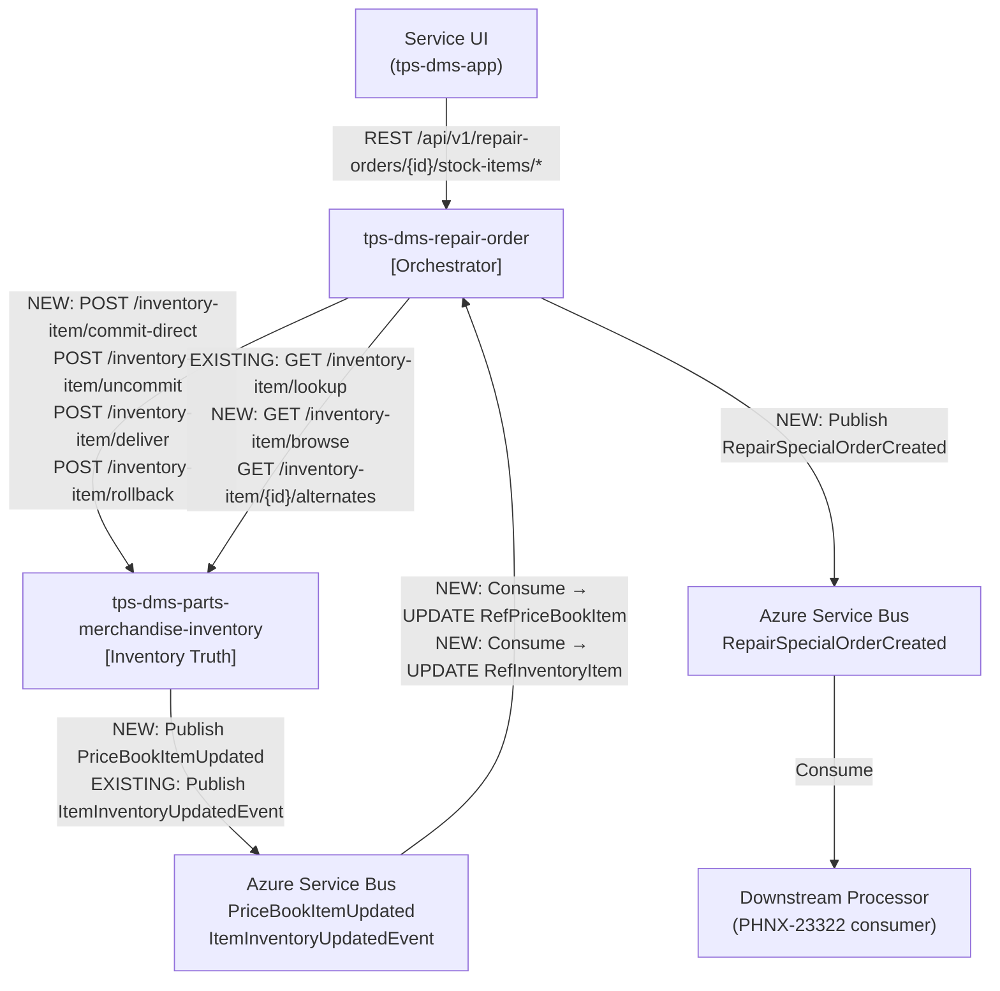
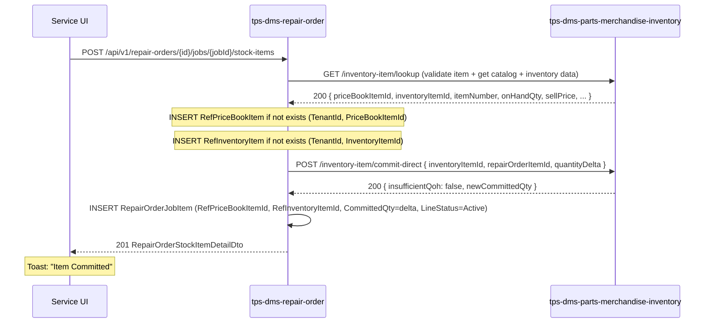
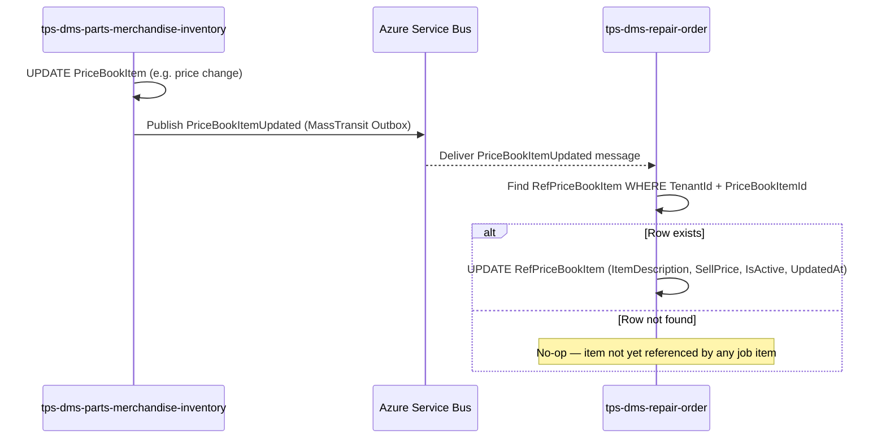
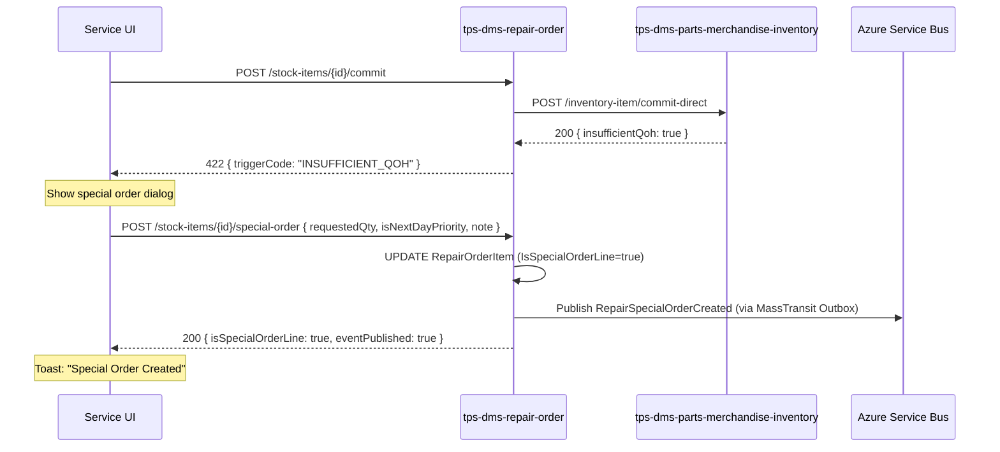
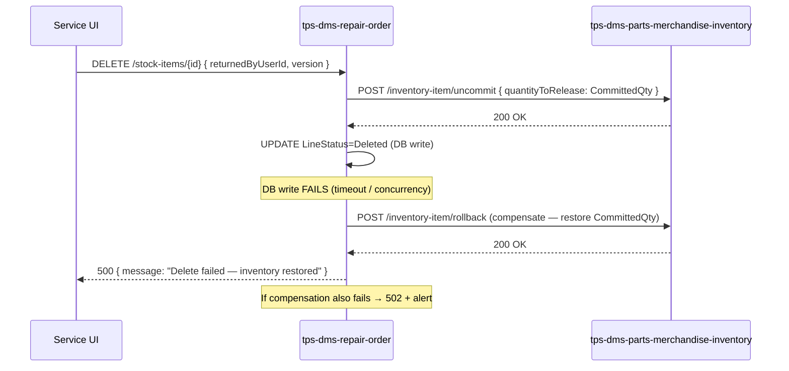

# Service - Manage Stock Items — LLD

> **Auto-Generated by Technical Lead Agent**
> Generated: 2026-05-15 | Epic: [PHNX-14594](https://harleydavidson.atlassian.net/browse/PHNX-14594)
> Source: [HLD](https://harleydavidson.atlassian.net/wiki/spaces/TPSPhoenix/pages/2388361255) | [FRD](https://harleydavidson.atlassian.net/wiki/x/GgBfjg)
> To regenerate: run `/lld PHNX-14594` in the Technical Lead Agent.

---

## 1. Overview

| Field | Value |
|-------|-------|
| Epic | [PHNX-14594](https://harleydavidson.atlassian.net/browse/PHNX-14594) — Service - Parts Handling - Manage Parts - Inventory |
| Generated | 2026-05-15 |
| HLD | [Service - Manage Stock Items HLD](https://harleydavidson.atlassian.net/wiki/spaces/TPSPhoenix/pages/2388361255) |
| FRD | [FRD: Service – Repair Order Stock Item Management](https://harleydavidson.atlassian.net/wiki/x/GgBfjg) |
| Status | APPROVED |

This epic implements the Items Management feature for Repair Orders (Service module), delivering a unified screen for service technicians and parts staff to manage all stock items, non-inventory items, digital products, and customer-provided items across one or more Jobs within a Repair Order. The primary changes involve three new tables in `tps-dms-repair-order` (`RepairOrderJobItem`, `RefPriceBookItem`, `RefInventoryItem`) following the project's ref-table cross-service data pattern, 16 net-new endpoints in `tps-dms-repair-order`, 6 new granular inventory-mutation endpoints in `tps-dms-parts-merchandise-inventory`, a new `RepairSpecialOrderCreated` event published to Azure Service Bus when QOH is insufficient, and two new consumer subscriptions in `tps-dms-repair-order` to keep ref tables current. All quantity-affecting operations follow a **sync-first** pattern: inventory mutation succeeds first, then the RO record is persisted; a compensating rollback is mandatory if RO persistence fails.

---

## 2. Scope

### 2.1 User Stories Covered

| Story | Summary | Figma |
|-------|---------|-------|
| [PHNX-7211](https://harleydavidson.atlassian.net/browse/PHNX-7211) | View Stock Items Grid | ✅ PDF |
| [PHNX-7209](https://harleydavidson.atlassian.net/browse/PHNX-7209) | Manage Service Items (Reserved Items) | ✅ PDF |
| [PHNX-7197](https://harleydavidson.atlassian.net/browse/PHNX-7197) | View Stock Item Details Panel | ✅ PDF |
| [PHNX-7210](https://harleydavidson.atlassian.net/browse/PHNX-7210) | Add Stock Item to Repair Order | ✅ PDF |
| [PHNX-7191](https://harleydavidson.atlassian.net/browse/PHNX-7191) | Edit Stock Item on Repair Order | ✅ PDF |
| [PHNX-7186](https://harleydavidson.atlassian.net/browse/PHNX-7186) | Commit Stock Item | ✅ PDF |
| [PHNX-7185](https://harleydavidson.atlassian.net/browse/PHNX-7185) | Uncommit Stock Item | ✅ PDF |
| [PHNX-23957](https://harleydavidson.atlassian.net/browse/PHNX-23957) | Deliver Stock Item | ✅ PDF |
| [PHNX-23303](https://harleydavidson.atlassian.net/browse/PHNX-23303) | Delete Stock Item from Repair Order | ✅ PDF |
| [PHNX-7184](https://harleydavidson.atlassian.net/browse/PHNX-7184) | Move Stock Item Between Jobs | ✅ PDF |
| [PHNX-7206](https://harleydavidson.atlassian.net/browse/PHNX-7206) | Create Special Order for Insufficient QOH | ✅ PDF |
| [PHNX-7208](https://harleydavidson.atlassian.net/browse/PHNX-7208) | Bulk Actions on Stock Items | ✅ PDF |
| [PHNX-23322](https://harleydavidson.atlassian.net/browse/PHNX-23322) | Consume RepairSpecialOrderCreated Event | ✅ PDF |
| [PHNX-7196](https://harleydavidson.atlassian.net/browse/PHNX-7196) | Replace Delivered Stock Item | ✅ PDF |
| [PHNX-7195](https://harleydavidson.atlassian.net/browse/PHNX-7195) | Add Non-Inventory Item to Repair Order | ✅ PDF |
| [PHNX-7189](https://harleydavidson.atlassian.net/browse/PHNX-7189) | Add Customer-Provided Item to Repair Order | ✅ PDF |
| [PHNX-7192](https://harleydavidson.atlassian.net/browse/PHNX-7192) | Add Digital Item to Repair Order | ✅ PDF |
| [PHNX-7207](https://harleydavidson.atlassian.net/browse/PHNX-7207) | Print / Export Stock Items | ✅ PDF |

### 2.2 Out of Scope

- Special Order lifecycle management post-creation (purchasing, receiving)
- Layaway management
- Return story PHNX-23302 (explicitly struck through in FRD)
- RO creation or Job creation workflows
- Customer Provided Items full lifecycle (pricing, returns)
- Digital fulfillment or license key management
- Frontend implementation (`tps-dms-app` — backend only per project rules)

---

## 3. Affected Services

| # | Service | Repository | Change Types | Why Affected |
|---|---------|------------|-------------|--------------|
| 1 | `tps-dms-repair-order` | `Harley-Davidson-Inc/tps-dms-repair-order` | New DB tables (3), New API endpoints (16), New AsyncAPI publisher, New AsyncAPI consumers (2) | Orchestrator for all RO stock item operations; owns `RepairOrderJobItem`, `RefPriceBookItem`, `RefInventoryItem` tables; subscribes to `PriceBookItemUpdated` and `ItemInventoryUpdatedEvent` to keep ref tables current |
| 2 | `tps-dms-parts-merchandise-inventory` | `Harley-Davidson-Inc/tps-dms-parts-merchandise-inventory` | New API endpoints (6), New AsyncAPI publisher (`PriceBookItemUpdated`) | Inventory quantity truth; new granular commit/uncommit/deliver/rollback endpoints needed for RO-scoped mutations; new `PriceBookItemUpdated` event for catalog sync |

---

## 4. Component Diagram



> NEW = new interaction introduced by this epic. EXISTING = existing, shown for context.

---

## 5. Database Design

> All DB design follows **TPSPhoenix SQL Database Design Guidelines**: PascalCase singular table names, `MultiTenantEntity` base class, Finbuckle multi-tenancy, `DECIMAL(18,6)` for monetary values, `DATETIME2` for timestamps, non-clustered PKs with partition-aligned clustered indexes.

### 5.1 tps-dms-repair-order — Database Changes

**Migration:** `20260515120000_AddRepairOrderJobItemWithRefTables`

> **Ref table pattern:** `tps-dms-repair-order` does not own `PriceBookItem` or `InventoryItem` — those are owned by `tps-dms-parts-merchandise-inventory`. Following the project's established cross-service data pattern (existing: `RefCustomer`, `RefUser`, `RefVendor`, `RefMajorUnit`), ref tables (`RefPriceBookItem`, `RefInventoryItem`) are created in the repair-order service. These tables use **`OrganizationEntityBase`** (org-scoped, no `TenantId`) — consistent with all other ref tables in this service. They are populated synchronously when an item is first added to a job, then kept current via async event subscriptions (UPDATE only — never insert via event).

---

#### 🟢 NEW Table: `RefPriceBookItem`

**Base class:** `OrganizationEntityBase` | **EF Config:** `Infrastructure/EntityConfigurations/RefPriceBookItemConfiguration.cs`

> Source: `PriceBookItem` table in `tps-dms-parts-merchandise-inventory`. That table is scoped by `OrganizationId` with `CreatedAt`/`UpdatedAt` audit columns and `RowVersion` — no `TenantId`. `RefPriceBookItem` follows the same base class. `CreatedAt` records when the ref row was first populated (synchronous add-item flow); `UpdatedAt` records the last event-driven catalog update — no separate `SyncedAtUtc` column needed. `ItemCategory` (PNA/GM/NI/DI/C) and `ItemTypeId` are RO-domain concepts stored on `RepairOrderJobItem`, not on the ref table.

| Column | .NET Type | SQL Type | Nullable | Constraints | Notes |
|--------|-----------|----------|----------|-------------|-------|
| `Id` | `long` | `BIGINT IDENTITY` | NO | PK | Surrogate key |
| `OrganizationId` | `long` | `BIGINT` | NO | Index leading key | Inherited from `OrganizationEntityBase` |
| `PriceBookItemId` | `long` | `BIGINT` | NO | UNIQUE per org | Source `PriceBookItem.Id` in `tps-dms-parts-merchandise-inventory` |
| `ItemNumber` | `string` | `NVARCHAR(100)` | NO | | Matches source `PriceBookItem.ItemNumber` (nvarchar(100)) |
| `Description` | `string` | `NVARCHAR(500)` | NO | | Matches source `PriceBookItem.Description` (nvarchar(500)) |
| `ProductType` | `string` | `NVARCHAR(50)` | NO | | PARTS_AND_ACCESSORIES / GENERAL_MERCHANDISE — matches source |
| `VendorId` | `long?` | `BIGINT` | YES | | Source `PriceBookItem.RefVendorId` |
| `SellingPrice` | `decimal?` | `DECIMAL(18,6)` | YES | | Source `PriceBookItem.SellingPrice`; `DECIMAL(18,6)` per standards |
| `IsActive` | `bool` | `BIT` | NO | DEFAULT 1 | Derived from source `InventoryStatus` |
| `CreatedAt` | `DateTime` | `DATETIME2` | NO | | Inherited from `OrganizationEntityBase`; set on first population |
| `CreatedBy` | `long` | `BIGINT` | NO | | Inherited from `OrganizationEntityBase` |
| `UpdatedAt` | `DateTime` | `DATETIME2` | NO | | Inherited from `OrganizationEntityBase`; updated on each event-driven sync |
| `UpdatedBy` | `long` | `BIGINT` | NO | | Inherited from `OrganizationEntityBase` |

```csharp
public class RefPriceBookItemConfiguration : IEntityTypeConfiguration<RefPriceBookItem>
{
    public void Configure(EntityTypeBuilder<RefPriceBookItem> builder)
    {
        builder.ToTable("RefPriceBookItem");
        builder.HasKey(e => e.Id);
        builder.Property(e => e.ItemNumber).HasMaxLength(100).IsRequired();
        builder.Property(e => e.Description).HasMaxLength(500).IsRequired();
        builder.Property(e => e.ProductType).HasMaxLength(50).IsRequired();
        builder.Property(e => e.SellingPrice).HasColumnType("DECIMAL(18,6)");
        builder.Property(e => e.CreatedAt).HasColumnType("DATETIME2").IsRequired();
        builder.Property(e => e.UpdatedAt).HasColumnType("DATETIME2").IsRequired();

        builder.HasIndex(e => new { e.OrganizationId, e.PriceBookItemId })
            .IsUnique()
            .HasDatabaseName("IX_RefPriceBookItem_OrganizationId_PriceBookItemId");

        builder.HasIndex(e => new { e.OrganizationId, e.ItemNumber })
            .HasDatabaseName("IX_RefPriceBookItem_OrganizationId_ItemNumber");
    }
}
```

> No post-deployment clustered index required — `OrganizationEntityBase` tables are not partitioned by `TenantId`.

---

#### 🟢 NEW Table: `RefInventoryItem`

**Base class:** `OrganizationEntityBase` | **EF Config:** `Infrastructure/EntityConfigurations/RefInventoryItemConfiguration.cs`

> Source: `InventoryItem` table in `tps-dms-parts-merchandise-inventory`. That table is scoped by `OrganizationId` with `CreatedAt`/`UpdatedAt` audit columns and `RowVersion` — no `TenantId`. `RefInventoryItem` follows the same base class. `CreatedAt` records when the ref row was first populated (synchronous add-item flow); `UpdatedAt` records the last event-driven quantity update — no separate `SyncedAtUtc` column needed. Quantities stored as `DECIMAL(18,6)` per Phoenix standards (source uses `decimal(18,4)`).

| Column | .NET Type | SQL Type | Nullable | Constraints | Notes |
|--------|-----------|----------|----------|-------------|-------|
| `Id` | `long` | `BIGINT IDENTITY` | NO | PK | Surrogate key |
| `OrganizationId` | `long` | `BIGINT` | NO | Index leading key | Inherited from `OrganizationEntityBase` |
| `InventoryItemId` | `long` | `BIGINT` | NO | UNIQUE per org | Source `InventoryItem.Id` in `tps-dms-parts-merchandise-inventory` |
| `ItemNumber` | `string` | `NVARCHAR(100)` | NO | | Via source `PriceBookItem.ItemNumber` |
| `OnHandQty` | `decimal` | `DECIMAL(18,6)` | NO | DEFAULT 0 | Updated via `ItemInventoryUpdatedEvent` |
| `CommittedQty` | `decimal` | `DECIMAL(18,6)` | NO | DEFAULT 0 | Updated via `ItemInventoryUpdatedEvent` |
| `IsActive` | `bool` | `BIT` | NO | DEFAULT 1 | Derived from source `ItemStatus` |
| `CreatedAt` | `DateTime` | `DATETIME2` | NO | | Inherited from `OrganizationEntityBase`; set on first population |
| `CreatedBy` | `long` | `BIGINT` | NO | | Inherited from `OrganizationEntityBase` |
| `UpdatedAt` | `DateTime` | `DATETIME2` | NO | | Inherited from `OrganizationEntityBase`; updated on each event-driven sync |
| `UpdatedBy` | `long` | `BIGINT` | NO | | Inherited from `OrganizationEntityBase` |

```csharp
public class RefInventoryItemConfiguration : IEntityTypeConfiguration<RefInventoryItem>
{
    public void Configure(EntityTypeBuilder<RefInventoryItem> builder)
    {
        builder.ToTable("RefInventoryItem");
        builder.HasKey(e => e.Id);
        builder.Property(e => e.ItemNumber).HasMaxLength(100).IsRequired();
        builder.Property(e => e.OnHandQty).HasColumnType("DECIMAL(18,6)").HasDefaultValue(0m);
        builder.Property(e => e.CommittedQty).HasColumnType("DECIMAL(18,6)").HasDefaultValue(0m);
        builder.Property(e => e.CreatedAt).HasColumnType("DATETIME2").IsRequired();
        builder.Property(e => e.UpdatedAt).HasColumnType("DATETIME2").IsRequired();

        builder.HasIndex(e => new { e.OrganizationId, e.InventoryItemId })
            .IsUnique()
            .HasDatabaseName("IX_RefInventoryItem_OrganizationId_InventoryItemId");
    }
}
```

> No post-deployment clustered index required — `OrganizationEntityBase` tables are not partitioned by `TenantId`.

---

#### 🟢 NEW Table: `RepairOrderJobItem`

**Base class:** `MultiTenantEntity` | **EF Config:** `Infrastructure/EntityConfigurations/RepairOrderJobItemConfiguration.cs`

> `RepairOrderId` is not stored — derivable via `RepairOrderJob.RepairOrderId`. Catalog columns (`ItemNumber`, `ItemCategory`, `ItemTypeId`, `VendorId`) are owned by `RefPriceBookItem`; `InventoryItemId` is owned by `RefInventoryItem`. This table holds only RO-scoped data: editable description and price snapshots, quantities, and workflow state.

| Column | .NET Type | SQL Type | Nullable | Constraints | Notes |
|--------|-----------|----------|----------|-------------|-------|
| `Id` | `long` | `BIGINT IDENTITY` | NO | PK (non-clustered) | |
| `TenantId` | `string` | `NVARCHAR(50)` | NO | Composite index leading key | Inherited from `StoreEntityBase` |
| `OrganizationId` | `long` | `BIGINT` | NO | | Inherited from `StoreEntityBase` |
| `RepairOrderJobId` | `long` | `BIGINT` | NO | FK → RepairOrderJobs.Id CASCADE | Parent job |
| `RefPriceBookItemId` | `long` | `BIGINT` | NO | FK → RefPriceBookItem.Id | Catalog reference |
| `RefInventoryItemId` | `long?` | `BIGINT` | YES | FK → RefInventoryItem.Id | NULL for NI/DI/C item types |
| `ItemDescription` | `string` | `NVARCHAR(500)` | NO | | Editable; initialized from `RefPriceBookItem.Description` on add |
| `ItemCategory` | `string` | `NVARCHAR(20)` | NO | CHECK IN ('PNA','GM','NI','DI','C') | RO-domain categorization; PNA/GM initialized from `RefPriceBookItem.ProductType` on add |
| `ItemTypeId` | `long` | `BIGINT` | NO | FK → EnumTypes.Id | RO workflow type: 1=Stock, 2=Sp.Order |
| `UnitSellPrice` | `decimal?` | `DECIMAL(18,6)` | YES | | RO-specific price; initialized from `RefPriceBookItem.SellingPrice`; NULL for customer-provided |
| `DiscountPercent` | `decimal?` | `DECIMAL(18,6)` | YES | CHECK BETWEEN 0 AND 100 | ⚠️ HLD: DECIMAL(9,4) — using DECIMAL(18,6) per standards; see GAP-005 |
| `DiscountAmount` | `decimal?` | `DECIMAL(18,6)` | YES | | Stored for grid display |
| `RequestedQty` | `decimal` | `DECIMAL(18,6)` | NO | DEFAULT 1, CHECK >= 0 | |
| `CommittedQty` | `decimal` | `DECIMAL(18,6)` | NO | DEFAULT 0, CHECK >= 0 | |
| `DeliveredQty` | `decimal` | `DECIMAL(18,6)` | NO | DEFAULT 0, CHECK >= 0 | |
| `OutstandingQty` | `decimal` | `DECIMAL(18,6)` | NO | DEFAULT 1 | Persisted; = RequestedQty - DeliveredQty |
| `SalesPersonUserId` | `long?` | `BIGINT` | YES | FK → RefUsers.Id | Defaults to Service Advisor on add |
| `DeliveredToUserId` | `long?` | `BIGINT` | YES | FK → RefUsers.Id | Required when DeliveredQty > 0 |
| `ReturnedByUserId` | `long?` | `BIGINT` | YES | FK → RefUsers.Id | Required for delete/replace of delivered items |
| `IsNextDayPriority` | `bool` | `BIT` | NO | DEFAULT 0 | |
| `Note` | `string?` | `NVARCHAR(500)` | YES | | max 500 |
| `IsSpecialOrderLine` | `bool` | `BIT` | NO | DEFAULT 0 | |
| `LineStatus` | `string` | `NVARCHAR(20)` | NO | DEFAULT 'Active', CHECK IN ('Active','Deleted') | Soft-delete |
| `CreatedAt` | `DateTime` | `DATETIME2` | NO | | Inherited from `StoreEntityBase` |
| `CreatedBy` | `long` | `BIGINT` | NO | FK → RefUsers.Id | Inherited from `StoreEntityBase` |
| `UpdatedAt` | `DateTime` | `DATETIME2` | NO | | Inherited from `StoreEntityBase` |
| `UpdatedBy` | `long` | `BIGINT` | NO | FK → RefUsers.Id | Inherited from `StoreEntityBase` |
| `RowVersion` | `byte[]` | `rowversion` | NO | Concurrency token | OCC; inherited from `StoreEntityBase` |

**EF Core Configuration:**

```csharp
public class RepairOrderJobItemConfiguration : IEntityTypeConfiguration<RepairOrderJobItem>
{
    public void Configure(EntityTypeBuilder<RepairOrderJobItem> builder)
    {
        builder.ToTable("RepairOrderJobItem");
        builder.HasKey(e => e.Id).IsClustered(false);
        builder.Property(e => e.TenantId).HasMaxLength(50).IsRequired();
        builder.Property(e => e.ItemDescription).HasMaxLength(500).IsRequired();
        builder.Property(e => e.ItemCategory).HasMaxLength(20).IsRequired();
        builder.Property(e => e.LineStatus).HasMaxLength(20).HasDefaultValue("Active").IsRequired();
        builder.Property(e => e.Note).HasMaxLength(500);

        builder.Property(e => e.RequestedQty).HasColumnType("DECIMAL(18,6)").HasDefaultValue(1m);
        builder.Property(e => e.CommittedQty).HasColumnType("DECIMAL(18,6)").HasDefaultValue(0m);
        builder.Property(e => e.DeliveredQty).HasColumnType("DECIMAL(18,6)").HasDefaultValue(0m);
        builder.Property(e => e.OutstandingQty).HasColumnType("DECIMAL(18,6)").HasDefaultValue(1m);
        builder.Property(e => e.UnitSellPrice).HasColumnType("DECIMAL(18,6)");
        builder.Property(e => e.DiscountPercent).HasColumnType("DECIMAL(18,6)");
        builder.Property(e => e.DiscountAmount).HasColumnType("DECIMAL(18,6)");
        builder.Property(e => e.CreatedAt).HasColumnType("DATETIME2").IsRequired();
        builder.Property(e => e.UpdatedAt).HasColumnType("DATETIME2").IsRequired();
        builder.Property(e => e.RowVersion).IsRowVersion();

        builder.IsMultiTenant();

        builder.HasOne<RepairOrderJob>().WithMany().HasForeignKey(e => e.RepairOrderJobId)
            .HasConstraintName("FK_RepairOrderJobItem_RepairOrderJob_RepairOrderJobId")
            .OnDelete(DeleteBehavior.Cascade);

        builder.HasOne<RefPriceBookItem>().WithMany().HasForeignKey(e => e.RefPriceBookItemId)
            .HasConstraintName("FK_RepairOrderJobItem_RefPriceBookItem_RefPriceBookItemId")
            .OnDelete(DeleteBehavior.Restrict);

        builder.HasOne<RefInventoryItem>().WithMany().HasForeignKey(e => e.RefInventoryItemId)
            .HasConstraintName("FK_RepairOrderJobItem_RefInventoryItem_RefInventoryItemId")
            .OnDelete(DeleteBehavior.Restrict);

        builder.HasIndex(e => new { e.TenantId, e.RepairOrderJobId })
            .HasDatabaseName("IX_RepairOrderJobItem_TenantId_RepairOrderJobId");

        builder.HasIndex(e => new { e.TenantId, e.LineStatus })
            .HasDatabaseName("IX_RepairOrderJobItem_TenantId_LineStatus");
    }
}
```

**OnModelCreating (DbContext):**

```csharp
modelBuilder.ApplyConfiguration(new RefPriceBookItemConfiguration());
modelBuilder.ApplyConfiguration(new RefInventoryItemConfiguration());
modelBuilder.ApplyConfiguration(new RepairOrderJobItemConfiguration());
// RefPriceBookItem and RefInventoryItem use OrganizationEntityBase — no .IsMultiTenant()
modelBuilder.Entity<RepairOrderJobItem>().IsMultiTenant();
```

**Indexes — RepairOrderJobItem:**

| Index Name | Columns | Unique | Reason |
|------------|---------|--------|--------|
| `IX_RepairOrderJobItem_TenantId_RepairOrderJobId` | `(TenantId, RepairOrderJobId)` | No | Primary access pattern — list items by Job |
| `IX_RepairOrderJobItem_TenantId_LineStatus` | `(TenantId, LineStatus)` | No | Filter active items |

**Post-Deployment Clustered Index (SQL Project):**

```sql
CREATE CLUSTERED INDEX IX_RepairOrderJobItem_TenantId_Id
ON dbo.RepairOrderJobItem (TenantId, Id)
ON ps_TenantId(TenantId);
```

**FK Constraints — RepairOrderJobItem:**

- `FK_RepairOrderJobItem_RepairOrderJob_RepairOrderJobId` → `RepairOrderJob(Id)` ON DELETE CASCADE
- `FK_RepairOrderJobItem_RefPriceBookItem_RefPriceBookItemId` → `RefPriceBookItem(Id)` ON DELETE RESTRICT
- `FK_RepairOrderJobItem_RefInventoryItem_RefInventoryItemId` → `RefInventoryItem(Id)` ON DELETE RESTRICT

**Traceability:** HLD §Data Model, FR-01, FR-02, FR-03, FR-04

### 5.2 tps-dms-parts-merchandise-inventory — Database Changes

No new tables required. Existing `InventoryItem` and `PriceBookItem` tables are sufficient. The new granular API endpoints operate on existing columns via existing EF entities.

---

## 6. API Changes (OpenAPI)

> All API design follows **TPSPhoenix API Development Standards**: plural nouns, URL versioning `/api/v1/`, DTOs only, JWT Bearer auth, RFC 7807 ProblemDetails errors via `Hellang.Middleware.ProblemDetails`, FluentValidation, async/await, paginated list endpoints.
>
> **Schema format:** JSON (per project API spec rules).

### 6.1 tps-dms-repair-order — API Changes

**OpenAPI version:** 3.0.3 | **Response wrapper:** `{ data, message, isSuccess }` | **New tag:** `StockItems`

All 16 endpoints are **net-new** (no stock-item paths exist in the current spec).

#### Endpoint Summary

| # | Change | Method | Path | Story |
|---|--------|--------|------|-------|
| 1 | 🟢 NEW | `GET` | `/api/v1/repair-orders/{repairOrderId}/stock-items` | PHNX-7211 |
| 2 | 🟢 NEW | `GET` | `/api/v1/repair-orders/{repairOrderId}/stock-items/managed` | PHNX-7209 |
| 3 | 🟢 NEW | `GET` | `/api/v1/repair-orders/{repairOrderId}/stock-items/{stockItemId}` | PHNX-7197 |
| 4 | 🟢 NEW | `POST` | `/api/v1/repair-orders/{repairOrderId}/jobs/{repairOrderJobId}/stock-items` | PHNX-7210, 7195, 7189, 7192 |
| 5 | 🟢 NEW | `PUT` | `/api/v1/repair-orders/{repairOrderId}/stock-items/{stockItemId}` | PHNX-7191 |
| 6 | 🟢 NEW | `DELETE` | `/api/v1/repair-orders/{repairOrderId}/stock-items/{stockItemId}` | PHNX-23303 |
| 7 | 🟢 NEW | `POST` | `/api/v1/repair-orders/{repairOrderId}/stock-items/{stockItemId}/commit` | PHNX-7186 |
| 8 | 🟢 NEW | `POST` | `/api/v1/repair-orders/{repairOrderId}/stock-items/{stockItemId}/uncommit` | PHNX-7185 |
| 9 | 🟢 NEW | `POST` | `/api/v1/repair-orders/{repairOrderId}/stock-items/{stockItemId}/deliver` | PHNX-23957 |
| 10 | 🟢 NEW | `POST` | `/api/v1/repair-orders/{repairOrderId}/stock-items/{stockItemId}/move` | PHNX-7184 |
| 11 | 🟢 NEW | `POST` | `/api/v1/repair-orders/{repairOrderId}/stock-items/{stockItemId}/special-order` | PHNX-7206 |
| 12 | 🟢 NEW | `POST` | `/api/v1/repair-orders/{repairOrderId}/stock-items/{stockItemId}/replace` | PHNX-7196 |
| 13 | 🟢 NEW | `POST` | `/api/v1/repair-orders/{repairOrderId}/stock-items/bulk-commit` | PHNX-7208 |
| 14 | 🟢 NEW | `POST` | `/api/v1/repair-orders/{repairOrderId}/stock-items/bulk-uncommit` | PHNX-7208 |
| 15 | 🟢 NEW | `POST` | `/api/v1/repair-orders/{repairOrderId}/stock-items/bulk-delete` | PHNX-7208 |
| 16 | 🟢 NEW | `GET` | `/api/v1/repair-orders/{repairOrderId}/stock-items/export` | PHNX-7207 |

---

#### 🟢 GET `/api/v1/repair-orders/{repairOrderId}/stock-items`

| Field | Value |
|-------|-------|
| Controller | `StockItemsController.GetStockItemsAsync` |
| Auth | `[Authorize]` — JWT Bearer |
| Story | [PHNX-7211](https://harleydavidson.atlassian.net/browse/PHNX-7211): View Stock Items Grid |
| Figma | Grid screen (PDF) — columns: Item, Description, Sell Price($), Disc(%), Disc($), QOH, Requested, Extended($), Committed, Delivered, Outstanding, Total(w/tax)($), Actions |

**Query Parameters:**

| Parameter | Type | Required | Default | Description |
|-----------|------|----------|---------|-------------|
| `groupBy` | `string` | No | `jobId` | Group results by Job |
| `includeDeleted` | `bool` | No | `false` | Include LineStatus=Deleted items |
| `page` | `int` | No | `1` | Page number |
| `pageSize` | `int` | No | `50` | Max 200 |

**Response 200 Schema:** `RepairOrderStockItemPagedDto`

```json
{
  "data": {
    "items": [
      {
        "repairOrderJobId": "integer — job grouping key",
        "jobName": "string — job display name",
        "stockItems": [
          {
            "id": "integer",
            "itemNumber": "string",
            "itemDescription": "string",
            "itemCategory": "string — PNA | GM | NI | DI | C",
            "itemTypeId": "integer",
            "unitSellPrice": "number | null",
            "discountPercent": "number | null",
            "discountAmount": "number | null",
            "quantityOnHand": "number | null — live from inventory; null for NI/DI/C",
            "requestedQty": "number",
            "committedQty": "number",
            "deliveredQty": "number",
            "outstandingQty": "number",
            "extendedAmount": "number — unitSellPrice * requestedQty - discountAmount",
            "totalWithTax": "number | null",
            "isSpecialOrderLine": "boolean",
            "lineStatus": "string — Active | Deleted",
            "salesPersonUserId": "integer | null",
            "rowVersion": "string — Base64-encoded rowversion"
          }
        ]
      }
    ],
    "totalCount": "integer",
    "page": "integer",
    "pageSize": "integer"
  },
  "message": "string | null",
  "isSuccess": "boolean"
}
```

**Response Example:**

```json
{
  "data": {
    "items": [
      {
        "repairOrderJobId": 1042,
        "jobName": "Engine Service",
        "stockItems": [
          {
            "id": 5001,
            "itemNumber": "29114-08A",
            "itemDescription": "Air Cleaner Assembly",
            "itemCategory": "PNA",
            "itemTypeId": 1,
            "unitSellPrice": 124.99,
            "discountPercent": 5.0,
            "discountAmount": 6.25,
            "quantityOnHand": 3.0,
            "requestedQty": 1.0,
            "committedQty": 1.0,
            "deliveredQty": 0.0,
            "outstandingQty": 1.0,
            "extendedAmount": 118.74,
            "totalWithTax": 127.66,
            "isSpecialOrderLine": false,
            "lineStatus": "Active",
            "salesPersonUserId": 201,
            "rowVersion": "AAAAAAAAB9E="
          }
        ]
      }
    ],
    "totalCount": 1,
    "page": 1,
    "pageSize": 50
  },
  "message": null,
  "isSuccess": true
}
```

**Errors:** 401, 403, 404 (RO not found), 500

---

#### 🟢 GET `/api/v1/repair-orders/{repairOrderId}/stock-items/managed`

| Field | Value |
|-------|-------|
| Controller | `StockItemsController.GetManagedStockItemsAsync` |
| Auth | `[Authorize]` — JWT Bearer |
| Story | [PHNX-7209](https://harleydavidson.atlassian.net/browse/PHNX-7209): Manage Service Items |
| Figma | Manage Service Items screen (PDF) — columns: Item, Description, Requested, Committed, Delivered, Outstanding |

**Query Parameters:** `page` (default 1), `pageSize` (default 50)

**Response 200 Schema:** `ManagedStockItemPagedDto`

```json
{
  "data": {
    "items": [
      {
        "id": "integer",
        "itemNumber": "string",
        "itemDescription": "string",
        "requestedQty": "number",
        "committedQty": "number",
        "deliveredQty": "number",
        "outstandingQty": "number",
        "lineStatus": "string",
        "rowVersion": "string"
      }
    ],
    "totalCount": "integer",
    "page": "integer",
    "pageSize": "integer"
  },
  "message": "string | null",
  "isSuccess": "boolean"
}
```

**Errors:** 401, 403, 404, 500

---

#### 🟢 GET `/api/v1/repair-orders/{repairOrderId}/stock-items/{stockItemId}`

| Field | Value |
|-------|-------|
| Controller | `StockItemsController.GetStockItemByIdAsync` |
| Auth | `[Authorize]` — JWT Bearer |
| Story | [PHNX-7197](https://harleydavidson.atlassian.net/browse/PHNX-7197): View Stock Item Details Panel |

**Response 200 Schema:** `RepairOrderStockItemDetailDto` — all `RepairOrderItem` columns as DTO fields.

```json
{
  "data": {
    "id": "integer",
    "repairOrderJobId": "integer",
    "inventoryItemId": "integer",
    "priceBookItemId": "integer | null",
    "itemNumber": "string",
    "itemDescription": "string",
    "itemCategory": "string",
    "itemTypeId": "integer",
    "vendorId": "integer | null",
    "salesPersonUserId": "integer | null",
    "deliveredToUserId": "integer | null",
    "returnedByUserId": "integer | null",
    "requestedQty": "number",
    "committedQty": "number",
    "deliveredQty": "number",
    "outstandingQty": "number",
    "unitSellPrice": "number | null",
    "discountPercent": "number | null",
    "discountAmount": "number | null",
    "isNextDayPriority": "boolean",
    "note": "string | null",
    "isSpecialOrderLine": "boolean",
    "lineStatus": "string",
    "createdAt": "string (date-time)",
    "createdBy": "integer",
    "updatedAt": "string (date-time)",
    "updatedBy": "integer",
    "rowVersion": "string — Base64-encoded rowversion"
  },
  "message": "string | null",
  "isSuccess": "boolean"
}
```

**Errors:** 401, 403, 404, 500

---

#### 🟢 POST `/api/v1/repair-orders/{repairOrderId}/jobs/{repairOrderJobId}/stock-items`

| Field | Value |
|-------|-------|
| Controller | `StockItemsController.AddStockItemAsync` |
| Auth | `[Authorize]` — JWT Bearer |
| Stories | [PHNX-7210](https://harleydavidson.atlassian.net/browse/PHNX-7210) (stock), [PHNX-7195](https://harleydavidson.atlassian.net/browse/PHNX-7195) (NI), [PHNX-7189](https://harleydavidson.atlassian.net/browse/PHNX-7189) (customer-provided), [PHNX-7192](https://harleydavidson.atlassian.net/browse/PHNX-7192) (digital) |
| Figma | Add Item dialog + Add NI/CP/DI forms (PDF) |

**Request Schema:** `AddStockItemRequest`

```json
{
  "inventoryItemId": { "type": "integer", "required": true, "description": "Nullable only for ItemCategory=C" },
  "itemNumber": { "type": "string", "required": false, "maxLength": 50 },
  "itemDescription": { "type": "string", "required": true, "maxLength": 200 },
  "itemCategory": { "type": "string", "required": true, "enum": ["PNA", "GM", "NI", "DI", "C"] },
  "itemTypeId": { "type": "integer", "required": true },
  "requestedQty": { "type": "number", "required": false, "default": 1, "minimum": 0.000001 },
  "unitSellPrice": { "type": "number", "required": false, "nullable": true },
  "discountPercent": { "type": "number", "required": false, "nullable": true, "minimum": 0, "maximum": 100 },
  "salesPersonUserId": { "type": "integer", "required": false, "nullable": true },
  "vendorId": { "type": "integer", "required": false, "nullable": true },
  "priceBookItemId": { "type": "integer", "required": false, "nullable": true }
}
```

**Request Example:**

```json
{
  "inventoryItemId": 8821,
  "itemNumber": "29114-08A",
  "itemDescription": "Air Cleaner Assembly",
  "itemCategory": "PNA",
  "itemTypeId": 1,
  "requestedQty": 1.0,
  "unitSellPrice": 124.99,
  "discountPercent": 5.0,
  "salesPersonUserId": 201,
  "priceBookItemId": 4401
}
```

**Response 201:** `RepairOrderStockItemDetailDto` (same as GET detail)

**Business Logic:**
1. Validate `repairOrderId` and `repairOrderJobId` exist and belong to the same tenant.
2. **Synchronous ref table population (INSERT if not present):**
   - Call `GET /inventory-item/lookup` on `tps-dms-parts-merchandise-inventory` to fetch `PriceBookItem` and `InventoryItem` data.
   - Check whether `RefPriceBookItem` row exists for this `(TenantId, PriceBookItemId)`. If not, INSERT from lookup response.
   - For item types that have inventory (PNA/GM): check whether `RefInventoryItem` row exists for `(TenantId, InventoryItemId)`. If not, INSERT from lookup response.
   - This is a **synchronous INSERT only** — events never trigger inserts, only updates.
3. INSERT `RepairOrderJobItem` with `RefPriceBookItemId` and `RefInventoryItemId` FKs.
4. `OutstandingQty` initialised to `RequestedQty`; `CommittedQty` = 0 on create.
5. `SalesPersonUserId` defaults to requesting user's Service Advisor if null.
6. `ItemCategory=C` (customer-provided): `UnitSellPrice` and `DiscountPercent` must be null; `RefInventoryItemId` = NULL.
7. Commit is a separate action — this endpoint only creates the line item.

**Errors:** 400 (ValidationProblemDetails), 401, 403, 404 (RO or Job not found), 500

---

#### 🟢 PUT `/api/v1/repair-orders/{repairOrderId}/stock-items/{stockItemId}`

| Field | Value |
|-------|-------|
| Controller | `StockItemsController.UpdateStockItemAsync` |
| Auth | `[Authorize]` — JWT Bearer |
| Story | [PHNX-7191](https://harleydavidson.atlassian.net/browse/PHNX-7191): Edit Stock Item |
| Figma | Edit row columns: Item, Description, Sell Price($), Disc(%), Disc($), Requested, Extended($), Salesperson (PDF) |

**Request Schema:** `UpdateStockItemRequest`

```json
{
  "itemDescription": { "type": "string", "required": true, "maxLength": 200 },
  "requestedQty": { "type": "number", "required": true, "minimum": 0.000001 },
  "unitSellPrice": { "type": "number", "required": false, "nullable": true },
  "discountPercent": { "type": "number", "required": false, "nullable": true, "minimum": 0, "maximum": 100 },
  "salesPersonUserId": { "type": "integer", "required": false, "nullable": true },
  "rowVersion": { "type": "string", "required": true, "description": "Base64-encoded rowversion for OCC" }
}
```

**Request Example:**

```json
{
  "itemDescription": "Air Cleaner Assembly — Sport Version",
  "requestedQty": 2.0,
  "unitSellPrice": 119.99,
  "discountPercent": 10.0,
  "salesPersonUserId": 201,
  "rowVersion": "AAAAAAAAB9E="
}
```

**Response 200:** `RepairOrderStockItemDetailDto`

**Business Logic:**
- `RequestedQty` cannot be decreased below `CommittedQty` → 422 `REQUESTED_BELOW_COMMITTED`.
- `OutstandingQty` recalculated: `RequestedQty - DeliveredQty`.
- `UnitSellPrice` and `DiscountPercent` ignored (locked) once `DeliveredQty > 0`.
- `ItemCategory=C`: only `ItemDescription` and `RequestedQty` are mutable.

**Errors:** 400, 401, 403, 404, 409 (OCC — version mismatch), 422, 500

---

#### 🟢 DELETE `/api/v1/repair-orders/{repairOrderId}/stock-items/{stockItemId}`

| Field | Value |
|-------|-------|
| Controller | `StockItemsController.DeleteStockItemAsync` |
| Auth | `[Authorize]` — JWT Bearer |
| Story | [PHNX-23303](https://harleydavidson.atlassian.net/browse/PHNX-23303): Delete Stock Item |
| Figma | Delete panel — "Returned By" employee dropdown (PDF) |

**Request Schema:** `DeleteStockItemRequest`

```json
{
  "returnedByUserId": { "type": "integer", "required": false, "nullable": true, "description": "Required when DeliveredQty > 0" },
  "rowVersion": { "type": "string", "required": true }
}
```

**Response 204:** No content.

**Business Logic (sync-first):**
1. If `CommittedQty > 0`: call `POST /inventory-item/uncommit`.
2. If `DeliveredQty > 0`: call `POST /inventory-item/rollback`. `ReturnedByUserId` required (400 if missing).
3. On inventory success: set `LineStatus = 'Deleted'` (soft delete).
4. If RO persistence fails after inventory: issue compensating re-commit/re-deliver; 502 on compensation failure.

**Errors:** 400, 401, 403, 404, 409 (OCC), 422, 502, 500

---

#### 🟢 POST `/api/v1/repair-orders/{repairOrderId}/stock-items/{stockItemId}/commit`

| Field | Value |
|-------|-------|
| Controller | `StockItemsController.CommitStockItemAsync` |
| Auth | `[Authorize]` — JWT Bearer |
| Story | [PHNX-7186](https://harleydavidson.atlassian.net/browse/PHNX-7186): Commit Stock Item |
| Figma | Commit button in Actions; Insufficient QOH dialog (PDF) |

**Request Schema:** `CommitStockItemRequest`

```json
{
  "quantityToCommit": { "type": "number", "required": false, "nullable": true, "description": "If null, commits RequestedQty - CommittedQty" },
  "rowVersion": { "type": "string", "required": true }
}
```

**Response 200 Schema:** `CommitResultDto`

```json
{
  "data": {
    "stockItemId": "integer",
    "committedQty": "number",
    "outstandingQty": "number",
    "specialOrderCreated": "boolean",
    "specialOrderId": "integer | null",
    "rowVersion": "string"
  },
  "message": "string | null",
  "isSuccess": "boolean"
}
```

**Business Logic (sync-first):**
1. `delta = quantityToCommit ?? (RequestedQty - CommittedQty)`.
2. Call `POST /inventory-item/commit-direct { inventoryItemId, repairOrderItemId, quantityDelta: delta }`.
3. If `insufficientQoh: true` → return 422 `{ triggerCode: "INSUFFICIENT_QOH" }` — client prompts special order.
4. On success: `CommittedQty += delta`; if `CommittedQty > RequestedQty` → adjust `RequestedQty = CommittedQty` (FR-05).
5. If RO persistence fails: compensating uncommit call.

**Errors:** 400, 401, 403, 404, 409 (OCC), 422 (insufficient QOH or invalid transition), 502, 500

---

#### 🟢 POST `/api/v1/repair-orders/{repairOrderId}/stock-items/{stockItemId}/uncommit`

| Field | Value |
|-------|-------|
| Controller | `StockItemsController.UncommitStockItemAsync` |
| Auth | `[Authorize]` — JWT Bearer |
| Story | [PHNX-7185](https://harleydavidson.atlassian.net/browse/PHNX-7185): Uncommit Stock Item |
| Figma | Uncommit button + confirmation dialog (PDF) |

**Request Schema:** `UncommitStockItemRequest`

```json
{
  "rowVersion": { "type": "string", "required": true }
}
```

**Response 200:** `RepairOrderStockItemDetailDto`

**Business Logic (sync-first):**
1. Guard: `DeliveredQty > 0` → 422 `CANNOT_UNCOMMIT_DELIVERED`.
2. Call `POST /inventory-item/uncommit { inventoryItemId, repairOrderItemId, quantityToRelease: CommittedQty }`.
3. On success: `CommittedQty = 0`.

**Errors:** 400, 401, 403, 404, 409 (OCC), 422, 502, 500

---

#### 🟢 POST `/api/v1/repair-orders/{repairOrderId}/stock-items/{stockItemId}/deliver`

| Field | Value |
|-------|-------|
| Controller | `StockItemsController.DeliverStockItemAsync` |
| Auth | `[Authorize]` — JWT Bearer |
| Story | [PHNX-23957](https://harleydavidson.atlassian.net/browse/PHNX-23957): Deliver Stock Item |
| Figma | Deliver panel: Quantity, Delivered To (required), Date & Time; delivery history (PDF) |

**Request Schema:** `DeliverStockItemRequest`

```json
{
  "quantityToDeliver": { "type": "number", "required": true, "minimum": 0.000001 },
  "deliveredToUserId": { "type": "integer", "required": true },
  "deliveredAtUtc": { "type": "string", "required": false, "format": "date-time", "description": "Defaults to server UTC time if omitted" },
  "rowVersion": { "type": "string", "required": true }
}
```

**Request Example:**

```json
{
  "quantityToDeliver": 1.0,
  "deliveredToUserId": 415,
  "deliveredAtUtc": "2026-05-15T10:30:00Z",
  "rowVersion": "AAAAAAAAB9E="
}
```

**Response 200 Schema:** `DeliverResultDto`

```json
{
  "data": {
    "stockItemId": "integer",
    "deliveredQty": "number",
    "outstandingQty": "number",
    "deliveredToUserId": "integer",
    "rowVersion": "string"
  },
  "message": "string | null",
  "isSuccess": "boolean"
}
```

**Business Logic (sync-first):**
1. Guard: `quantityToDeliver > CommittedQty` → 422 `EXCEED_COMMITTED_QTY`.
2. Call `POST /inventory-item/deliver { inventoryItemId, repairOrderItemId, quantity: quantityToDeliver }`.
3. On success: `DeliveredQty += quantityToDeliver`, `OutstandingQty = RequestedQty - DeliveredQty`, `DeliveredToUserId = deliveredToUserId`.
4. If RO persistence fails: compensating rollback call.

**Errors:** 400 (`deliveredToUserId` required), 401, 403, 404, 409 (OCC), 422, 502, 500

---

#### 🟢 POST `/api/v1/repair-orders/{repairOrderId}/stock-items/{stockItemId}/move`

| Field | Value |
|-------|-------|
| Controller | `StockItemsController.MoveStockItemAsync` |
| Auth | `[Authorize]` — JWT Bearer |
| Story | [PHNX-7184](https://harleydavidson.atlassian.net/browse/PHNX-7184): Move Stock Item Between Jobs |
| Figma | Move dialog with Job selector dropdown (PDF) |

**Request Schema:** `MoveStockItemRequest`

```json
{
  "targetRepairOrderJobId": { "type": "integer", "required": true },
  "rowVersion": { "type": "string", "required": true }
}
```

**Response 200:** `RepairOrderStockItemDetailDto`

**Business Logic:**
- Guard: `DeliveredQty > 0` → 422 `CANNOT_MOVE_DELIVERED`.
- `RepairOrderJobId` updated to `targetRepairOrderJobId`.
- No inventory mutation; committed reservation follows the item.
- If same item exists in target job: merge quantities (FR-13).

**Errors:** 400, 401, 403, 404, 409 (OCC), 422, 500

---

#### 🟢 POST `/api/v1/repair-orders/{repairOrderId}/stock-items/{stockItemId}/special-order`

| Field | Value |
|-------|-------|
| Controller | `StockItemsController.CreateSpecialOrderAsync` |
| Auth | `[Authorize]` — JWT Bearer |
| Story | [PHNX-7206](https://harleydavidson.atlassian.net/browse/PHNX-7206): Create Special Order |
| Figma | Special order dialog: Quantity, Next Day Priority toggle, Note max 500 (PDF) |

**Request Schema:** `CreateSpecialOrderRequest`

```json
{
  "requestedQty": { "type": "number", "required": true, "minimum": 0.000001 },
  "isNextDayPriority": { "type": "boolean", "required": false, "default": false },
  "note": { "type": "string", "required": false, "nullable": true, "maxLength": 500 },
  "rowVersion": { "type": "string", "required": true }
}
```

**Request Example:**

```json
{
  "requestedQty": 1.0,
  "isNextDayPriority": true,
  "note": "Customer waiting — priority delivery requested",
  "rowVersion": "AAAAAAAAB9E="
}
```

**Response 200 Schema:** `SpecialOrderResultDto`

```json
{
  "data": {
    "stockItemId": "integer",
    "isSpecialOrderLine": "boolean",
    "eventPublished": "boolean",
    "rowVersion": "string"
  },
  "message": "string | null",
  "isSuccess": "boolean"
}
```

**Business Logic:**
1. Set `IsSpecialOrderLine = true`, `IsNextDayPriority`, `Note`, `RequestedQty`.
2. Publish `RepairSpecialOrderCreated` event via MassTransit Outbox (see §7).

**Errors:** 400, 401, 403, 404, 409 (OCC), 500

---

#### 🟢 POST `/api/v1/repair-orders/{repairOrderId}/stock-items/{stockItemId}/replace`

| Field | Value |
|-------|-------|
| Controller | `StockItemsController.ReplaceStockItemAsync` |
| Auth | `[Authorize]` — JWT Bearer |
| Story | [PHNX-7196](https://harleydavidson.atlassian.net/browse/PHNX-7196): Replace Delivered Stock Item |
| Figma | Replace dialog: replacement item search, Returned By dropdown (PDF) |

**Request Schema:** `ReplaceStockItemRequest`

```json
{
  "replacementInventoryItemId": { "type": "integer", "required": true },
  "replacementItemDescription": { "type": "string", "required": true, "maxLength": 200 },
  "returnedByUserId": { "type": "integer", "required": true },
  "rowVersion": { "type": "string", "required": true }
}
```

**Response 200 Schema:** `ReplaceResultDto`

```json
{
  "data": {
    "originalStockItemId": "integer",
    "originalLineStatus": "string",
    "replacementStockItemId": "integer"
  },
  "message": "string | null",
  "isSuccess": "boolean"
}
```

**Business Logic (sync-first):**
1. Call `POST /inventory-item/rollback` for committed quantity on original.
2. Set `ReturnedByUserId`, `LineStatus = 'Deleted'` on original.
3. Create new `RepairOrderItem` with `RequestedQty = 1`, same `RepairOrderJobId`.
4. If replacement insufficient QOH: special order flow triggered for new item.
5. If same replacement item already in same job: merge quantities (FR-10).

**Errors:** 400, 401, 403, 404, 409 (OCC), 422, 500

---

#### 🟢 POST `/api/v1/repair-orders/{repairOrderId}/stock-items/bulk-commit`

| Field | Value |
|-------|-------|
| Controller | `StockItemsController.BulkCommitAsync` |
| Auth | `[Authorize]` — JWT Bearer |
| Story | [PHNX-7208](https://harleydavidson.atlassian.net/browse/PHNX-7208): Bulk Actions — Commit All |

**Request Schema:** `BulkCommitRequest`

```json
{
  "stockItemIds": { "type": "array", "required": true, "items": { "type": "integer" }, "minItems": 1 }
}
```

**Response 200 Schema:** `BulkActionResultDto`

```json
{
  "data": {
    "succeeded": ["integer — array of successfully committed stockItemIds"],
    "failed": [
      { "stockItemId": "integer", "reason": "string" }
    ],
    "specialOrdersRequired": ["integer — stockItemIds with insufficient QOH, needing special order"]
  },
  "message": "string | null",
  "isSuccess": "boolean"
}
```

**Business Logic:** Processes each item sequentially using single-commit logic. Returns partial success. Toast: "Item(s) Committed" (per PDF).

---

#### 🟢 POST `/api/v1/repair-orders/{repairOrderId}/stock-items/bulk-uncommit`

Same pattern as `bulk-commit`. Request: `BulkUncommitRequest` — `{ stockItemIds: integer[] }`. Returns `BulkActionResultDto`.

---

#### 🟢 POST `/api/v1/repair-orders/{repairOrderId}/stock-items/bulk-delete`

Same pattern. Request: `BulkDeleteRequest` — `{ stockItemIds: integer[] }`. Performs soft-delete per item. Returns `BulkActionResultDto`.

---

#### 🟢 GET `/api/v1/repair-orders/{repairOrderId}/stock-items/export`

| Field | Value |
|-------|-------|
| Controller | `StockItemsController.ExportStockItemsAsync` |
| Auth | `[Authorize]` — JWT Bearer |
| Story | [PHNX-7207](https://harleydavidson.atlassian.net/browse/PHNX-7207): Print / Export Stock Items |

**Query Parameters:** `format` — `csv` (default) | `pdf`

**Response 200:** `application/octet-stream` — file download.
`Content-Disposition: attachment; filename="RO-{repairOrderId}-Items-{date}.csv"`

**Business Logic:** Exports all active items (LineStatus=Active) across all jobs. Deleted items excluded. Columns match grid: Item, Description, Sell Price($), Disc(%), Disc($), QOH, Requested, Extended($), Committed, Delivered, Outstanding, Total(w/tax)($).

---

### 6.2 tps-dms-parts-merchandise-inventory — API Changes

**OpenAPI version:** 3.1.0 | **Response wrapper:** `{ data, success, message }` | **Existing tag:** `InventoryItem`

These endpoints are called **only** by `tps-dms-repair-order` as part of the sync-first pattern.

#### Endpoint Summary

| # | Change | Method | Path | Caller |
|---|--------|--------|------|--------|
| 1 | 🟡 EXISTING | `GET` | `/inventory-item/lookup` | tps-dms-repair-order (item search) |
| 2 | 🟢 NEW | `GET` | `/inventory-item/browse` | tps-dms-repair-order (category browse) |
| 3 | 🟢 NEW | `GET` | `/inventory-item/{inventoryItemId}/alternates` | tps-dms-repair-order (alternate items) |
| 4 | 🟢 NEW | `POST` | `/inventory-item/commit-direct` | tps-dms-repair-order (commit flow) |
| 5 | 🟢 NEW | `POST` | `/inventory-item/uncommit` | tps-dms-repair-order (uncommit/delete flow) |
| 6 | 🟢 NEW | `POST` | `/inventory-item/deliver` | tps-dms-repair-order (deliver flow) |
| 7 | 🟢 NEW | `POST` | `/inventory-item/rollback` | tps-dms-repair-order (compensating transaction) |

---

#### 🟢 GET `/inventory-item/browse`

| Field | Value |
|-------|-------|
| Controller | `InventoryItemController.BrowseAsync` |
| Auth | `[Authorize]` — JWT Bearer |
| Story | [PHNX-7210](https://harleydavidson.atlassian.net/browse/PHNX-7210): Add Item — browse by category |
| Figma | Browse panel columns: Item, Description, QOH, Sell Price($), Reserved, On Order, Vendor, Alternate (PDF) |

**Query Parameters:** `category` (PNA|GM|NI|DI), `sort`, `page` (default 1), `pageSize` (default 50)

**Response 200 Schema:** `BrowseInventoryItemPagedDto`

```json
{
  "data": {
    "items": [
      {
        "id": "integer",
        "itemNumber": "string",
        "description": "string",
        "category": "string",
        "onHandQty": "number",
        "reservedQty": "number",
        "onOrderQty": "number",
        "sellPrice": "number | null",
        "vendorId": "integer | null",
        "hasAlternate": "boolean"
      }
    ],
    "totalCount": "integer"
  },
  "success": "boolean",
  "message": "string | null"
}
```

---

#### 🟢 GET `/inventory-item/{inventoryItemId}/alternates`

| Field | Value |
|-------|-------|
| Controller | `InventoryItemController.GetAlternatesAsync` |
| Auth | `[Authorize]` — JWT Bearer |
| Story | [PHNX-7196](https://harleydavidson.atlassian.net/browse/PHNX-7196): Replace — alternate item search |
| Figma | Alternate columns: Type, Vendor, Item, Description, QOH, Superseed, Cross Reference, Reserved, On Order, Sell Price($), Status, PB Status (PDF) |

**Response 200 Schema:** `AlternateInventoryItemDto[]`

```json
{
  "data": [
    {
      "id": "integer",
      "itemNumber": "string",
      "description": "string",
      "type": "string",
      "vendorId": "integer | null",
      "onHandQty": "number",
      "supersedesItemNumber": "string | null",
      "crossReferenceNumber": "string | null",
      "reservedQty": "number",
      "onOrderQty": "number",
      "sellPrice": "number | null",
      "status": "string",
      "priceBookStatus": "string | null"
    }
  ],
  "success": "boolean",
  "message": "string | null"
}
```

---

#### 🟢 POST `/inventory-item/commit-direct`

**Request Schema:** `CommitDirectRequest`

```json
{
  "inventoryItemId": { "type": "integer", "required": true },
  "repairOrderItemId": { "type": "integer", "required": true, "description": "Idempotency key" },
  "quantityDelta": { "type": "number", "required": true, "minimum": 0.000001 }
}
```

**Request Example:**

```json
{
  "inventoryItemId": 8821,
  "repairOrderItemId": 5001,
  "quantityDelta": 1.0
}
```

**Response 200 Schema:** `InventoryCommitResultDto`

```json
{
  "data": {
    "inventoryItemId": "integer",
    "newCommittedQty": "number",
    "newOnHandQty": "number",
    "insufficientQoh": "boolean"
  },
  "success": "boolean",
  "message": "string | null"
}
```

**Business Logic:** Atomically increments `CommittedQty`. If `OnHandQty - CommittedQty < quantityDelta`: sets `insufficientQoh: true` (HTTP 200, does not commit). Idempotent on `repairOrderItemId`. OCC on `InventoryItem.Version`.

**Errors:** 400, 401, 403, 404, 409 (OCC), 500

---

#### 🟢 POST `/inventory-item/uncommit`

**Request Schema:** `UncommitRequest`

```json
{
  "inventoryItemId": { "type": "integer", "required": true },
  "repairOrderItemId": { "type": "integer", "required": true },
  "quantityToRelease": { "type": "number", "required": true, "minimum": 0.000001 }
}
```

**Response 200 Schema:** `InventoryUncommitResultDto`

```json
{
  "data": {
    "inventoryItemId": "integer",
    "newCommittedQty": "number",
    "newOnHandQty": "number"
  },
  "success": "boolean",
  "message": "string | null"
}
```

---

#### 🟢 POST `/inventory-item/deliver`

**Request Schema:** `DeliverInventoryRequest`

```json
{
  "inventoryItemId": { "type": "integer", "required": true },
  "repairOrderItemId": { "type": "integer", "required": true },
  "quantity": { "type": "number", "required": true, "minimum": 0.000001 }
}
```

**Response 200 Schema:** `InventoryDeliverResultDto`

```json
{
  "data": {
    "inventoryItemId": "integer",
    "newOnHandQty": "number",
    "newCommittedQty": "number"
  },
  "success": "boolean",
  "message": "string | null"
}
```

**Business Logic:** Decrements `OnHandQty` by `quantity`. Decrements `CommittedQty` by `quantity`. Guard: `OnHandQty >= quantity`.

---

#### 🟢 POST `/inventory-item/rollback`

Compensating transaction — used by delete and replace flows.

**Request Schema:** `RollbackInventoryRequest`

```json
{
  "inventoryItemId": { "type": "integer", "required": true },
  "repairOrderItemId": { "type": "integer", "required": true },
  "committedQuantityToRestore": { "type": "number", "required": false, "default": 0 },
  "deliveredQuantityToRestore": { "type": "number", "required": false, "default": 0 }
}
```

**Response 200 Schema:** `InventoryRollbackResultDto`

```json
{
  "data": {
    "inventoryItemId": "integer",
    "newOnHandQty": "number",
    "newCommittedQty": "number"
  },
  "success": "boolean",
  "message": "string | null"
}
```

**Business Logic:** Restores `OnHandQty` by `deliveredQuantityToRestore`. Restores `CommittedQty` by `committedQuantityToRestore`. Idempotent on `repairOrderItemId`.

---

## 7. Event Changes (AsyncAPI)

### 7.1 tps-dms-repair-order — Event Changes

#### 🟢 NEW Publisher: `RepairSpecialOrderCreated`

| Field | Value |
|-------|-------|
| Topic | `repair-special-order-created` |
| Role | **Producer** |
| Broker | Azure Service Bus (MassTransit Outbox pattern) |
| Trigger | `POST /special-order` succeeds; OR bulk commit with insufficient QOH items |
| Consumers | PHNX-23322 downstream processor |
| Stories | [PHNX-7206](https://harleydavidson.atlassian.net/browse/PHNX-7206), [PHNX-23322](https://harleydavidson.atlassian.net/browse/PHNX-23322) |

**AsyncAPI Channel definition (AsyncAPI 3.0.0):**

```yaml
channels:
  repairSpecialOrderCreated:
    address: repair-special-order-created
    messages:
      RepairSpecialOrderCreatedMessage:
        $ref: '#/components/messages/RepairSpecialOrderCreated'

operations:
  publishRepairSpecialOrderCreated:
    action: send
    channel:
      $ref: '#/channels/repairSpecialOrderCreated'
    messages:
      - $ref: '#/channels/repairSpecialOrderCreated/messages/RepairSpecialOrderCreatedMessage'

components:
  messages:
    RepairSpecialOrderCreated:
      name: RepairSpecialOrderCreated
      title: Repair Special Order Created
      summary: Published when a stock item is flagged for special order due to insufficient QOH
      contentType: application/json
      payload:
        $ref: '#/components/schemas/RepairSpecialOrderCreatedPayload'

  schemas:
    RepairSpecialOrderCreatedPayload:
      type: object
      required: [repairOrderId, repairOrderItemId, tenantId, itemNumber, requestedQty]
      properties:
        repairOrderId:
          type: integer
          format: int64
        repairOrderItemId:
          type: integer
          format: int64
        tenantId:
          type: string
          maxLength: 50
        organizationId:
          type: integer
          format: int64
        itemNumber:
          type: string
          maxLength: 50
        itemDescription:
          type: string
          maxLength: 255
        requestedQty:
          type: number
          format: decimal
        isNextDayPriority:
          type: boolean
          default: false
        note:
          type: string
          nullable: true
          maxLength: 500
        createdAtUtc:
          type: string
          format: date-time
        createdByUserId:
          type: integer
          format: int64
```

**MassTransit Outbox:** Event written to the outbox table within the same DB transaction as the RO item update. MassTransit delivers to Azure Service Bus after commit. Ensures at-least-once delivery with no phantom events on rollback.

---

#### 🟢 NEW Consumer: `PriceBookItemUpdated`

| Field | Value |
|-------|-------|
| Topic | `price-book-item-updated` |
| Role | **Consumer** |
| Broker | Azure Service Bus (MassTransit) |
| Source | `tps-dms-parts-merchandise-inventory` (see §7.2) |
| Handler | `UpdateRefPriceBookItemConsumer` |
| Handler action | **UPDATE only** — never inserts. Updates `RefPriceBookItem` row matching `(TenantId, PriceBookItemId)` if it exists. No-op if row not found (item not yet referenced by any RO job item). |

**AsyncAPI Channel definition (AsyncAPI 3.0.0):**

```yaml
channels:
  priceBookItemUpdated:
    address: price-book-item-updated
    messages:
      PriceBookItemUpdatedMessage:
        $ref: '#/components/messages/PriceBookItemUpdated'

operations:
  consumePriceBookItemUpdated:
    action: receive
    channel:
      $ref: '#/channels/priceBookItemUpdated'
    messages:
      - $ref: '#/channels/priceBookItemUpdated/messages/PriceBookItemUpdatedMessage'

components:
  messages:
    PriceBookItemUpdated:
      name: PriceBookItemUpdated
      title: Price Book Item Updated
      summary: Consumed to keep RefPriceBookItem current when catalog data changes
      contentType: application/json
      payload:
        $ref: '#/components/schemas/PriceBookItemUpdatedPayload'

  schemas:
    PriceBookItemUpdatedPayload:
      type: object
      required: [priceBookItemId, tenantId]
      properties:
        priceBookItemId:
          type: integer
          format: int64
        tenantId:
          type: string
          maxLength: 50
        organizationId:
          type: integer
          format: int64
        itemNumber:
          type: string
          maxLength: 50
        itemDescription:
          type: string
          maxLength: 255
        itemCategory:
          type: string
          maxLength: 20
        itemTypeId:
          type: integer
          format: int64
        vendorId:
          type: integer
          format: int64
          nullable: true
        sellPrice:
          type: number
          nullable: true
        isActive:
          type: boolean
        updatedAtUtc:
          type: string
          format: date-time
```

**Handler logic:** Find `RefPriceBookItem` WHERE `TenantId = payload.tenantId AND PriceBookItemId = payload.priceBookItemId`. If found: UPDATE all mapped fields and set `UpdatedAt = UTC now`. If not found: **no-op** — do not insert. The INSERT path is owned by the add-item synchronous flow only.

---

#### 🟢 NEW Consumer: `ItemInventoryUpdatedEvent`

| Field | Value |
|-------|-------|
| Topic | `item-inventory-updated` |
| Role | **Consumer** |
| Broker | Azure Service Bus (MassTransit) |
| Source | `tps-dms-parts-merchandise-inventory` — existing publisher (AsyncAPI 2.6.0) |
| Handler | `UpdateRefInventoryItemConsumer` |
| Handler action | **UPDATE only** — never inserts. Updates `RefInventoryItem` row matching `(TenantId, InventoryItemId)` if it exists. No-op if row not found. |

**AsyncAPI Channel definition (AsyncAPI 3.0.0):**

```yaml
channels:
  itemInventoryUpdated:
    address: item-inventory-updated
    messages:
      ItemInventoryUpdatedMessage:
        $ref: '#/components/messages/ItemInventoryUpdated'

operations:
  consumeItemInventoryUpdated:
    action: receive
    channel:
      $ref: '#/channels/itemInventoryUpdated'
    messages:
      - $ref: '#/channels/itemInventoryUpdated/messages/ItemInventoryUpdatedMessage'

components:
  messages:
    ItemInventoryUpdated:
      name: ItemInventoryUpdated
      title: Item Inventory Updated
      summary: Consumed to keep RefInventoryItem (OnHandQty, CommittedQty) current
      contentType: application/json
      payload:
        $ref: '#/components/schemas/ItemInventoryUpdatedPayload'

  schemas:
    ItemInventoryUpdatedPayload:
      type: object
      required: [inventoryItemId, tenantId]
      properties:
        inventoryItemId:
          type: integer
          format: int64
        tenantId:
          type: string
          maxLength: 50
        organizationId:
          type: integer
          format: int64
        itemNumber:
          type: string
          maxLength: 50
        onHandQty:
          type: number
        committedQty:
          type: number
        isActive:
          type: boolean
        updatedAtUtc:
          type: string
          format: date-time
```

**Handler logic:** Find `RefInventoryItem` WHERE `TenantId = payload.tenantId AND InventoryItemId = payload.inventoryItemId`. If found: UPDATE `OnHandQty`, `CommittedQty`, `IsActive`, `UpdatedAt`. If not found: **no-op** — do not insert.

---

### 7.2 tps-dms-parts-merchandise-inventory — Event Changes

#### 🟢 NEW Publisher: `PriceBookItemUpdated`

| Field | Value |
|-------|-------|
| Topic | `price-book-item-updated` |
| Role | **Producer** |
| Broker | Azure Service Bus (MassTransit Outbox pattern) |
| Trigger | Any write that changes a `PriceBookItem` record (catalog price update, description change, IsActive toggle) |
| Consumers | `tps-dms-repair-order` (see §7.1) |
| Stories | Ref table sync requirement introduced by PHNX-14594 |

**AsyncAPI Channel definition (AsyncAPI 2.6.0):**

```yaml
channels:
  price-book-item-updated:
    publish:
      operationId: publishPriceBookItemUpdated
      summary: Published when a PriceBookItem is modified
      message:
        name: PriceBookItemUpdated
        contentType: application/json
        payload:
          type: object
          required: [priceBookItemId, tenantId]
          properties:
            priceBookItemId:
              type: integer
              format: int64
            tenantId:
              type: string
              maxLength: 50
            organizationId:
              type: integer
              format: int64
            itemNumber:
              type: string
              maxLength: 50
            itemDescription:
              type: string
              maxLength: 255
            itemCategory:
              type: string
              maxLength: 20
            itemTypeId:
              type: integer
              format: int64
            vendorId:
              type: integer
              format: int64
              nullable: true
            sellPrice:
              type: number
              nullable: true
            isActive:
              type: boolean
            updatedAtUtc:
              type: string
              format: date-time
```

**MassTransit Outbox:** Published within the same DB transaction as the `PriceBookItem` update. Ensures no phantom events on rollback.

#### 🟡 EXISTING Publisher: `ItemInventoryUpdatedEvent`

No changes to the existing publisher definition. `tps-dms-repair-order` adds a new consumer subscription to this existing topic (see §7.1).

---

## 8. Cross-Service Flows

### 8.1 Add Stock Item — Happy Path (QOH Sufficient)



### 8.4 Ref Table Sync — PriceBookItem Catalog Update



### 8.2 Commit Flow — Insufficient QOH → Special Order



### 8.3 Delete Flow — Compensating Rollback on RO Persist Failure



---

## 9. Traceability Matrix

| Source | Reference | Story | Design Element | Section |
|--------|-----------|-------|---------------|---------|
| FRD | FR-01: Items Management Screen; Jobs grouping | PHNX-7211 | `GET /stock-items?groupBy=jobId` + `RepairOrderJobItem` table | §5.1, §6.1 |
| FRD | FR-02: Item types PNA/GM/NI/DI/C | PHNX-7210, 7195, 7189, 7192 | `ItemCategory` column + `AddStockItemRequest.itemCategory` | §5.1, §6.1 |
| FRD | FR-03: Item attributes per type | PHNX-7191 | `UpdateStockItemRequest` field rules by category | §6.1 |
| FRD | FR-04: Outstanding = Requested - Delivered; persisted | PHNX-7211 | `OutstandingQty DECIMAL(18,6)` persisted in `RepairOrderJobItem`, recalculated on every write | §5.1 |
| FRD | FR-05: Commit; over-commit adjusts Requested | PHNX-7186 | `POST /commit` — `RequestedQty = CommittedQty` when over-commit | §6.1 |
| FRD | FR-06: Deliver — Delivered To required | PHNX-23957 | `DeliverStockItemRequest.deliveredToUserId required:true` | §6.1 |
| FRD | FR-07: Delete — committed auto-returned; delivered requires Returned By | PHNX-23303 | `DELETE` sync-first; `ReturnedByUserId` required when `DeliveredQty>0` | §6.1 |
| FRD | FR-08: Bulk Commit, Bulk Deliver | PHNX-7208 | `POST /bulk-commit`, `POST /bulk-uncommit`, `POST /bulk-delete` | §6.1 |
| FRD | FR-09: Add Items — search; browse by category | PHNX-7210 | Existing `GET /inventory-item/lookup` + new `GET /inventory-item/browse` | §6.2 |
| FRD | FR-10: Replace — alternate search; Returned By; merge if exists | PHNX-7196 | `POST /replace` + `GET /alternates` + merge logic | §6.1, §6.2 |
| FRD | FR-11: Special Order — Qty, Priority, Notes | PHNX-7206 | `CreateSpecialOrderRequest` + `RepairSpecialOrderCreated` event | §6.1, §7 |
| FRD | FR-12: Manage Quantities Screen | PHNX-7209 | `GET /stock-items/managed` endpoint | §6.1 |
| FRD | FR-13: Move Items — merge if same item in target job | PHNX-7184 | `POST /move` merge logic | §6.1 |
| FRD | FR-14: Edit Items — field rules per RO/Job type | PHNX-7191 | `UpdateStockItemRequest` field rules | §6.1 |
| HLD | Ref table cross-service data pattern | PHNX-7210 | `RefPriceBookItem` + `RefInventoryItem` tables; INSERT on first add; UPDATE via event subscription | §5.1, §6.1, §7 |
| HLD | Sync-first write pattern | All mutation stories | All mutation endpoints: inventory call → RO persist | §6.1, §8 |
| HLD | OCC via ROWVERSION | All mutation stories | `Version ROWVERSION` on `RepairOrderJobItem`; `version` in all request bodies | §5.1, §6.1 |
| HLD | RepairSpecialOrderCreated event | PHNX-7206, PHNX-23322 | AsyncAPI publisher + MassTransit Outbox | §7 |
| HLD | Compensating rollback on RO persist failure | All mutation stories | Rollback logic in §8.3; 502 on compensation failure | §6.1, §8 |
| HLD | Soft-delete via LineStatus | PHNX-23303 | `LineStatus NVARCHAR(20)` on `RepairOrderJobItem` + DELETE → `LineStatus='Deleted'` | §5.1, §6.1 |
| HLD | EnumType FK for ItemTypeId | PHNX-7210 | `ItemTypeId BIGINT FK→EnumType` | §5.1 |
| HLD | PriceBookItemUpdated event subscription | PHNX-7210 | `UpdateRefPriceBookItemConsumer` — UPDATE-only handler; no inserts via event | §7.1, §7.2 |
| HLD | ItemInventoryUpdatedEvent subscription | PHNX-7210 | `UpdateRefInventoryItemConsumer` — UPDATE-only handler; no inserts via event | §7.1 |
| Story AC | PHNX-7186: OCC 409 on commit version mismatch | PHNX-7186 | `POST /commit` returns 409 on ROWVERSION mismatch | §6.1 |
| Story AC | PHNX-7185: Cannot uncommit if DeliveredQty > 0 | PHNX-7185 | Guard in `POST /uncommit` → 422 `CANNOT_UNCOMMIT_DELIVERED` | §6.1 |
| Story AC | PHNX-23957: Delivery panel with Delivered To required | PHNX-23957 | `deliveredToUserId` required in `DeliverStockItemRequest` | §6.1 |
| Story Design | Grid columns (PDF): Item, Description, Sell Price($), Disc(%), Disc($), QOH, Requested, Extended($), Committed, Delivered, Outstanding, Total(w/tax)($) | PHNX-7211 | `RepairOrderStockItemSummaryDto` fields | §6.1 |
| Story Design | Edit grid columns (PDF): Item, Description, Sell Price($), Disc(%), Disc($), Requested, Extended($), Salesperson | PHNX-7191 | `UpdateStockItemRequest` fields | §6.1 |
| Story Design | Browse columns (PDF): Item, Description, QOH, Sell Price($), Reserved, On Order, Vendor, Alternate | PHNX-7210 | `BrowseInventoryItemPagedDto` fields | §6.2 |
| Story Design | Alternate columns (PDF): Type, Vendor, Item, Description, QOH, Superseed, Cross Reference, Reserved, On Order, Sell Price($), Status, PB Status | PHNX-7196 | `AlternateInventoryItemDto` fields | §6.2 |
| Story Design | Manage Service Items columns (PDF): Item, Description, Requested, Committed, Delivered, Outstanding | PHNX-7209 | `ManagedStockItemPagedDto` fields | §6.1 |
| Story Design | Special order fields (PDF): Quantity, Next Day Priority toggle, Note max 500 | PHNX-7206 | `CreateSpecialOrderRequest` fields | §6.1 |
| Story Design | Delete panel: Returned By dropdown (PDF) | PHNX-23303 | `DeleteStockItemRequest.returnedByUserId` | §6.1 |

---

## 10. Assumptions & Gaps

### 10.1 Assumptions Made

| # | Assumption | Reason | Risk if Wrong |
|---|------------|--------|---------------|
| A-1 | `RepairOrderJobItem` table is entirely new | No stock-item paths in current openapi.yaml | Low |
| A-2 | `EnumType` table exists with seed data for `RepairOrderItemType` (1=Stock, 2=Sp.Order) | HLD data model references EnumType | Migration may need seed data added |
| A-3 | Existing `GET /inventory-item/lookup` returns both `PriceBookItem` and `InventoryItem` data needed for ref table population on add | openapi.yaml + db-design.md verified — `PriceBookItem.Id`, `ItemNumber`, `Description`, `ProductType`, `SellingPrice`, `RefVendorId` and `InventoryItem.Id`, `OnHandQty`, `CommittedQty` are all present | If lookup response doesn't include all these fields, a dedicated endpoint may be needed |
| A-4 | Refit Common Policy configured in `tps-dms-repair-order` (5s timeout, exponential backoff, circuit breaker) | HLD architectural patterns | Standard in Phoenix ecosystem |
| A-5 | MassTransit Outbox already configured in `tps-dms-repair-order` | AsyncAPI 3.0.0 consumer channels present → MassTransit in use | If Outbox not configured, additional setup needed |
| A-6 | `DiscountPercent` stored as percentage (0–100), not fractional (0–1) | PDF UI labels show "Disc(%)" | If fractional, CHECK constraint and calculation would be wrong |
| A-7 | `OutstandingQty` is persisted (not computed at read) | HLD explicitly states "Persisted; recalculated on write" | Low — HLD is explicit |
| A-8 | Delivery history is tracked via single `DeliveredToUserId`/`DeliveredAtUtc` on `RepairOrderItem` (last delivery only); if multi-delivery history is needed a child table `RepairOrderItemDelivery` is required | HLD data model has no child delivery table | Medium — see GAP-006 |

### 10.2 Open Gaps

| ID | Severity | Subject | Gap | Recommendation |
|----|----------|---------|-----|----------------|
| ~~GAP-001~~ | ✅ CLOSED | `tps-dms-repair-order` | `db-design.md` confirmed present at `specifications/db-design.md`. LLD table design verified against actual schema. | Update pipeline config: `spec_files.db_schema` → `specifications/db-design.md`. |
| ~~GAP-002~~ | ✅ CLOSED | `tps-dms-parts-merchandise-inventory` | `db-design.md` confirmed present at `specifications/db-design.md`. `PriceBookItem` and `InventoryItem` columns verified. | Update pipeline config as above. |
| GAP-003 | ⚠️ WARN | All 18 stories | Figma MCP rate limit reached. All design data sourced from PDF export `PHNX-14594-screen-designs.pdf`. | Re-run Figma reads when quota resets if higher fidelity needed. |
| GAP-005 | ⚠️ WARN | `RepairOrderItem.DiscountPercent` | HLD: `DECIMAL(9,4)`; standards: `DECIMAL(18,6)`. LLD uses `DECIMAL(18,6)` per standards. | Confirm with HLD author. No functional impact expected. |
| GAP-006 | ⚠️ WARN | Delivery history | PDF shows a delivery history table (Delivered To, Date & Time, Qty). Current design stores only the last delivery per item. Multiple partial deliveries overwrite `DeliveredToUserId`/`DeliveredAtUtc`. | If per-delivery history is required, add child table `RepairOrderItemDelivery`. Confirm with product owner before implementation. |
| GAP-007 | ⚠️ WARN | Endpoint versioning | Existing `tps-dms-repair-order` endpoints have no `/api/v1/` prefix. New stock-item endpoints follow standards with `/api/v1/`, creating inconsistency. | Plan future refactor to add versioning to existing endpoints. |

---

## 11. Review Notes

| Field | Value |
|-------|-------|
| Review Status | APPROVED |
| Reviewed by | Technical Lead Agent (automated) |
| Date | 2026-05-15 |

All Phoenix DB standards and API standards checks passed. Two schema discrepancies (GAP-004, GAP-005) require developer confirmation before implementation but do not block approval. GAP-006 (delivery history table) requires product owner confirmation before implementation begins.
