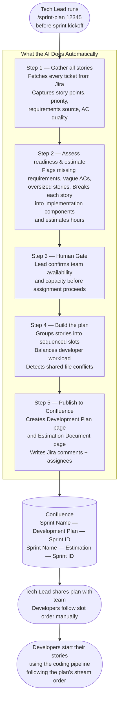
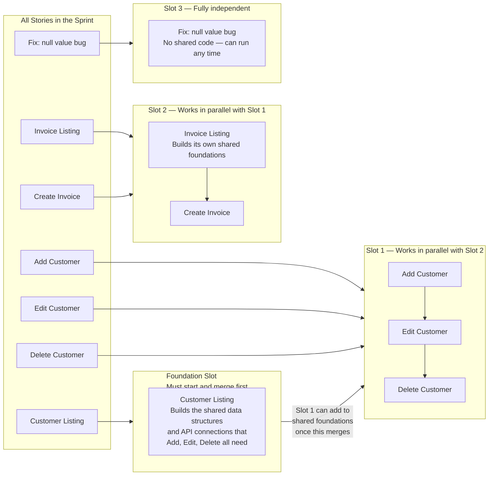
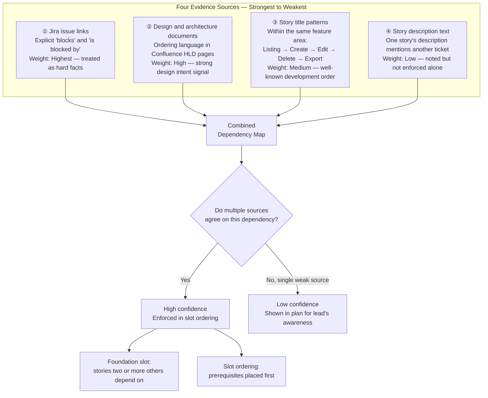

# TPS DMS — Frontend Senior Lead Sprint Planning Agent

---

## Setup

### Prerequisites

- **Claude Code** installed and authenticated
- **Atlassian MCP server** credentials configured

### Environment Variables

Set the following before starting Claude Code (Windows System Environment Variables or shell profile):

```powershell
$env:JIRA_URL              = "https://your-org.atlassian.net"
$env:CONFLUENCE_URL        = "https://your-org.atlassian.net/wiki"
$env:ATLASSIAN_EMAIL       = "you@example.com"
$env:ATLASSIAN_API_TOKEN   = "<your-atlassian-api-token>"
```

Generate your API token at: https://id.atlassian.com/manage-profile/security/api-tokens

### Configuration

Update `.claude/context/project-config.md` with your project's values before first use:
- **Project Identity** — Jira ticket prefix, Confluence space key, base URLs
- **Sprint Team** — developer names, Jira usernames, sprint capacity hours

---

## How to Run

Open Claude Code and type:

```
/sprint-plan 12345
```

Replace `12345` with the numeric Jira sprint ID (visible in the Jira sprint URL).

---

## The Problem This Solves

With 30+ developers working across 50+ modules simultaneously, a predictable problem emerges every sprint: two developers unknowingly start working on the same underlying code file at the same time. When they both try to submit their work, one of them has to stop, wait, manually reconcile the differences, and re-test. This is not a rare edge case — it happens every sprint, costs hours of senior developer time, and often delays deliveries.

A second problem sits underneath the first: some stories can only begin properly once another story's foundation is in place. A "Create Customer" screen needs the data structures and API connections that the "Customer Listing" screen defines. If the developer working on "Create Customer" starts before "Customer Listing" is ready, they either have to duplicate work or redo it once the foundation exists.

Without a coordination plan, both problems are invisible until they become blockers.

**The sprint planning command solves both problems before the sprint begins.** A tech lead runs one command, the AI analyses every story in the sprint, identifies the ordering constraints and shared code risks, and publishes a sequenced plan to Confluence.

---

## How It Works — The Full Picture



---

## What Gets Published to Confluence

The command produces two Confluence pages.

### Development Plan

Contains:
- **Readiness Flags** — stories needing attention before sprint kickoff (missing ACs, vague criteria, oversized)
- **Carry-Over Stories** — stories that appeared in the previous sprint
- **Story Assignments** — every story with slot, estimated hours, complexity, assigned developer
- **Developer Workload** — hours per developer vs. capacity; flags overloaded developers
- **Sprint Capacity** — total estimated effort vs. team capacity (utilisation %)
- **Risk Flags** — high-complexity stories and Foundation stories
- **Dependencies** — every ordering constraint found, its source, and confidence level
- **Slot Details** — per-developer stream breakdown with shared file guidance

### Estimation Document

Contains:
- **Sprint Commitment Summary** — totals table: SP, estimated hours, capacity, utilisation
- **Per-Story Estimation Breakdown** — 12-component hour table per story
- **Estimation Mismatches** — stories where technical estimate diverges from story point target
- **Developer Hour Allocation** — capacity vs. assigned vs. remaining per developer

---

## How Stories Are Sequenced Into Slots

The core output is a set of work slots. Think of it like a construction schedule — a foreman sequences the trades before anyone shows up on site, because the electrician cannot wire a wall that hasn't been framed yet.



**Foundation slot** — the story that builds the shared code foundations (data structures, API connections, service layer) that other stories in the same feature area depend on. Must be completed first.

**Parallel slots** — independent work streams that can run simultaneously. Stories within the same slot must be done in order by one developer; stories in different slots have no overlap.

---

## How Developers Work Without Blocking Each Other

When a Foundation story exists, developers in other slots do not have to sit idle. They use a two-phase approach.

```mermaid
gantt
    title Sprint Timeline — Parallel Work Without Blocking
    dateFormat  D
    axisFormat  Day %d

    section Foundation Developer
    Building foundation story         :active, f1, 1, 3d
    PR under review                   :crit, f2, after f1, 2d
    Foundation merged ✓               :milestone, f3, after f2, 0d

    section Slot 1 Developer
    Phase 1 — screen layout and UI only     :s1a, 1, 5d
    Phase 2 — connect to shared foundations :s1b, after f3, 1d
    Submission ready for review             :milestone, after s1b, 0d

    section Slot 2 Developer
    Phase 1 — screen layout and UI only     :s2a, 1, 5d
    Phase 2 — connect to shared foundations :s2b, after f3, 1d
    Submission ready for review             :milestone, after s2b, 0d

    section Slot 3 Developer
    Full implementation                   :s3a, 1, 3d
    Under review                          :s3b, after s3a, 2d
    Merged ✓                              :milestone, after s3b, 0d
```



**Phase 1 — while the foundation is in review**
Developers build everything they can without needing the shared foundations: screen layout, UI components, loading and error states, internationalisation text, and unit tests. By the time the foundation merges, developers are typically 70–80% done with their story.

**Phase 2 — after the foundation merges**
Developers sync to the latest code and connect their screen to the shared foundations.

---

## How the AI Finds Dependencies Between Stories

The AI reads four sources and combines them, giving more weight to harder evidence.



---

## Tech Lead Responsibilities

### Reviewing the Human Gate

After the Lead Analysis phase completes, the agent presents a summary of readiness flags, capacity status, carry-overs, and team availability. At this point:

- **Confirm team availability** — note any PTO, reduced capacity, or developers not in this sprint
- **Review readiness flags** — chase the product owner for missing ACs before kickoff
- **Check capacity** — if utilisation is over 100%, consider removing stories before committing

### After the Plan is Published

- **Verify assignments** — confirm assigned developers in the Confluence plan match actual team availability
- **Communicate slot order** — ensure Foundation slot developer knows they are blocking others
- **Share the plan** — link the Confluence page in the sprint kickoff meeting

### Oversight Notes

Because the AI pipeline generates implementation, oversight on each story reflects how much human judgment is needed before the work can safely merge — not the difficulty of coding it.

| Readiness | What it means |
|-----------|---------------|
| `ready` | Clear requirements, specific ACs, reasonable scope |
| `needs-attention` | Missing ACs, vague requirements, or oversized story — resolve before sprint starts |
| `blocked` | External blocker or carry-over stuck in To Do — investigate before committing |

---

## If the Foundation Story Is Delayed

1. **Find out why** — is the PR waiting for reviewers, or is implementation taking longer?
2. **Prioritise review immediately** — assign two reviewers as soon as the PR is open
3. **Other developers continue Phase 1 work** — screen layout, UI, tests — while they wait
4. **Set an ETA and communicate it** — other developers need to know when Phase 2 will unlock

If the Foundation story will slip by more than two or three days, consider moving dependent stories to the next sprint.

---

## Re-Running the Plan

If stories are added to the sprint after the plan was generated, or if significant assignments change, re-run:

```
/sprint-plan 12345
```

The Confluence pages are overwritten with a fresh analysis.

---

## When to Skip Sprint Planning

Not every sprint requires a plan. Skip it when:
- All stories are in unrelated feature areas with no shared code
- The sprint contains only bug fixes or hotfixes
- Only one developer is working in the sprint

---

## Troubleshooting

**"No stories found in sprint 12345"**
The sprint ID is incorrect or the sprint has not been created in Jira yet. Find the correct ID in the Jira sprint URL.

**Atlassian connection unavailable**
Check that the required environment variables (`ATLASSIAN_API_TOKEN`, `JIRA_URL`, `ATLASSIAN_EMAIL`, `CONFLUENCE_URL`) are set and restart Claude Code.

**A developer's carry-over story shows as blocked**
The agent flags any carry-over story still in "To Do" status as blocked. Investigate why it didn't move last sprint before committing it to this one.
