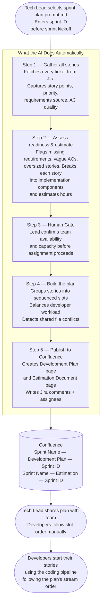
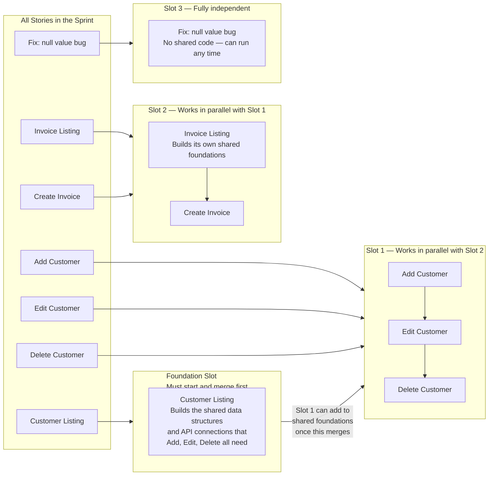

# TPS DMS — Frontend Senior Lead Sprint Planning Agent (Copilot)

---

## Setup

### Prerequisites

- **VS Code 1.99+** — required for MCP server support in Copilot agent mode
- **GitHub Copilot extension** — installed and signed in
- **Atlassian MCP server** credentials configured

### Environment Variables

Set the following before opening VS Code (Windows System Environment Variables or shell profile):

```powershell
$env:JIRA_URL              = "https://your-org.atlassian.net"
$env:CONFLUENCE_URL        = "https://your-org.atlassian.net/wiki"
$env:ATLASSIAN_EMAIL       = "you@example.com"
$env:ATLASSIAN_API_TOKEN   = "<your-atlassian-api-token>"
```

Generate your API token at: https://id.atlassian.com/manage-profile/security/api-tokens

### Configuration

Update `.github/rules/project-config.md` with your project's values before first use:
- **Project Identity** — Jira ticket prefix, Confluence space key, base URLs
- **Sprint Team** — developer names, Jira usernames, sprint capacity hours

---

## How to Run

1. Open Copilot Chat (`Ctrl+Shift+I` on Windows / `Cmd+Shift+I` on Mac)
2. Click the paperclip / attach icon
3. Select **Prompts**
4. Pick `sprint-plan.prompt.md`
5. Enter the numeric Jira sprint ID when prompted

---

## The Problem This Solves

With 30+ developers working across 50+ modules simultaneously, a predictable problem emerges every sprint: two developers unknowingly start working on the same underlying code file at the same time. When they both try to submit their work, one of them has to stop, wait, manually reconcile the differences, and re-test.

A second problem: some stories can only begin properly once another story's foundation is in place. A "Create Customer" screen needs the data structures and API connections that the "Customer Listing" screen defines.

**The sprint planning command solves both problems before the sprint begins.** A tech lead runs one command, the AI analyses every story in the sprint, identifies the ordering constraints and shared code risks, and publishes a sequenced plan to Confluence.

---

## How It Works — The Full Picture



---

## What Gets Published to Confluence

The command produces two Confluence pages.

### Development Plan

Contains:
- **Readiness Flags** — stories needing attention before sprint kickoff (missing ACs, vague criteria, oversized)
- **Carry-Over Stories** — stories that appeared in the previous sprint
- **Story Assignments** — every story with slot, estimated hours, complexity, assigned developer
- **Developer Workload** — hours per developer vs. capacity; flags overloaded developers
- **Sprint Capacity** — total estimated effort vs. team capacity (utilisation %)
- **Risk Flags** — high-complexity stories and Foundation stories
- **Dependencies** — every ordering constraint found, its source, and confidence level
- **Slot Details** — per-developer stream breakdown with shared file guidance

### Estimation Document

Contains:
- **Sprint Commitment Summary** — totals table: SP, estimated hours, capacity, utilisation
- **Per-Story Estimation Breakdown** — 12-component hour table per story
- **Estimation Mismatches** — stories where technical estimate diverges from story point target
- **Developer Hour Allocation** — capacity vs. assigned vs. remaining per developer

---

## How Stories Are Sequenced Into Slots



**Foundation slot** — the story that builds the shared code foundations that other stories depend on. Must be completed first.

**Parallel slots** — independent work streams that can run simultaneously. Stories within the same slot must be done in order by one developer.

---

## How Developers Work Without Blocking Each Other

When a Foundation story exists, developers in other slots use a two-phase approach.

**Phase 1 — while the foundation is in review**
Developers build everything they can without needing the shared foundations: screen layout, UI components, loading and error states, internationalisation text, and unit tests. By the time the foundation merges, developers are typically 70–80% done.

**Phase 2 — after the foundation merges**
Developers sync to the latest code and connect their screen to the shared foundations.

---

## How the AI Finds Dependencies

The AI reads four sources and combines them, giving more weight to harder evidence:

1. **Jira issue links** — `blocks`/`is blocked by` — highest confidence
2. **Confluence HLD ordering signals** — `before`, `after`, `depends on`, phase sequencing — high confidence
3. **Summary keyword patterns** — Listing → Create → Edit → Delete — medium confidence
4. **Description cross-references** — one story mentions another ticket ID — low confidence

---

## Tech Lead Responsibilities

### At the Human Gate

After Lead Analysis completes, the agent presents readiness flags, capacity status, and team availability. At this point:
- **Confirm team availability** — note PTO, reduced capacity, or developers not in this sprint
- **Review readiness flags** — chase the product owner for missing ACs before kickoff
- **Check capacity** — if over 100%, consider removing stories before committing

### After the Plan is Published

- **Verify assignments** in the Confluence plan
- **Communicate slot order** — ensure Foundation slot developer knows they are a blocker
- **Share the plan** at sprint kickoff

---

## Re-Running the Plan

If stories are added after the plan was generated, re-run:

```
sprint-plan.prompt.md → Sprint ID: 12345
```

The Confluence pages are overwritten with a fresh analysis.

---

## Troubleshooting

**"No stories found in sprint 12345"**
The sprint ID is incorrect or the sprint has not been created in Jira yet.

**Atlassian MCP unavailable**
Check that `ATLASSIAN_API_TOKEN`, `JIRA_URL`, `ATLASSIAN_EMAIL`, and `CONFLUENCE_URL` are set. Restart VS Code after setting environment variables.

**A carry-over story shows as blocked**
The agent flags any carry-over story still in "To Do" status. Investigate why it didn't move last sprint before committing it to this one.
