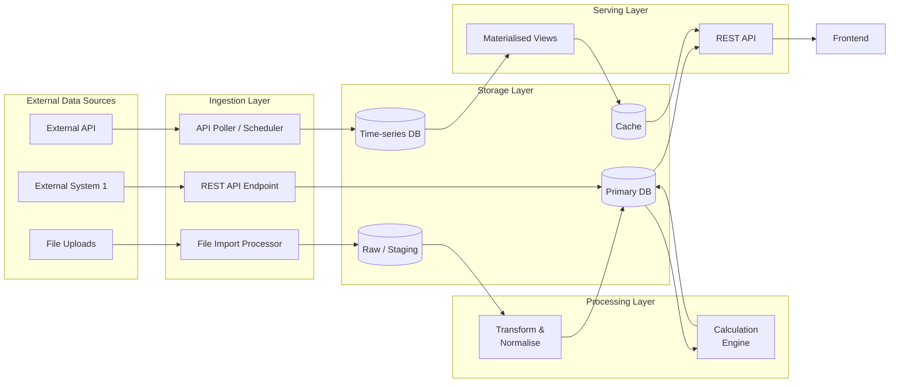
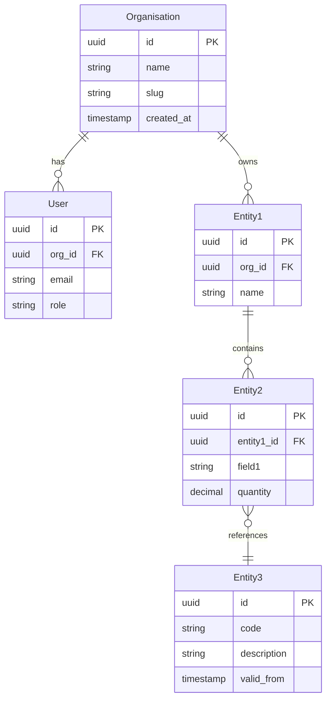

# [PRODUCT NAME] — Data Architecture

| Field | Value |
|---|---|
| **Document Status** | In Progress |
| **Document Owner** | [Owner] |
| **Reviewer(s)** | [Reviewer] |
| **Approver(s)** | [Approver] |

---

## Architecture Overview

[Summary of the data architecture approach: data stores used, multi-tenancy isolation model, batch vs. real-time processing, key design principles.]

---

## Data Flow Diagram

---

## Data Domains

| Domain | Description | Source System | Storage | Update Frequency | Owner |
|---|---|---|---|---|---|
| [Domain 1] | [Description] | [Source] | [DB/table] | [Real-time / Hourly / Daily] | [Team] |
| [Domain 2] | | | | | |
| [Domain 3] | | | | | |

---

## Database Selection Rationale

| Database | Use Case | Rationale | Access Pattern |
|---|---|---|---|
| [Primary DB e.g. PostgreSQL] | Transactional data | ACID compliance, row-level security for multi-tenancy, mature ecosystem | OLTP — point reads and writes |
| [Time-series DB] | Time-stamped data | Optimised for time-range queries, high write throughput | Append writes, range reads |
| [Cache e.g. Redis] | Hot data & sessions | Sub-millisecond read latency, TTL-based expiry | Key-value reads |

---

## Entity Relationship Diagram

---

## Data Ingestion Layer

| Source | Method | Frequency | Format | Validation |
|---|---|---|---|---|
| [External API 1] | REST API polling | [Every N min] | JSON | Schema validation + type checking |
| [File uploads] | HTTP multipart upload | On demand | CSV / Excel | Column mapping + row validation |
| [External API 2] | Webhook / push | Real-time | JSON | HMAC signature + schema |

---

## Data Processing Layer

[Description of transformation and calculation pipeline: what gets normalised, what calculations are run, whether they are batch or real-time.]

| Process | Type | Trigger | Output |
|---|---|---|---|
| [Process 1] | Batch | [Schedule / Event] | [Output target] |
| [Process 2] | Real-time | [Event / API call] | [Output target] |

---

## Data Serving Layer

| Mechanism | Used For | Notes |
|---|---|---|
| REST API endpoints | All client data access | Paginated; max [N] records per request |
| Materialised views | Pre-aggregated analytics queries | Refreshed [on write / on schedule] |
| Cache layer (if applicable) | Hot data and dashboard snapshots | TTL per data type — see Caching Strategy |

---

## Caching Strategy

Two approaches are valid — choose based on whether the product uses a dedicated cache layer:

**Option A — Dedicated cache layer (e.g. Redis / Memcached):**

| Data Type | Cache Key Pattern | TTL | Invalidation |
|---|---|---|---|
| [Data type 1] | `[org_id]:[entity]:[id]` | [5 min] | On write to source |
| [Data type 2] | `[org_id]:dashboard:[view]` | [1 min] | On underlying data update |
| Session tokens | `session:[user_id]` | [15 min] | On logout |

**Option B — Pre-computed tables in primary DB (no Redis):**
For analytics/dashboard products where data is expensive to recompute but not sub-second latency sensitive, pre-computed summary tables in the primary DB (written by the calculation engine, always queried via latest ingestion run ID with `status = 'complete'`) can replace a dedicated cache layer. This avoids introducing a separate stateful service. Document the table names and refresh triggers here.

| Pre-computed Table | Contents | Written By | Refresh Trigger |
|---|---|---|---|
| [exposure_summary] | [Aggregated risk exposure per tenant/period] | [Calculation engine] | [On data ingestion complete] |

---

## Data Retention & Archival

| Data Type | Retention | Archival | Deletion |
|---|---|---|---|
| Transactional records | [N years] | [Cold storage after N months] | Soft delete + hard delete after [N days] |
| Time-series / market data | [N years] | [Cold storage after N months] | N/A |
| Audit logs | [7 years] — regulatory requirement | [Cold storage after 1 year] | Not deleted |
| User data (GDPR) | Until erasure request | N/A | Hard delete within 30 days of request |
| Uploaded files | [N months] | [Cold/archive storage after N months] | On user request |

---

## Data Security

| Control | Implementation |
|---|---|
| Encryption at rest | AES-256 via cloud KMS on all storage volumes and managed databases |
| Encryption in transit | TLS 1.2+ between all services and client connections |
| Multi-tenant isolation | Row-level security (RLS) — `org_id` filter enforced at database level |
| PII masking | Email, name, and personal identifiers masked before log emission |
| Column-level encryption | PII columns encrypted using application-layer encryption where required |
| Audit logging | All data mutations (create/update/delete) logged with user, timestamp, entity, action |

---

## Backup & Recovery

| Data Store | Backup Method | Frequency | Retention | RPO | RTO |
|---|---|---|---|---|---|
| Primary DB | Continuous PITR + daily snapshot | Continuous | 30 days | **[TBD]** | **[TBD]** |
| Time-series DB | Daily snapshot | Daily | 30 days | **[TBD]** | **[TBD]** |
| File storage | Object versioning | Continuous | 90 days | N/A | Immediate |
| Restore testing | DR drill | Monthly | — | — | — |
