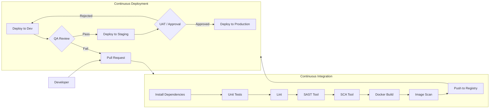

# [PRODUCT NAME] — Deployment Architecture

| Field | Value |
|---|---|
| **Document Status** | In Progress |
| **Document Owner** | [Owner] |
| **Reviewer(s)** | [Reviewer] |
| **Approver(s)** | [Approver] |

---

## Architecture Overview

[Summary of CI/CD approach, tooling, environments, and key principles.]

---

## CI/CD Pipeline Diagram

---

## Source Control

| Field | Value |
|---|---|
| Platform | [GitHub / GitLab] |
| Repository structure | [Monorepo / Multi-repo] |
| PR review requirement | Minimum 1 approver, all CI checks pass |
| Main branch protection | Direct push blocked; merge via PR only |
| Version tagging | Semantic versioning (MAJOR.MINOR.PATCH) |

---

## Branch Structure

| Branch | Purpose | Target Environment | Protection |
|---|---|---|---|
| `main` | Production-ready code | Production | Protected — no direct push |
| `staging` | Pre-production validation | Staging | Protected — merge from develop only |
| `develop` | Integration branch | Dev / QA | Protected — merge via PR |
| `feature/<ticket-id>` | Feature development | Local | Short-lived |
| `bugfix/<ticket-id>` | Bug fixes | Local / QA | Short-lived |
| `hotfix/<ticket-id>` | Emergency production fixes | Production | Short-lived — merge to main + develop |

---

## CI Pipeline Steps

1. **Install dependencies** — `npm install` / `pip install` (cached)
2. **Unit tests** — must pass (blocking)
3. **Lint validation** — code style enforcement (blocking)
4. **SAST** — [SonarCloud / SonarQube]: quality gate (≥80% coverage on critical paths, no Critical/High issues) (blocking)
5. **SCA** — [Snyk]: dependency vulnerability scan (blocking on Critical)
6. **Docker image build** — multi-stage build
7. **Container image scan** — [Snyk / Trivy]: image vulnerability scan (blocking on Critical)
8. **Push to registry** — tag with commit SHA and branch name

---

## CD Pipeline Steps

1. **Pull image** from registry using commit SHA tag
2. **Render Helm / IaC templates** for target environment
3. **Apply infrastructure changes** via IaC tool (if any)
4. **Deploy via Helm** — rolling update strategy
5. **Rollout validation** — wait for all pods healthy
6. **Smoke tests** — health check endpoint + key API endpoints
7. **Environment promotion gate** (manual for Staging → Production)

---

## Multi-Environment Strategy

| Environment | Branch | Deploy Trigger | Approval Gate | Purpose |
|---|---|---|---|---|
| Dev | `develop` | Auto on merge | None | Developer integration testing |
| Staging | `staging` | Auto on merge | QA sign-off before merge | Pre-production validation |
| Production | `main` | Auto on merge | UAT + explicit approval | Live system |

---

## Infrastructure as Code

| Tool | Purpose | State / Config Management |
|---|---|---|
| [Terraform] | Cloud infrastructure (VPC, compute, DBs, etc.) | Remote state in [S3 / Azure Blob / GCS], lock table |
| [Helm] | Kubernetes workload deployment | Per-environment values files |

All environments defined as code. No manual cloud console changes permitted in Staging or Production.

---

## Container Strategy

| Aspect | Approach |
|---|---|
| Base image | Minimal distroless or Alpine-based |
| Registry | [ECR / GCR / ACR] |
| Image tagging | `<service>:<git-sha>` for immutability; `<service>:latest` for dev only |
| Image scanning | Every build in CI pipeline |

---

## Code Quality Gates

| Gate | Tool | Threshold | On Failure |
|---|---|---|---|
| Test coverage | [SonarCloud] | ≥ 80% on critical paths | Pipeline blocked |
| SAST — code quality | [SonarCloud] | No Critical/High | Pipeline blocked |
| Dependency vulnerabilities | [Snyk] | No Critical | Pipeline blocked |
| Container vulnerabilities | [Snyk / Trivy] | No Critical | Pipeline blocked |
| Lint | [ESLint / Pylint / Ruff] | Zero errors | Pipeline blocked |

---

## Rollback Strategy

| Scenario | Approach |
|---|---|
| Failed container deployment | Rolling deployment with circuit breaker; auto-rollback triggered if smoke tests fail after deploy |
| Bad infrastructure change | Re-apply previous IaC state; destroy newly created resources |
| Emergency production rollback | Redeploy previous image tag (by commit SHA) via CD pipeline; no `latest` tag in production |

---

## Release Strategy

- Staging releases tagged: `<major>.<minor>.<patch>`
- Production releases tagged: `<major>.<minor>.<patch>` (promoted from staging tag)
- Hotfix releases: `<major>.<minor>.<patch+1>` merged to `main`, `staging`, and `develop`

---

## Secrets Management in Pipelines

| Control | Approach |
|---|---|
| CI/CD secrets | Stored as encrypted repository/environment secrets in CI platform — never plain-text |
| Cloud credentials | CI/CD uses OIDC trust with cloud provider — no long-lived access keys stored in pipeline |
| Runtime secrets | Services retrieve secrets at startup from Secrets Manager via the `secrets` block in task/pod definition — not environment variables in the manifest |
| No secrets in images | Dockerfiles, docker-compose files, and IaC templates must never contain credentials |
| Secret rotation | Triggered externally (secrets store rotation / manual); services restart to pick up new values |
