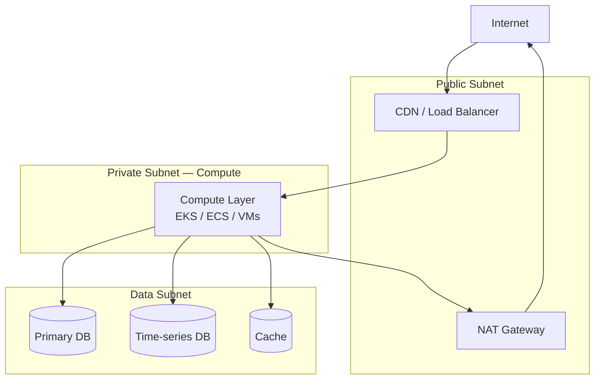

# [PRODUCT NAME] — Infrastructure Architecture

| Field | Value |
|---|---|
| **Document Status** | In Progress |
| **Document Owner** | [Owner] |
| **Reviewer(s)** | [Reviewer] |
| **Approver(s)** | [Approver] |

---

## Architecture Overview

[2–3 sentences: deployment model, cloud provider, key design principles — e.g. highly available, stateless compute, fully IaC-driven.]

---

## High-Level Infrastructure Diagram

---

## Cloud Platform

| Field | Value |
|---|---|
| Cloud Provider | [AWS / Azure / GCP / Other] |
| Primary Region | [Region] |
| DR Region | [Region or N/A for MVP] |
| Account Structure | [e.g. Single account with environment separation via namespace/tags] |
| Multi-AZ | [Yes — production / No] |

---

## Networking

| Component | Configuration |
|---|---|
| VPC / VNet CIDR | [e.g. 10.0.0.0/16] |
| Public Subnet | [CIDR] — Load balancer, NAT gateway |
| Private Subnet | [CIDR] — Compute workloads |
| Data Subnet | [CIDR] — Databases and cache |
| NAT Gateway | [Yes / No] — Outbound internet access for private subnets |
| DNS | [Cloud DNS service — e.g. Route 53, Azure DNS] |
| VPC Endpoints | [Services with private endpoints — e.g. S3, Secrets Manager] |

---

## Compute Layer

| Aspect | Configuration |
|---|---|
| Compute Model | [EKS / ECS / AKS / GKE / Lambda / VMs] |
| Rationale | [Why this model was chosen] |
| Node Groups / Service Config | [e.g. General: t3.medium × 3; GPU: none for MVP] |
| Auto-scaling | [HPA on CPU ≥ 70% / ASG based on target tracking] |
| Min Pods (prod) | **[TBD]** |
| Max Pods (prod) | **[TBD]** |

---

## Storage

| Type | Service | Purpose | Encryption |
|---|---|---|---|
| Object Storage | [S3 / Azure Blob / GCS] | File uploads, exports, backups | SSE at rest |
| Block Storage | [EBS / Managed Disk] | Persistent volumes for stateful workloads | Encrypted volumes |
| File Storage | [EFS / Azure Files — or N/A] | Shared filesystem (if required) | Encrypted |

---

## Content Delivery

| Aspect | Configuration |
|---|---|
| CDN | [CloudFront / Azure CDN / Cloudflare — or N/A for API-only] |
| Origin 1 — SPA | [Object storage bucket; CDN-to-storage private access policy; Cache TTL: 1 year (assets), 60s (index.html)] |
| Origin 2 — API | [Load balancer — path `/api/*`; TTL = 0; all headers forwarded] |
| WAF | [Cloud WAF — Managed Rule Set, rate limiting per IP] |
| HTTPS | HTTPS-only enforced; TLS 1.2 minimum; HTTP → HTTPS redirect |

---

## Load Balancing

| Aspect | Configuration |
|---|---|
| Type | [Application Load Balancer / Azure App Gateway — internal or external] |
| Listeners | HTTPS :443; HTTP :80 → HTTPS redirect |
| Routing | [Path-based routing rules — e.g. `/api/admin/*` → admin service; `/api/*` → api service] |
| Target Groups | [One per HTTP-facing service; port; health check path] |
| Health Check | GET /health; [N] healthy / [N] unhealthy thresholds |
| Access Logs | → [access logs bucket] |

---

## Identity and Secrets

### Identity Provider

| Aspect | Configuration |
|---|---|
| IDP | [Keycloak / Auth0 / AWS Cognito / Azure AD — TBD if not finalised] |
| Protocol | OIDC / OAuth2; JWT bearer tokens |
| Tenant isolation | JWT `tenant_id` / `org_id` claim enforced on every API handler and DB query |
| MFA | [Required / Not required for MVP] |

### Secrets Manager

| Secret | Contents | Rotation |
|---|---|---|
| [product]/{env}/db/credentials | DB master username + password | Auto-rotation (30-day) |
| [product]/{env}/external/[integration] | External API key / credentials | Manual |

### Encryption Keys

| Key Alias | Purpose | Rotation |
|---|---|---|
| [product]-db-key | Database encryption at rest | Annual |
| [product]-storage-key | Object storage encryption | Annual |
| [product]-secrets-key | Secrets store encryption | Annual |

### IAM / Service Roles

| Role | Used By | Key Permissions |
|---|---|---|
| [product]-task-execution-role | All container services | Container registry pull, secrets store read, log write |
| [product]-api-task-role | API service | Object storage read/write, secrets store read, AI/LLM invoke |
| [product]-cicd-deploy-role | CI/CD pipeline (OIDC) | Container registry push, deploy service, storage sync |

---

## Managed Services

| Service | Cloud Product | Purpose | Configuration Notes |
|---|---|---|---|
| Relational DB | [RDS PostgreSQL / Cloud SQL / Azure Database] | Primary application database | Multi-AZ in production |
| Time-series DB | [RDS TimescaleDB / Managed InfluxDB / N/A] | Market/IoT/analytics data | |
| Cache | [ElastiCache Redis / Azure Cache / Memorystore] | Session, hot data, rate limiting | |
| Secrets Manager | [AWS Secrets Manager / Azure Key Vault / GCP Secret Manager] | Runtime secret injection | |
| Container Registry | [ECR / GCR / ACR] | Docker image storage | |

---

## Scaling Strategy

| Layer | Trigger | Scale-out Action | Min | Max |
|---|---|---|---|---|
| Application pods | CPU ≥ 70% for 2 min | Add pod (HPA) | **[TBD]** | **[TBD]** |
| Application pods | Memory ≥ 80% for 2 min | Add pod (HPA) | **[TBD]** | **[TBD]** |
| DB | N/A — vertical scaling | Read replica (if needed) | — | — |
| Cache | N/A | Cluster mode (if needed) | — | — |

---

## Environment Sizing

| Environment | Compute | Replicas | DB | Purpose |
|---|---|---|---|---|
| Development | [t3.small / B2s] | 1 | [db.t3.micro] | Developer integration testing |
| Staging | [t3.medium / B2ms] | 2 | [db.t3.small] | Pre-production validation |
| Production | [t3.large / D2s_v3] | **[TBD]** | [db.t3.medium multi-AZ] | Live system |

---

## Observability

### Log Groups

| Log Group | Retention |
|---|---|
| [product/api/{env}] | 90 days |
| [product/worker/{env}] | 90 days |
| [product/audit/{env}] | 24 months (compliance) |
| [product/db/{env}] | 30 days |
| [product/lb/{env}] | 90 days |

### Alarms

| Alarm | Metric | Threshold | Action |
|---|---|---|---|
| API CPU High | CPUUtilization | ≥ 80% for 5 min | Alert notification |
| API 5xx Rate | HTTPCode_Target_5XX_Count | ≥ 10 in 5 min | Alert notification |
| DB CPU High | CPUUtilization | ≥ 80% for 5 min | Alert notification |
| DB Storage Low | FreeStorageSpace | ≤ [N] GB | Alert notification |
| Task Stopped | Service event | Any unexpected stop | Alert notification |

Alerting topic: `[product]-alerts-{env}` — ops email + [on-call alerting platform] (prod only)

---

## Infrastructure as Code

| Aspect | Configuration |
|---|---|
| Tooling | [Terraform / Pulumi / CDK / Bicep] |
| Repository | [Monorepo under `/infra` / Separate IaC repo] |
| State Backend | [S3 + DynamoDB lock / Azure Blob + lease / GCS] |
| Plan/Apply Workflow | PR triggers `plan` — merge to main triggers `apply` with manual approval for prod |
| Environment Separation | [Separate state files per environment / workspaces] |
| Auth | CI/CD OIDC trust — no long-lived cloud credentials stored in pipeline |
| Drift Detection | Nightly scheduled plan against prod; alerts on drift |

All infrastructure defined as code. No manual cloud console changes permitted in Staging or Production.

---

## Infrastructure Resource Inventory

Resources follow naming convention `[product]-{resource}-{env}`. Shared resources omit the env suffix.

### Networking

| Resource Type | Name Pattern | Environments | Key Configuration | Purpose |
|---|---|---|---|---|
| VPC | `[product]-vpc-{env}` | All | CIDR: [10.0.0.0/16] | Isolated network boundary |
| Public Subnet A | `[product]-public-a-{env}` | All | [CIDR]; [AZ-a] | Load balancer, NAT Gateway |
| Private Subnet A | `[product]-private-a-{env}` | All | [CIDR]; no public IP | Compute tasks |
| Data Subnet A | `[product]-data-a-{env}` | All | [CIDR]; no public IP | Database placement |
| Internet Gateway | `[product]-igw-{env}` | All | Attached to VPC | Public internet access |
| NAT Gateway | `[product]-nat-{env}` | All | Public subnet; Elastic IP | Outbound internet for compute |
| VPC Endpoints | [list services] | All | Interface endpoints; private subnets | Avoid NAT cost for cloud services |
| Security Group — LB | `[product]-sg-lb-{env}` | All | Inbound 443 from internet | Controls LB inbound |
| Security Group — App | `[product]-sg-app-{env}` | All | Inbound from LB SG only | Controls app traffic |
| Security Group — DB | `[product]-sg-db-{env}` | All | Inbound DB port from App SG only | Restricts DB to app only |

### Compute

| Resource Type | Name Pattern | Environments | Key Configuration | Purpose |
|---|---|---|---|---|
| Cluster | `[product]-cluster-{env}` | All | [ECS/EKS]; Container Insights enabled | Logical compute grouping |
| Service — api | `[product]-api-{env}` | All | [vCPU/mem (prod)]; min [N] / max [N] | Core REST API |
| Service — worker | `[product]-worker-{env}` | All | [vCPU/mem (prod)]; min [N] / max [N] | Background job processing |

### Storage

| Resource Type | Name Pattern | Environments | Key Configuration | Purpose |
|---|---|---|---|---|
| DB Instance | `[product]-db-{env}` | All | [engine + version]; [instance type]; Multi-AZ prod | Primary application database |
| Object storage — Uploads | `[product]-uploads-{env}` | All | Encrypted at rest; versioning on | Tenant file uploads |
| Object storage — Exports | `[product]-exports-{env}` | All | Encrypted at rest; expire at [N] days | Generated exports |
| Object storage — Frontend | `[product]-frontend-{env}` | All | Encrypted at rest; private access only | SPA static assets |
| Object storage — IaC State | `[product]-tf-state` | Shared | Encrypted at rest; versioning on | IaC remote state |

### Container Registry

| Resource Type | Name Pattern | Environments | Key Configuration | Purpose |
|---|---|---|---|---|
| Registry repos | `[product]/[service]` | Shared | Image scan on push; immutable tags; lifecycle: last 10 | Versioned Docker images |
