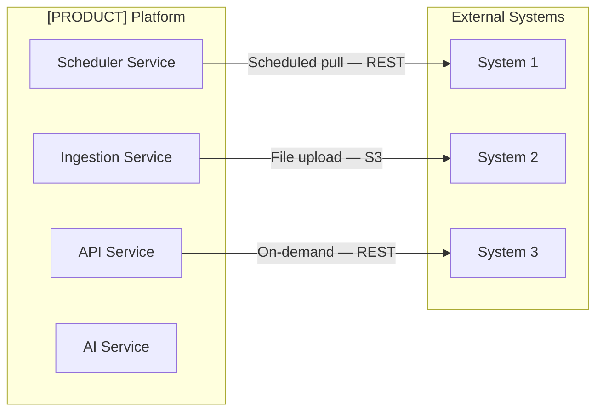

# [PRODUCT NAME] — Integration Architecture

| Field | Value |
|---|---|
| **Document Status** | In Progress |
| **Document Owner** | [Owner] |
| **Reviewer(s)** | [Reviewer] |
| **Approver(s)** | [Approver] |

---

## Overview

[2–3 sentences: total number of external integrations, dominant integration pattern (pull vs push, sync vs async), and key design principles — e.g. all external calls are isolated in a dedicated scheduler service, circuit breakers on all outbound calls, no inbound webhooks in MVP.]

---

## Integration Topology Diagram

---

## Integration Inventory

| # | System | Provider | Direction | Protocol | Trigger | Auth | Data Classification | DPA Required |
|---|---|---|---|---|---|---|---|---|
| 1 | [System Name] | [Provider] | Inbound / Outbound | REST / File / WebSocket / SDK | Scheduled / Event / Manual | API Key / OAuth2 / None | Restricted / Confidential / Public | Yes / No / N/A |
| 2 | | | | | | | | |
| 3 | | | | | | | | |

---

## Integration Specifications

### [Integration 1 — System Name]

| Field | Detail |
|---|---|
| **Provider** | [Provider name] |
| **Purpose** | [What data is exchanged and why] |
| **Direction** | Outbound (platform calls external) / Inbound (external calls platform) |
| **Protocol** | REST API / SFTP / File upload / SDK |
| **Endpoint / Delivery** | [URL or delivery mechanism — e.g. S3 bucket, SFTP path] |
| **Authentication** | [API Key in header / OAuth2 client credentials / No auth (public API)] |
| **Trigger** | [Scheduled daily at 18:00 UTC / On tenant file upload / On-demand user action] |
| **Request Format** | [HTTP GET with params / Multipart file upload / N/A] |
| **Response / Data Format** | [JSON / CSV / XML / XLSX] |
| **Data Sent to External** | [Describe what is included in outbound payload — data classification] |
| **Data Received** | [Describe what is received and stored] |
| **Frequency** | [Daily / Real-time / Per tenant upload] |
| **SLA Dependency** | [Is this on the critical path? Impact if unavailable] |
| **Error Handling** | [Retry strategy — e.g. 3 retries with exponential backoff] |
| **Fallback Behaviour** | [What happens if the call fails — e.g. use previous day's data] |
| **Circuit Breaker** | [Yes — open after N consecutive failures / No] |
| **DPA / Data Agreement** | [Required / Not required / In place] |
| **Post-MVP Enhancements** | [Any planned improvements — e.g. direct API replacing file ingestion] |

---

### [Integration 2 — System Name]

| Field | Detail |
|---|---|
| **Provider** | |
| **Purpose** | |
| **Direction** | |
| **Protocol** | |
| **Endpoint / Delivery** | |
| **Authentication** | |
| **Trigger** | |
| **Request Format** | |
| **Response / Data Format** | |
| **Data Sent to External** | |
| **Data Received** | |
| **Frequency** | |
| **SLA Dependency** | |
| **Error Handling** | |
| **Fallback Behaviour** | |
| **Circuit Breaker** | |
| **DPA / Data Agreement** | |
| **Post-MVP Enhancements** | |

---

## Resilience & Error Handling Patterns

| Pattern | Applied To | Implementation |
|---|---|---|
| Retry with exponential backoff | [All outbound REST calls] | [3 retries; delays: 1s, 2s, 4s; max wait 10s] |
| Circuit breaker | [All critical external calls] | [Open after N consecutive failures; half-open after 60s] |
| Dead-letter queue | [Async ingestion failures] | [Failed jobs → DLQ → alert ops team] |
| Fallback data | [Market data pulls] | [Use previous successful dataset if current pull fails] |
| Idempotent ingestion | [All file and API ingestion] | [Deduplication key on record hash or external ID] |

---

## Security Controls Per Integration

| Integration | Data Classification | Auth Mechanism | Data in Transit | PII in Payload | DPA Status | Notes |
|---|---|---|---|---|---|---|
| [System 1] | [Restricted / Confidential / Public] | [API Key / OAuth2 / None] | TLS 1.2+ | [Yes / No] | [In place / Required / N/A] | |
| [System 2] | | | TLS 1.2+ | | | |

---

## Integration Monitoring & Alerting

| Integration | Health Check | Alert Condition | Alert Target | Runbook |
|---|---|---|---|---|
| [System 1] | [Scheduled probe / N/A] | [N consecutive failures] | [Ops email / PagerDuty] | **[TBD]** |
| [System 2] | | | | |

---

## Data Flow Summary per Integration

| Integration | Data Enters At | Stored In | Processed By | Served Via |
|---|---|---|---|---|
| [System 1] | [S3 staging bucket / API endpoint] | [PostgreSQL / S3] | [ingestion-service / risk-engine-service] | [Dashboard API] |
| [System 2] | | | | |

---

## Open Items

| Item | Owner | Target Date |
|---|---|---|
| **[TBD]** | | |
