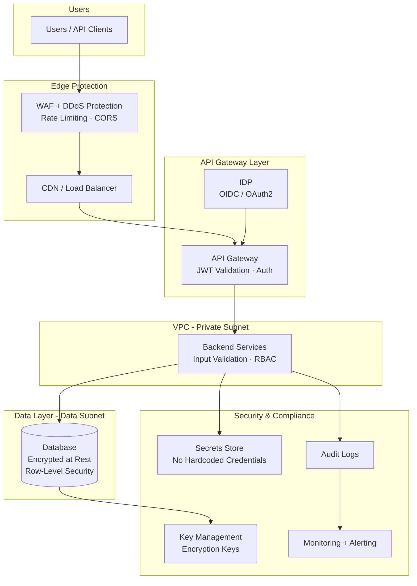

# [PRODUCT NAME] — Security Architecture

| Field | Value |
|---|---|
| **Document Status** | In Progress |
| **Document Owner** | [Owner] |
| **Reviewer(s)** | [Reviewer] |
| **Approver(s)** | [Approver] |

---

## Overview

[Summary of security posture, key principles, and compliance targets.]

---

## Security Architecture Diagram

---

## Identity & Access Management

| Control | Implementation |
|---|---|
| Authentication Model | [Federated via IDP — OIDC/OAuth2] |
| Token-Based Access | Short-lived access tokens (15 min), refresh token rotation enabled |
| Principle of Least Privilege | Role-based access policies; each service has minimum required permissions |
| MFA | [Required / Optional] for user accounts |
| Session Management | Token expiry enforced; logout invalidates refresh token |
| Machine-to-Machine Auth | [OAuth2 client credentials / API Keys + mTLS] |

---

## API Security

| Control | Implementation |
|---|---|
| JWT Validation | All backend APIs validate JWT on every request |
| Rate Limiting | [N] requests/min per user; [N] requests/min per IP at API Gateway |
| CORS | Allow-list of origins; credentials mode enforced |
| CSRF Protection | SameSite cookies; CSRF token for state-changing operations |
| Input Validation | All inbound API request bodies validated against schema |
| SQL Injection Prevention | Parameterised queries via ORM; no raw SQL construction |
| Security Headers | HSTS, X-Content-Type-Options, X-Frame-Options, CSP |

---

## Multi-Tenancy Security

| Control | Implementation |
|---|---|
| Tenant isolation | Row-Level Security (RLS) on all tenant tables — `org_id` filter enforced at DB level |
| Cross-tenant prevention | Middleware validates `org_id` claim in JWT matches requested resource |
| Admin access | Super-admin role with explicit audit logging on all cross-tenant operations |

---

## Secrets & Key Management

| Asset Type | Storage | Rotation Policy |
|---|---|---|
| API Keys (external integrations) | [Secrets Manager / Key Vault] | [Every 90 days / on demand] |
| Database credentials | [Cloud secrets store] | [Every 30 days] |
| TLS Certificates | [Cloud certificate manager / Let's Encrypt] | Auto-renew before expiry |
| Encryption Keys | [Cloud KMS / Key Vault] | Annual rotation |
| JWT signing keys | [IDP-managed] | IDP rotation policy |

Secrets are never stored in source code, configuration files, or container images.

---

## Encryption & Data Protection

| Layer | Protection Mechanism | Standard |
|---|---|---|
| Data in transit | TLS 1.2+ (HTTPS everywhere), HSTS enabled | TLS 1.2 minimum |
| Data at rest | AES-256 via cloud key management service | Cloud-managed keys |
| Database | Encrypted storage volumes | Key-management-service-managed |
| Secrets | Encrypted in cloud secrets store | — |
| PII in logs | Masked before emission (name, email, phone) | GDPR Art. 32 |
| Backup data | Encrypted with same key as source data | — |

---

## Infrastructure Security

| Control | Implementation |
|---|---|
| VPC segmentation | Application in private subnet; database in isolated data subnet |
| No public DB endpoints | Databases not accessible from internet |
| Controlled ingress | All traffic via load balancer in public subnet only |
| Security groups / NACLs | Least-privilege inbound rules per service; DB only accessible from app subnet |
| Egress control | NAT Gateway for outbound; no unrestricted 0.0.0.0/0 egress |
| Bastion / emergency access | [SSM Session Manager — no bastion needed / Bastion host in private subnet] |
| Secrets injection | Cloud secrets store at container startup; no plain-text env var secrets in task/pod definitions |

---

## Application Security

| Control | Tool / Approach |
|---|---|
| Secure SDLC | SAST on every PR; DAST on staging; penetration test before go-live |
| SAST | [SonarCloud / SonarQube] — Critical/High findings block pipeline |
| SCA (dependencies) | [Snyk] — Critical findings block pipeline |
| Container scanning | [Snyk / Trivy] — on every image build |
| OWASP Top 10 | Rate limiting, CSRF, security headers, input validation, parameterised queries |
| Unit test coverage | ≥ 80% on critical paths (pipeline enforced) |
| Dependency pinning | Lock files committed; automated dependency updates via Dependabot / Snyk |

---

## CI/CD Security

| Control | Tool / Approach |
|---|---|
| Pipeline quality gates | SAST + SCA fail on Critical findings |
| Container security | Minimal base images; non-root user in containers |
| Secrets in pipelines | Injected from cloud secrets store at runtime; not stored as plain-text env vars |
| Signed commits | [Required / Recommended] |

---

## Compliance Controls

| Regulation | Requirement | Implementation |
|---|---|---|
| GDPR | Data subject right to erasure | Soft delete + scheduler for hard delete within 30 days |
| GDPR | Breach notification within 72 hours | Incident response runbook + monitoring alerts |
| GDPR | Data minimisation | Only collect data required for the stated purpose |
| [SOC2 / ISO27001] | Access control, audit logging, encryption | Enforced by controls in this document |

---

## PII & Data Privacy

| Field | Classification | Handling |
|---|---|---|
| User email | PII | Masked in logs; encrypted at rest |
| User name | PII | Masked in logs |
| Organisation name | Business confidential | Access controlled by tenancy |
| [Domain-specific sensitive data] | Sensitive business | Tenant-isolated; no cross-org access |

---

## Audit Log Retention

All logs must be append-only, tamper-evident, and tenant-scoped. Log entries should include `org_id`, `user_id`, `action`, `entity_type`, `entity_id`, and `timestamp`.

| Log Type | Retention | Notes |
|---|---|---|
| User login & session logs | 12 months | |
| Data upload / mutation events | 24 months | |
| Export & download logs | 24 months | |
| Admin & configuration changes | 36 months | |
| Error & validation logs | 90 days | |
| GDPR data subject request logs | 36 months | |
| Regulatory disclosure records (CSRD / CSDDD / etc.) | 5–7 years | Confirm exact period with legal |
| All logs | Append-only, tamper-evident | No delete API permitted; object lock on archive storage |

---

## Monitoring & Threat Detection

| Control | Tool / Approach |
|---|---|
| Audit logging | All data mutations logged (user, timestamp, action, entity) |
| API access logs | API Gateway logs all requests including auth failures |
| Failed login alerting | [N] failed attempts triggers alert |
| Anomaly detection | Cloud monitoring alarms on high 4xx/5xx rates, unusual access patterns |
| Certificate expiry | Auto-renewal + alert at 30 days before expiry |

---

## Incident Response

High-level incident response flow:

1. **Detection** — Monitoring alerts trigger via [on-call alerting platform] / email
2. **Containment** — Isolate affected service; revoke compromised credentials
3. **Investigation** — Audit logs + SIEM analysis to determine scope
4. **Remediation** — Apply fix, re-deploy, validate
5. **Post-incident review** — Blameless post-mortem within 48 hours; runbook update

**[TBD — Full incident response runbook to be created before go-live]**
