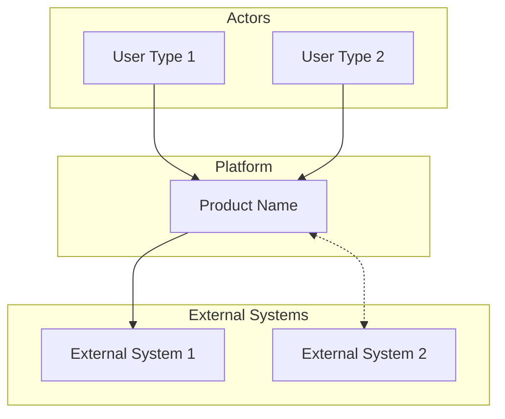
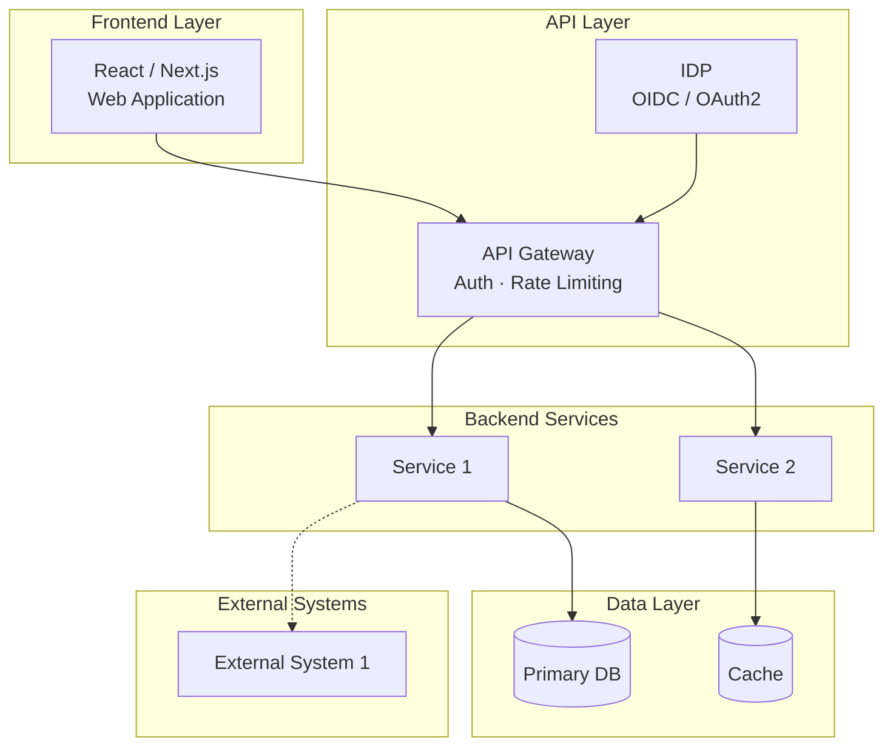

# [PRODUCT NAME] — Solution Architecture

| Field | Value |
|---|---|
| **Document Status** | In Progress |
| **Document Owner** | [Owner] |
| **Reviewer(s)** | [Reviewer] |
| **Approver(s)** | [Approver] |

---

## Executive Summary

[2–3 sentences: what the platform does, for whom, and the core value it delivers.]

---

## Disclaimers

This architecture document reflects the current understanding of requirements and constraints at the time of writing. It will evolve during engineering phases as implementation details are confirmed, technology decisions are validated, and requirements change.

---

## Business Context

[How the system sits within its ecosystem. Who uses it, what problems it solves, how it fits with external systems and existing platforms.]

---

## Actor & System Responsibilities

| Actor / System | Type | Role in Ecosystem | Key Responsibilities |
|---|---|---|---|
| [User type 1] | Human User | [Role description] | [Responsibilities] |
| [User type 2] | Human User | | |
| [External System 1] | External System | | |
| [Internal Service] | Internal | | |

---

## Key Business Capabilities

| Capability | Description | Owned By | Triggered By |
|---|---|---|---|
| [Capability 1] | [Description] | [Team/Role] | [User action / event / schedule] |
| [Capability 2] | | | |
| [Capability 3] | | | |

---

## Business Process Flows

[Reference to wireframes or process flow documentation if available. Note any specific flows that need architecture support.]

**[TBD — Process flow diagrams to be linked once available]**

---

## Business Architecture

---

## Solution Architecture

[2–3 paragraphs describing how the system is structured: what the frontend does, how the API layer works, what the backend services handle, and how data flows end-to-end.]

---

## Child Pages

- [Infrastructure Architecture](./Infrastructure-Architecture)
- [Data Architecture](./Data-Architecture)
- [Deployment Architecture](./Deployment-Architecture)
- [Technology Stack](./Technology-Stack)
- [Security Architecture](./Security-Architecture)
- [Non-Functional Requirements](./Non-Functional-Requirements)
