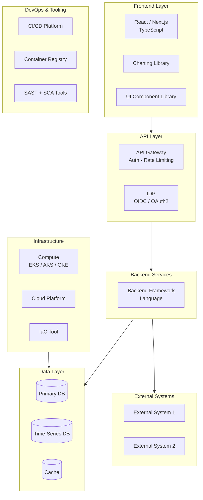

# [PRODUCT NAME] — Technology Stack

| Field | Value |
|---|---|
| **Document Status** | In Progress |
| **Document Owner** | [Owner] |
| **Reviewer(s)** | [Reviewer] |
| **Approver(s)** | [Approver] |

---

## Stack Overview

---

## Frontend

| Technology | Version | Purpose | Notes |
|---|---|---|---|
| [React] | [18.x] | UI framework | |
| [Next.js] | [14.x] | SSR / routing / bundling | |
| [TypeScript] | [5.x] | Type safety | |
| [UI Library] | [Latest] | Component library | e.g. Material UI, Ant Design |
| [Charting Library] | [Latest] | Data visualisation | e.g. Recharts, Chart.js, ECharts |
| [State Management] | [Latest] | Client-side state | e.g. Zustand, Redux Toolkit |
| [React Query] | [5.x] | Server state / data fetching | |
| [React Hook Form] | [Latest] | Form management | |
| [Jest + RTL] | [Latest] | Unit + component testing | |

---

## Backend

| Technology | Version | Purpose | Notes |
|---|---|---|---|
| [NestJS / FastAPI] | [Latest] | Backend framework | |
| [TypeScript / Python] | [5.x / 3.12+] | Language | |
| [ORM] | [Latest] | Database access layer | e.g. TypeORM, Prisma, SQLAlchemy |
| [Validation Library] | [Latest] | Input validation | e.g. Class Validator, Pydantic |
| [Jest / Pytest] | [Latest] | Unit + integration testing | |
| [Logging Library] | [Latest] | Structured logging | e.g. Winston, Loguru |
| [Swagger / OpenAPI] | [Latest] | API documentation | Auto-generated |

---

## Databases & Storage

| Technology | Type | Purpose | Managed Service | Notes |
|---|---|---|---|---|
| [PostgreSQL] | Relational | Primary application database | [RDS / Cloud SQL / Azure DB] | Row-level security for multi-tenancy |
| [TimescaleDB / InfluxDB] | Time-series | [Domain-specific time-series data] | [Managed / Self-hosted] | Optimised for time-range queries |
| [Redis] | Cache | Session, hot data, rate limiting | [ElastiCache / Azure Cache / Memorystore] | TTL-based invalidation |
| [S3 / GCS / Blob] | Object | File uploads, exports, backups | Managed | SSE / KMS encrypted |

---

## Message Broker & Streaming

| Technology | Purpose | Configuration Notes |
|---|---|---|
| [Kafka / SQS+SNS / N/A] | [Async job processing / event streaming / Not applicable] | [Config notes] |

---

## API & Integration Layer

| Technology | Purpose | Notes |
|---|---|---|
| [API Gateway] | Auth, rate limiting, routing | Cloud-native or custom |
| [REST Framework] | API endpoints | Provided by backend framework |
| [External SDK / HTTP Client] | External API integration | Custom wrapper per integration |

---

## Identity & Access Management

| Technology | Purpose | Protocol | Notes |
|---|---|---|---|
| [Auth0 / Cognito / Azure AD / Okta] | User authentication + authorisation | OIDC / OAuth2 | |
| [JWT] | API token format | — | Short-lived access tokens |
| [RBAC] | Role-based access control | — | Implemented in backend middleware |

---

## Observability & Monitoring

| Technology | Purpose | What It Monitors |
|---|---|---|
| [CloudWatch / Azure Monitor / GCP Monitoring] | Infrastructure + application metrics | CPU, memory, pod health, custom metrics |
| [Audit Logs] | Audit trail | API calls, data mutations |
| [Structured Logging] | Application logs | All service events in JSON format |

---

## Security Tooling

| Technology | Purpose | When Used |
|---|---|---|
| [SonarCloud / SonarQube] | SAST + code quality | Every CI run (PR gate) |
| [Snyk] | SCA + container scanning | Every CI run (PR gate) |
| [WAF] | Web application firewall | Production ingress |
| [Secrets Manager] | Secrets management | Runtime secret injection |
| [KMS / Key Vault] | Encryption key management | Data at rest |

---

## DevOps & CI/CD

| Technology | Purpose | Notes |
|---|---|---|
| [GitHub Actions / GitLab CI] | CI/CD pipelines | Triggered on PR and merge |
| [Docker] | Containerisation | Multi-stage builds |
| [kubectl] | Kubernetes CLI | Used by CD pipeline + engineers |
| [Helm CLI] | Kubernetes deployment management | Per-environment values |

---

## Infrastructure as Code

| Technology | Purpose | Manages |
|---|---|---|
| [Terraform / Pulumi / CDK] | Cloud infrastructure provisioning | VPC, compute, DBs, LBs, IAM, etc. |
| [Helm] | Kubernetes workload deployment | Deployments, Services, ConfigMaps |

---

## Project Management & Collaboration

| Tool | Purpose |
|---|---|
| Jira | Issue tracking, sprint management |
| Confluence | Documentation (this page) |
| GitHub / GitLab | Source code + PR reviews |
| Slack / Teams | Team communication |

---

## External Systems & APIs

| System / API | Provider | Purpose | Integration Method |
|---|---|---|---|
| [External System 1] | [Provider] | [Purpose] | REST API / File / WebSocket |
| [External System 2] | [Provider] | [Purpose] | REST API |

---

## Technology Decisions & Rationale

[3–5 paragraphs explaining the most significant technology choices — why this DB, why this framework, why this IDP, why containerised vs serverless. These decisions should reference the product's specific requirements from the intake form.]

---

## Technology Lifecycle & Support

| Technology | Current Version | Mainstream Support Until | EOL / Action Required |
|---|---|---|---|
| [Runtime/Language] | [version] | [date] | [Upgrade plan or N/A] |
| [Framework] | [version] | [date] | [Upgrade plan or N/A] |
| [Database] | [version] | [date] | [Upgrade plan or N/A] |
| [Container OS / base image] | [version] | [date] | [Upgrade plan or N/A] |

---

## Open Technology Decisions

The following technology choices are unresolved at the time of writing. Each must be confirmed before the relevant component is built.

| Decision | Options | Owner | Target Resolution |
|---|---|---|---|
| [IDP Provider] | [Option A / Option B] | [Owner] | [Before Sprint N / Before go-live] |
| [Message broker — if applicable] | [Option A / N/A] | [Owner] | [Before Sprint N] |
| [Any other unresolved choice] | [Options] | [Owner] | [Date] |
