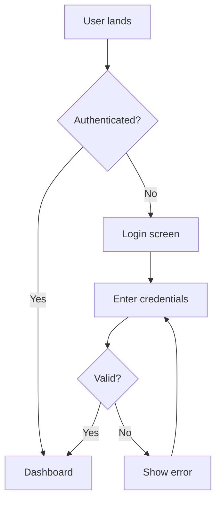

# UX Architect Playbook

A generic, reusable workflow for UX architects to follow when a new requirement and PRD land on their desk. Use this document as the master checklist on every project — read top to bottom on day one, then revisit each phase as you progress.

**Inputs:** Requirement document + Product Requirements Document (PRD)
**Output:** Complete UX design package (research insights, IA, flows, wireframes, prototypes, handoff specs)

---

## Table of Contents

1. Phase 0 — Intake & Alignment
2. Phase 1 — Discovery & Research
3. Phase 2 — Information Architecture
4. Phase 3 — User Flows & Interaction Models
5. Phase 4 — Wireframing (Lo-Fi)
6. Phase 5 — Visual Design & UI System Alignment
7. Phase 6 — Prototyping & Validation
8. Phase 7 — Handoff & Documentation
9. Phase 8 — Post-Launch Iteration
10. Cross-Cutting Concerns (Accessibility, AI, Edge Cases)
11. Deliverable Templates
12. Quality Gates & Sign-Off Checklist

---

## Phase 0 — Intake & Alignment

Before sketching a single screen, get clarity on the problem, the people, and the constraints.

### 0.1 Read the inputs critically

Read the requirement and PRD twice. On the second pass, mark up:

- **Stated user problem** — what pain are we solving?
- **Stated business goal** — what metric will move?
- **Hidden assumptions** — anything stated as fact without evidence
- **Ambiguities** — vague terms ("easy", "intuitive", "fast")
- **Missing pieces** — empty states, error paths, edge cases, offline behavior, permissions

### 0.2 Generate a clarification list

Never start designing with open questions. Compile them and send to the product owner before kickoff. Typical questions:

- Who is the primary user? Secondary user? Are there power users vs. first-timers?
- What devices and contexts will this be used in?
- What are the must-have vs. nice-to-have features for v1?
- What success metrics will the team track post-launch?
- What existing systems, brand guidelines, or design libraries must we reuse?
- What are the non-negotiable constraints (legal, compliance, accessibility, performance budgets)?
- Is this AI-powered? If so, what model, what data, what fallback when the model fails?
- What is the launch deadline and what is fixed vs. flexible?

### 0.3 Define the scope statement

Write a one-paragraph project brief in your own words and get it approved before moving on. Format:

> *"We are designing **[feature/product]** for **[user segment]** so they can **[user goal]**. Success looks like **[measurable outcome]**. v1 includes **[scope]**; explicitly out of scope: **[non-goals]**. Constraints: **[deadline, platform, accessibility level, brand]**."*

### 0.4 Stakeholder map

Identify everyone whose input or sign-off you need: product manager, engineering lead, brand/marketing, legal/compliance, customer support, accessibility specialist, data/analytics. Schedule recurring sync points with each.

---

## Phase 1 — Discovery & Research

Even on tight timelines, do *some* research. The goal is to ground every design decision in real user behavior, not assumptions.

### 1.1 Audit existing material

- Existing product analytics (where do users drop off?)
- Customer support tickets (what are users complaining about?)
- Sales/CRM notes (what do prospects ask for?)
- Competitor walkthroughs (what patterns are users already familiar with?)
- Brand guidelines and design system documentation

### 1.2 Choose research methods by goal

| Goal | Method | Sample size | Time |
|---|---|---|---|
| Understand user goals & pain | 1:1 interviews | 5–8 | 1–2 weeks |
| Validate which problem to solve | Survey + interviews | 50+ survey, 5–8 interviews | 2 weeks |
| Test if a design works | Usability test (moderated) | 5 per segment | 1 week |
| Compare two design options | A/B test or unmoderated test | 30+ per variant | 1–3 weeks |
| Map the current journey | Diary study or contextual inquiry | 5–8 | 2–4 weeks |
| Quantify priorities | Card sort or MaxDiff survey | 30+ | 1–2 weeks |

### 1.3 Run the research

For interviews and usability tests, write a discussion guide with:

- A warm-up question
- Open-ended questions about current behavior (not preferences)
- Task scenarios (for usability tests) — realistic, not leading
- Probes ready for short answers
- A wrap-up question to surface anything missed

### 1.4 Synthesize findings

- **Affinity mapping** — group raw quotes into themes
- **Personas or proto-personas** — 2–4 archetypes capturing goals, contexts, frustrations
- **Jobs-to-be-Done (JTBD)** — "When [situation], I want to [motivation], so I can [outcome]"
- **Empathy map** — Says / Thinks / Does / Feels per segment
- **Current-state journey map** — phases × actions × emotions × pain points × opportunities

### 1.5 Insight document

Write a short research summary (2–4 pages) the whole team can read. Include: top 5 insights, evidence (quotes/data), implications for design, open questions to revisit.

---

## Phase 2 — Information Architecture

Good IA makes the rest of UX easier. Bad IA forces every screen to overcompensate.

### 2.1 Inventory the content and functionality

List every piece of content, action, and data the product needs to expose. Don't design yet — just enumerate.

### 2.2 Choose a structural model

- **Hierarchical** — clear parent/child (most apps)
- **Hub-and-spoke** — central dashboard, focused tasks branching out (workflows)
- **Matrix** — multiple ways to slice the same content (e-commerce, media)
- **Sequential** — step-by-step (onboarding, checkout, wizards)
- **Faceted** — filter-driven exploration (search, catalogs)

### 2.3 Build the sitemap

Use a markdown sitemap or tree diagram. Annotate each node with: page type (list / detail / form / dashboard), primary user task, key content modules.

```
# [Product] Site Map

## Global Navigation
- Home — type: dashboard
- [Section A]
  - [Subsection A1] — type: list view, action: browse + filter
  - [Subsection A2] — type: detail view, action: review + edit
- [Section B]
- Account

## Utility Navigation
- Search, Notifications, Help

## Footer
- About, Privacy, Terms, Contact
```

### 2.4 Define navigation patterns

- **Global nav** — consistent across all pages; what goes here is the user's mental model anchor
- **Local/section nav** — context-specific
- **Contextual nav** — related links, breadcrumbs, "see also"
- **Utility nav** — search, account, help, notifications

### 2.5 Test the IA

Run a tree test or card sort with 15–30 users. If task success is below 70%, revise the structure before moving on.

### 2.6 Flag IA risks

Watch for: orphaned content, duplicate paths, ambiguous category labels, deep nesting (>3 levels), inconsistent terminology.

---

## Phase 3 — User Flows & Interaction Models

Flows turn the static IA into dynamic experiences.

### 3.1 List the critical flows

For every PRD requirement, identify the user task that satisfies it. Prioritize:

- **Critical paths** — the 3–5 flows that drive the success metric
- **Supporting flows** — settings, account management, error recovery
- **Edge flows** — first-run, empty state, expired session, failure modes

### 3.2 Map each flow

For every flow, document: entry points, steps (action → system response), decision branches, exit points, error/recovery paths, success state.

**Flow table format:**

| Step | User Action | System Response | Branch Logic | Notes / Risks |
|---|---|---|---|---|
| 1 | Lands on page | Shows hero + CTA | — | Entry from email or homepage |
| 2 | Clicks "Start" | Step 1 form appears | If logged in → skip auth | |
| 3 | Submits form | Validation runs | If invalid → inline error | Error must be specific, actionable |

**Mermaid diagram for branching flows:**



### 3.3 Define interaction models

For each major surface, decide: how does the user enter? what feedback do they get? how do they undo? what happens on error? what happens offline?

### 3.4 Map states explicitly

For every screen, document the states: empty, loading, partial-data, full-data, error, disabled, success. Missing state design becomes engineering guesswork.

---

## Phase 4 — Wireframing (Lo-Fi)

Wireframes communicate structure and priority — not visual design. Stay grayscale.

### 4.1 Sketch first, tool second

Whiteboard or paper for fast iteration. Move to Figma only when the structure feels right.

### 4.2 Wireframe in this order

1. **Layout zones** — header, content, sidebar, footer
2. **Content blocks** — what goes where, in what hierarchy
3. **Primary action** — the one CTA per screen the user is most likely to take
4. **Secondary actions** — nav, filters, less-common tasks
5. **Edge content** — empty/error/loading states

### 4.3 Apply layout principles

- **Visual hierarchy** — most important element is biggest, boldest, or first
- **Proximity** — group related items, separate unrelated ones
- **Alignment** — everything sits on a grid
- **Consistency** — repeating patterns reduce cognitive load
- **White space** — breathing room is content too
- **Progressive disclosure** — show essentials first, advanced on demand

### 4.4 Annotate wireframes

For every meaningful element, note: behavior on click/hover, source of data, validation rules, links to other flows. Annotations turn wireframes into specs.

### 4.5 Internal review

Walk the team through the wireframes flow by flow. Ask: "Does this match how the user thinks? Are there missing states? Is the primary action clear?"

---

## Phase 5 — Visual Design & UI System Alignment

Translate structure into a polished, on-brand experience using a design system.

### 5.1 Use or build a token system

Reference an existing design system if one exists. If not, define a three-layer token architecture:

- **Primitives** — raw values: `color.blue.500`, `space.4`, `font.size.16`
- **Semantic** — purpose-driven: `color.background.primary`, `color.text.on-primary`
- **Component** — scoped: `button.primary.background`, `button.padding.horizontal`

### 5.2 Define foundational scales

- **Typography** — display, heading-xl/lg/md/sm, body-lg/body/body-sm, caption, label
- **Color** — background, surface, text, border, interactive, feedback (success/warning/error/info)
- **Spacing** — 4px-base scale: 4, 8, 12, 16, 24, 32, 40, 48, 64, 80, 96
- **Radius & elevation** — consistent corner and shadow scales
- **Iconography** — single-stroke set, sized 16/20/24

### 5.3 Spec components completely

For every component, document the 10 points: purpose, anatomy, variants, sizes, states, behaviors, composition rules, do/don't, tokens used, accessibility (ARIA, keyboard nav, contrast).

### 5.4 Spec every interaction state

Default, hover, focus, active, disabled, loading, error, success. A component without all states is an unfinished spec.

### 5.5 Responsive behavior

Define behavior at breakpoints: xs (<480), sm (480–767), md (768–1023), lg (1024–1279), xl (1280–1535), 2xl (≥1536). Document fluid vs. fixed elements, reflow rules, navigation transformations (e.g., side nav → bottom tabs on mobile).

### 5.6 Motion guidelines

- **Timing** — instant 0ms, fast 100ms, normal 200ms, moderate 300ms, slow 500ms
- **Easing** — default `cubic-bezier(0.4, 0, 0.2, 1)`, enter `(0, 0, 0.2, 1)`, exit `(0.4, 0, 1, 1)`
- **Principle** — animate transform/opacity only; respect `prefers-reduced-motion`

---

## Phase 6 — Prototyping & Validation

Test before you ship.

### 6.1 Choose prototype fidelity by goal

- **Lo-fi clickable** — validate IA and flow logic
- **Mid-fi** — validate layout and content priority
- **Hi-fi interactive** — validate visual design, micro-interactions, motion

### 6.2 Build the prototype

Use Figma Smart Animate for transitions. Use Variables and Conditionals for stateful prototypes (cart counters, multi-step forms, dark mode). Connect every interactive element on the critical path.

### 6.3 Run usability tests

5 users per segment uncovers ~85% of issues. Format:

- Realistic, non-leading task scenarios
- Think-aloud protocol
- Observer takes notes (what they did, what they said, where they hesitated)
- 3–5 tasks per session, 30–45 minutes

### 6.4 Severity-rate findings

| Severity | Definition | Action |
|---|---|---|
| Critical | Blocks task completion | Fix before launch |
| Major | Significant frustration or workaround | Fix before launch |
| Minor | Mild annoyance | Backlog |
| Cosmetic | Polish opportunity | Future iteration |

### 6.5 Iterate

Make the changes. Re-test if the changes are substantial. Don't ship a flow you haven't watched a real user complete.

---

## Phase 7 — Handoff & Documentation

A design isn't done until engineering can build it without follow-up.

### 7.1 Handoff package contents

- Final designs in Figma with proper layer naming and Auto Layout
- Component spec sheets (10-point format)
- Token export (JSON or Style Dictionary format)
- Annotated flows for every critical path
- Edge state inventory (empty, loading, error, success per screen)
- Accessibility notes (focus order, ARIA labels, keyboard shortcuts, contrast ratios)
- Motion specs (which property, duration token, easing token)
- Responsive specs (breakpoint behavior per screen)

### 7.2 Walk-through with engineering

Schedule a working session. Demo the prototype, walk every state, answer questions live. Flag risk areas (complex interactions, perf-sensitive animations, accessibility gotchas).

### 7.3 Living documentation

Component library with usage guidance. Pattern library for repeated solutions. Decision log so future designers know *why* choices were made.

### 7.4 Dev mode in Figma

Enable Dev Mode. Verify token names map to engineering's variable names. Add annotations where the spec might be misread.

---

## Phase 8 — Post-Launch Iteration

Designs are hypotheses. Validate after launch.

### 8.1 Instrument success metrics

Track: task completion rate, time-on-task, error rate, drop-off by step, engagement frequency, NPS or CSAT, support ticket volume tied to the feature.

### 8.2 Run continuous discovery

Quarterly user interviews, monthly support-ticket review, weekly analytics check. Feed findings back into the backlog.

### 8.3 Maintain the design system

Track component usage. Deprecate unused patterns. Promote one-off solutions to system components when they recur. Version the library and communicate breaking changes.

---

## Cross-Cutting Concerns

These apply at every phase, not as an afterthought.

### Accessibility (WCAG 2.2 AA minimum)

- Color contrast: 4.5:1 for body text, 3:1 for large text and UI components
- Focus order matches reading order; visible focus ring on every interactive element
- Keyboard reachable: every action must work without a mouse
- Screen reader: meaningful labels, semantic landmarks, ARIA only when HTML can't express it
- Touch targets ≥ 44×44px on mobile
- Don't rely on color alone to convey information
- Respect `prefers-reduced-motion` for all animations
- Forms have labels, errors are descriptive and associated with the input

### AI-Powered Features

When the product uses AI, design for these from day one:

- **Streaming UX** — first-token latency, progressive output, skeleton loading
- **Confidence and uncertainty** — show when the model isn't sure
- **User control** — stop generation, regenerate, edit output, reject suggestion
- **Disclosure** — clearly mark AI-generated content
- **Hallucination handling** — what does the user see when the model is wrong?
- **Trust ladder** — Observe → Assist → Collaborate → Delegate; let users move at their pace
- **Human-in-the-loop** — approval gates for irreversible AI actions
- **Explainability** — "Why did the system suggest this?" should have an answer

### Edge Cases — Always Design These

- First-time user with no data (empty state with guidance, not a blank screen)
- User with massive data (pagination, search, virtualization)
- Slow network or offline
- Permission denied / not authorized
- Session expired mid-task
- Validation errors on every form field
- Backend down / API timeout
- Unsupported browser or feature
- Right-to-left languages and long translations (German, Finnish)
- Reduced motion, high contrast, screen reader, keyboard-only
- Light mode + dark mode

---

## Deliverable Templates

Reusable formats. Copy and fill in.

### Project Brief

> **Project:** [name]
> **Owner:** [PM / designer / engineering lead]
> **Problem:** [user pain in one sentence]
> **User segment:** [primary, secondary]
> **Goal:** [what the user accomplishes]
> **Success metric:** [measurable outcome]
> **In scope (v1):** [bullet list]
> **Out of scope:** [bullet list]
> **Constraints:** [deadline, platform, accessibility, brand, compliance]
> **Open questions:** [bullet list]

### Research Summary

> **Method:** [interviews / survey / usability test]
> **Sample:** [n, segment description]
> **Top 5 insights:** [each with one quote of evidence]
> **Implications for design:** [bullet list]
> **Open questions to validate later:** [bullet list]

### Component Spec

> **Component:** [name]
> **Purpose:** [one sentence]
> **Anatomy:** [labeled parts]
> **Variants:** [primary, secondary, ghost, …]
> **Sizes:** [sm, md, lg]
> **States:** [default, hover, focus, active, disabled, loading, error]
> **Tokens used:** [list]
> **Accessibility:** [ARIA role, keyboard nav, contrast ratio, touch target]
> **Do / Don't:** [usage guidance]

### Flow Documentation

> **Flow:** [name]
> **Goal:** [what the user accomplishes]
> **Entry points:** [where users start]
> **Critical path steps:** [numbered list with system response]
> **Branches:** [decision points and outcomes]
> **Error paths:** [what fails and how to recover]
> **Success state:** [what confirmation looks like]

---

## Quality Gates & Sign-Off Checklist

Before declaring a phase complete, every item must be checked.

### Phase 0 — Intake

- Project brief written and approved
- Clarification questions answered
- Stakeholders identified and aligned
- Constraints and non-goals explicit

### Phase 1 — Research

- Existing materials audited
- Research method chosen and justified
- Insight document delivered
- Personas or JTBD framed

### Phase 2 — IA

- Sitemap reviewed with stakeholders
- Navigation patterns defined
- Tree test or card sort run (or rationale if skipped)
- IA risks flagged

### Phase 3 — Flows

- Critical, supporting, and edge flows enumerated
- Every flow has entry, branches, errors, success
- Every screen has all states defined

### Phase 4 — Wireframes

- Layout, hierarchy, primary action clear on every screen
- Annotations cover behavior, data, validation
- Empty, loading, error states drawn — not just happy path
- Reviewed with engineering for feasibility

### Phase 5 — Visual Design

- All tokens reference a defined scale (no hardcoded values)
- Components specced with all states
- Responsive behavior defined per breakpoint
- Motion specs reference timing and easing tokens

### Phase 6 — Prototype & Validation

- Prototype covers every critical path
- Usability test run with 5+ users per segment
- Findings severity-rated and triaged
- Critical and major issues fixed and re-tested

### Phase 7 — Handoff

- Component specs complete
- Tokens exported in engineering-ready format
- Edge states documented per screen
- Accessibility notes attached
- Engineering walk-through completed

### Phase 8 — Post-Launch

- Success metrics instrumented
- First-week monitoring scheduled
- Backlog of follow-up improvements created
- Design system updated with any new patterns

---

## Principles to Carry Across Every Project

1. **User goals first** — every decision maps back to a real user task.
2. **Design from data, not opinion** — research before, validation after.
3. **Progressive disclosure** — show what's needed now, not everything at once.
4. **Match mental models** — design to user expectations, not engineering convenience.
5. **Fail gracefully** — error, empty, and edge states are part of the design, not afterthoughts.
6. **Accessibility is architecture** — bake it in from IA onward, not as a final pass.
7. **Token-first, system-first** — never hardcode values; never reinvent components.
8. **Build-ready specs** — every handoff is complete enough to build without follow-up.
9. **Explain the why** — every artifact says what was decided *and* why.
10. **Iterate after launch** — designs are hypotheses; validate them with real usage.

---

*Use this document as a living checklist. Adapt it to project size: a one-week feature might compress phases 0–3 into a single day, while a multi-quarter platform redesign may spend weeks on each. The phases stay constant; the depth scales to the work.*
